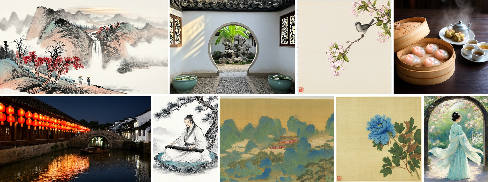
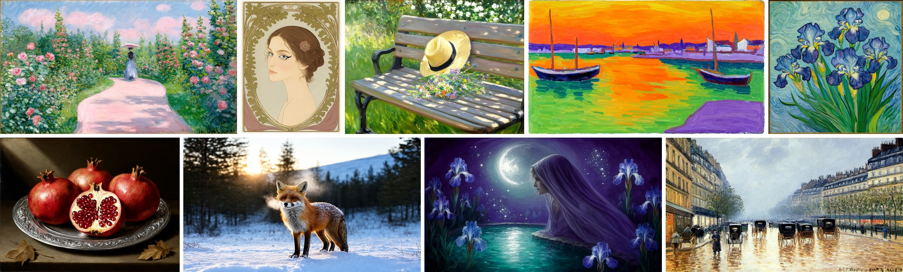

<h1 align="center">Inko</h1>

<p align="center"><strong>A 0.5B text-to-image model for fine art, in English and Chinese.</strong></p>

<p align="center">
  <a href="#gallery">Gallery</a> ·
  <a href="#results">Results</a> ·
  <a href="#quickstart">Quickstart</a> ·
  <a href="#training-journey">Technical report</a> ·
  <a href="https://huggingface.co/spaces/kaupane/Inko">Try the demo</a> ·
  <a href="https://huggingface.co/kaupane/Inko">Get the model</a>
</p>

Inko is a text-to-image model trained for painting and illustration across Chinese and Western traditions. Its 532M-parameter flow-matching transformer pairs a curated art corpus with caption and resolution curricula, chunked Muon optimization on Ascend, and DiffusionART post-training against a self-produced prompt and rubric pool.

**Release model: the EMA of the specialized post-training run** (60 DiffusionART rounds on the completed 300-round main run), built on the 600k pretrained EMA.

## Gallery

<p align="center">
  <a href="notes/assets/gallery/hero1/gallery.jpg"></a>
</p>
<p align="center">
  <a href="notes/assets/gallery/hero2/gallery.jpg"></a>
</p>

All images are generated by the release model at 20 Euler steps and CFG 4.5. Click either board for the full-size view; prompts, seeds and canvas sizes are in the manifests ([hero1](notes/assets/gallery/hero1/manifest.jsonl), [hero2](notes/assets/gallery/hero2/manifest.jsonl)).

## Results

[](notes/assets/benchmark_overview.png)

The chart compares nine models on five public benchmarks (GenEval, DPG, OneIG English, TIIF testmini and Qwen-Image-Bench), each run under its native inference recipe: Inko, the pretrained Inko base, and seven external references. Click the chart for the full-size version. Inko competes directly with the similarly sized DreamLite, SANA-0.6B and PixArt-Σ, and approaches the much larger SD3.5 Medium on DPG, OneIG alignment and Qwen-Image-Bench. Dense prompt alignment is its strongest general result, and its diversity is high relative to models with comparable alignment. Protocol, full tables and per-benchmark analysis: [notes/evaluation.md](notes/evaluation.md).

## Quickstart

Use Python 3.12 and a CUDA GPU. Install this checkout:

```bash
pip install -e .
```

```python
import torch
from src.pipeline import InkoPipeline

pipe = InkoPipeline.from_pretrained(
    "kaupane/Inko", torch_dtype=torch.bfloat16
).to("cuda")

image = pipe(
    "中国水墨画，远山笼罩在薄雾中，近处一棵松树伸向江面，一叶小舟停在岸边。",
    width=1920,
    height=1088,
    generator=torch.Generator(device="cpu").manual_seed(42),
).images[0]
image.save("inko.png")
```

The release defaults are 896 × 896, 20 Euler steps, and CFG 4.5. Width and height must be multiples of 16, up to 1920 per axis; above the 1184-pixel training reference, Dy-YaRN scaling applies automatically, sharing one scale factor across both axes to avoid distorting proportions on rectangular canvases.

<details>
<summary>Batch generation and local model files</summary>

The first load downloads Inko, [Qwen3-0.6B](https://huggingface.co/Qwen/Qwen3-0.6B) and the [REPA-E Qwen-Image VAE](https://huggingface.co/REPA-E/e2e-qwenimage-vae). Pass a local export directory to `from_pretrained` to load local Inko weights. Use `text_encoder_path` and `vae_path` for local copies of the frozen models, and `local_files_only=True` to disable downloads.

Sampling uses resolution-dependent time shifting.

```python
images = pipe(
    [
        "A watercolor painting of fishing boats in a quiet harbor at sunrise.",
        "一幅水彩画，清晨的港湾停泊着几艘渔船，水面倒映着淡粉色的天空。",
    ],
    width=1152,
    height=704,
    num_inference_steps=20,
    guidance_scale=4.5,
    generator=[torch.Generator().manual_seed(seed) for seed in (7, 8)],
).images
```

Each prompt produces one image. A list of generators assigns a separate random stream to each image. CFG 1 uses one conditional model forward per step; other guidance values also evaluate the empty prompt, or `negative_prompt` when supplied. CPU generators make the initial noise independent of the inference device; outputs can still vary across hardware and numerical kernels.

</details>

## Model and design at a glance

| Dimension | Choice |
|---|---|
| Model | `inko`: hidden width 1152, 16 heads, 1 double-stream + 24 single-stream blocks, FFN width 3072, 532,496,992 parameters |
| Text | Frozen Qwen3-0.6B, encoded online with an early exit after layer 20 |
| Latents | Qwen-Image VAE, 16 channels, factor 8; 2×2 latent patches |
| Objective | Rectified flow with logit-normal timestep sampling and resolution time shift |
| Positions | Centered image-grid RoPE; text pinned to a fixed diagonal; Dy-YaRN scaling at inference |
| Modulation | Independent image/text and attention/MLP modulation in the double-stream block; shared attention/MLP modulation within each single-stream block; branch-output RMSNorm before gates |
| Precision | FP32 solver state and times; BF16 model forwards and VAE decode |
| Resolution | Variable-aspect 256p → 640p → 896p; 75:20:5 split of 600,000 optimizer updates |
| Pretraining duration | 323h 26m active (160h 12m at 256p, 119h 11m at 640p, 44h 03m at 896p), about 5,175 card-hours |
| Corpus | Fixed eligible pools per resolution; explicit per-source weights in [`configs/pretrain.toml`](configs/pretrain.toml) |
| Captioning | API-based VLM captioning with cached responses and recorded model/prompt provenance |
| Optimizer | Chunked Muon, LR 0.02 and decay 0.0015; auxiliary AdamW LR 1e-4, ordinary decay 0.01, conditioning-matrix decay 0.4 |
| Post-training | DiffusionART with attention LoRA (rank 64), Muon 1e-3, EMA 0.999; seven reward channels dominated by five rubric categories |
| Data permissions | The corpus includes research-only sources. Per-sample provenance/license metadata is preserved, and restricted sources stay in separate mix entries so a license-clean variant can be assembled. |
| Training hardware | Ascend (16×910B2C) for both pretraining and post-training |

## Training journey

### Data

An earlier WikiArt-only DiT project taught two lessons: anatomy is far harder to learn than artistic style, and eastern art is severely underexposed. The response was four domains (Chinese painting, Western art, people and anatomy, and general world knowledge) holding about 1.7M eligible rows at 256p across museum collections, recaptioned public sets and synthetic additions. Every caption produced for this corpus is Chinese or English at a deterministic 50:50, and a dedicated recaption pass added longer prompts after they proved scarce. The curation stories, galleries and caption policy: [notes/data.md](notes/data.md).

### Pretraining

Pretraining ran 600,000 optimizer updates on 16 Ascend 910B2C cards under a 256p → 640p → 896p resolution curriculum with a 75:20:5 update split. Dynamic micro-batching by aspect ratio and caption length, followed by CUDA and Ascend kernel passes, gave 33.92% more throughput on the early-256p comparison. A loss-spike investigation produced branch-output RMSNorm and a corrected Muon scaling, and the staged run completed with zero skipped optimizer updates. Architecture choices, the stability record and the infrastructure work: [notes/pretraining.md](notes/pretraining.md).

### Post-training

Post-training uses DiffusionART, selected over DiffusionNFT by a direct reward–diversity comparison under one protocol. When selection experiments that optimized only pointwise scorers (each image scored on its own) collapsed diversity into a single visual attractor, the project built its own 24.6k-row rollout pool and a reward of five pairwise rubric channels with HPSv3 and VQAScore as auxiliaries. Production was a 300-round main run plus a 60-round specialized top-up for counting, people and short prompts; the release is the specialized run's EMA. The selection campaign, pool design and run records: [notes/posttraining.md](notes/posttraining.md).

## Evaluation and limitations

Beyond the general catalogs, a fixed suite of eleven cross-model cases probes Inko's target domain directly: Chinese traditional painting, Western fine-art movements and composition across style and subject. Against its own base, the release improves counting, position adherence and human structure, at a measurable cost in diversity. The full suite with per-case analysis: [notes/evaluation.md](notes/evaluation.md#style-diversity-and-fine-art).


<details><summary>Prompt and English translation (American muscle car in ink wash)</summary>

> 水墨画风格，一辆美式肌肉车，车身低矮宽大，长引擎盖、短车尾，侧身线条硬朗。以浓淡墨色渲染车身，焦墨勾勒轮廓与轮毂，淡墨晕染阴影与地面，留白处透出宣纸质感。构图取三分之四前侧视角，车头略微朝左，背景以极简远山与薄雾衬托，营造刚柔对比的静谧氛围。整体色调仅黑、白、灰，笔触有干湿浓淡变化，兼工带写，气势沉稳。

> *English translation:* Ink-wash painting style: an American muscle car with a low, wide body, a long hood, a short rear deck and hard, angular side lines. Use light and dark ink to render the body, dry, dark ink to outline the silhouette and wheel hubs, and pale ink to wash in the shadows and ground; leave white space that reveals the texture of xuan paper. Compose a three-quarter front-side view, with the nose pointing slightly left. Use minimal distant mountains and thin mist as the background, creating a quiet atmosphere of contrast between strength and softness. The overall palette is only black, white and gray, with dry and wet, dark and light variations in the brushwork, combining meticulous and freehand techniques and a calm, powerful presence.

</details>

Known limitations of the release model, from the post-training assessment and case studies:

- Exact rendered text, detector-based counting and spatial relations remain weak.
- Some unrelated subjects (crevices, magic relics, factory creatures) can be substituted by ornate portraits; requested illustration styles and actions can collapse into static realistic portraits.
- Chinese negation is followed far more reliably than English negation (measured probe in the [evaluation chapter](notes/evaluation.md)).

## Development

<details>
<summary>Training, running the demo locally, and exporting a checkpoint</summary>

Pretraining and post-training ran on Ascend NPUs. To reproduce training, install the project dependencies in an environment matched to the Ascend runtime, then inspect the launcher:

```bash
python -m scripts.pretrain.launch --help
```

### Run the demo locally

With the checkout installed per the Quickstart, add the demo dependencies and launch:

```bash
pip install gradio==6.13.0 spaces -r demo/requirements.txt
INKO_MODEL_ID=kaupane/Inko python app.py
```

Set `DEEPSEEK_API_KEY` in the server environment or Space secrets to enable prompt enhancement with `deepseek-flash`. Enhancement runs before GPU allocation; if the service is unavailable, the app uses the original prompt and shows a notice. Set `INKO_MODEL_ID` to a local export of the release weights or an explicit model repository. The demo requires this setting at startup. `INKO_DEVICE=cpu` runs in FP32 on CPU.

The demo accepts 480–1920 pixels per axis in steps of 16, CFG 0–10, and 10–50 sampling steps. The hosted demo uses [ZeroGPU](https://huggingface.co/docs/hub/spaces-zerogpu). Its implementation, dependencies and Space metadata live in [`demo/`](demo/), with [`app.py`](app.py) as the launch entry point.

### Export a checkpoint

The exporter reads a weight file and its adjacent `transformer_config.json`. For the release model, use the merged EMA weights exported by post-training:

```bash
python -m scripts.export_model \
  --checkpoint /path/to/release-ema/weights.pt \
  --output models/InkoFinal
```

The output contains `model.safetensors`, `transformer_config.json` and `pipeline_config.json`. The exporter reloads the saved weights and checks exact tensor equality. Sampling defaults and frozen-model identifiers come from [`configs/inference.json`](configs/inference.json).

[Generation pipeline](src/pipeline.py) · [Data, training, and evaluation tools](scripts/README.md)

</details>
