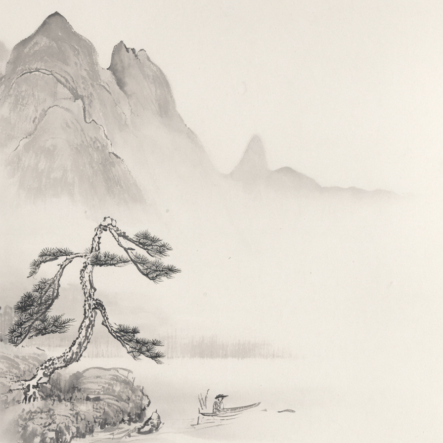
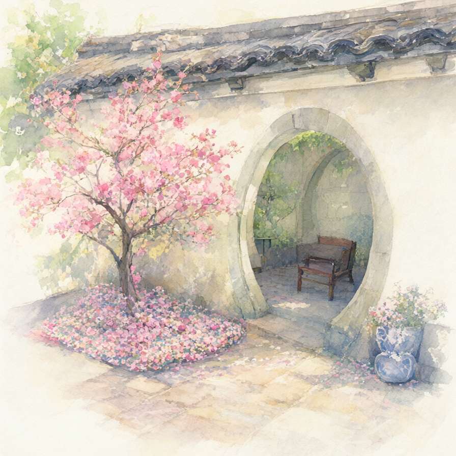
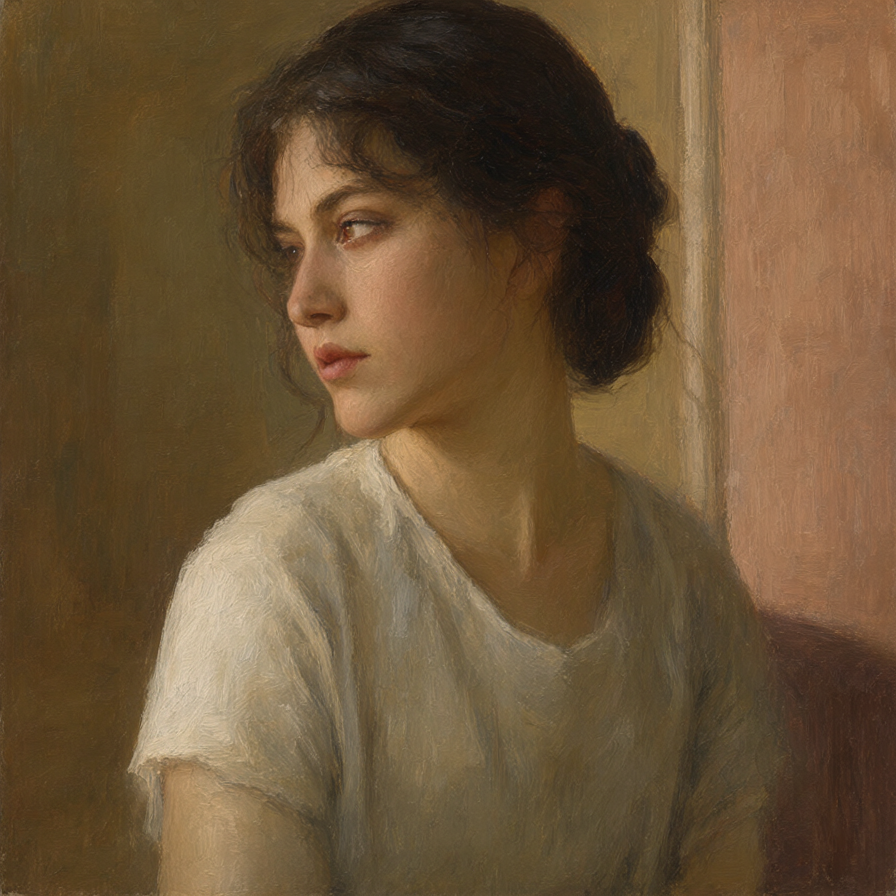
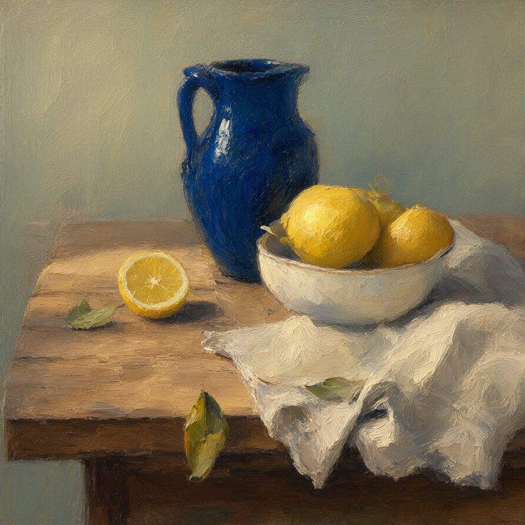

<h1 align="center">Inko</h1>

<p align="center"><strong>Paint with words, in English and Chinese.</strong></p>

<p align="center">
  <a href="#gallery">Gallery</a> ·
  <a href="#training-recipe">Training recipe</a> ·
  <a href="https://huggingface.co/spaces/kaupane/Inko">Try the demo</a> ·
  <a href="https://huggingface.co/kaupane/Inko">Get the model</a>
</p>

Inko is a bilingual text-to-image model for paintings and illustrations. Its
532M-parameter flow-matching transformer brings together a curated art corpus,
caption and resolution curricula, chunked Muon optimization, and Ascend training.

**Current release: 600k pretrained EMA.** Explore its images below, then follow
the recipe from data preparation through pretraining and posttraining.

## Gallery

From quiet ink landscapes to sunlit watercolors and textured oils. These are
selected images from the released checkpoint. Click an image to see it at full
resolution, or choose its prompt in the demo and make it your own.

<table>
  <tr>
    <td width="33%" align="center"><a href="demo/showcase/misty-mountains.png"></a><br><sub>Misty mountains · 水墨山水</sub></td>
    <td width="33%" align="center"><a href="demo/showcase/harbor.png"></a><br><sub>Harbor at dawn</sub></td>
    <td width="33%" align="center"><a href="demo/showcase/garden.png"></a><br><sub>Spring garden · 春日庭院</sub></td>
  </tr>
  <tr>
    <td align="center"><a href="demo/showcase/bookshop.png"></a><br><sub>The evening bookshop</sub></td>
    <td align="center"><a href="demo/showcase/portrait.png"></a><br><sub>A quiet portrait</sub></td>
    <td align="center"><a href="demo/showcase/lemons.png"></a><br><sub>Lemons in afternoon light</sub></td>
  </tr>
</table>

600k EMA · 896 × 896 · 20 Euler steps · CFG 1.
[Prompts and seeds](demo/showcase/prompts.json)

## Training recipe

### A corpus for painting, people, and the wider world

| Domain | Sources and coverage |
|---|---|
| Chinese painting | National Palace Museum, Taipei, and museum collections; artwork crops and captions that retain inscriptions and calligraphy |
| Western painting | WikiArt, NGA, Rijksmuseum, and the Met; oils, watercolors, and a broad range of painting traditions |
| People | Human-recaption, people supplements, and Pexels; faces, full bodies, movement, clothing, and anatomy |
| Objects and scenes | Vintage imagery, ReLAION, PD12M, Z-Image, Megalith, iNaturalist, and Pexels; objects, architecture, nature, and everyday scenes |

The pipeline cleans artwork crops and caption text, retains source and license
metadata, and precomputes Qwen-Image VAE latents. Chinese, English, and longer
captions can share one image row. Training samples an image from a weighted
source pool, then chooses a caption within that image. Extra captions therefore
expand the descriptions available for an image without multiplying its source
weight.

Each resolution has its own eligible pool. At 640p and 896p, source mass is
computed from eligible image rows: Chinese painting, WikiArt, museum painting,
and the dedicated Pexels people source receive a 1.8× multiplier; selected
supplementary pools receive 1.5×. This keeps painting and anatomy coverage
explicit as higher-resolution filtering changes the available mix. The
[corpus notes](notes/dataset_plan.md) describe curation and caption production;
[the run configuration](configs/pretrain.toml) records every source weight.

### Two curricula: image resolution and caption length

A continuous **600,000-update** run progresses through three variable-aspect
resolutions. Learning-rate, optimizer, EMA, and caption-curriculum progress
carry across the resolution boundaries.

| Resolution | Optimizer updates | Configured training image rows |
|---|---:|---:|
| 256p | 1–450,000 | 1,699,951 |
| 640p | 450,001–570,000 | 1,366,193 |
| 896p | 570,001–600,000 | 649,772 |

The row counts describe separate resolution pools, not disjoint images to add
together. Caption variants stay inside their image row.

Within each image, caption sampling shifts from favoring short descriptions
with a length bias of `L⁻¹` to favoring detailed descriptions with `L⁺¹`.
The exponent changes linearly over the run. A **20% probability reserve** goes
to captions shorter than 256 tokens when available, so concise prompts remain
part of training. Caption dropout is independently sampled at 10%.

Text is encoded online with frozen Qwen3-0.6B, stopping computation after
layer 20. This lets the selected caption change across visits to an image.
Retained text can reach **2,048 tokens**; aspect-ratio and caption-length
buckets match each batch to its actual image/text workload.

### Caption length also controls gradient share

Long descriptions receive more weight in the flow-matching objective:

```text
w(L) = max(1, log₂(max(L, 1) / 128))
step loss = Σ wᵢ ℓᵢ / Σ wᵢ
```

For example, 128-, 512-, and 2,048-token captions receive weights 1, 2, and 4.
Samples with dropped captions keep weight 1. The denominator includes all
micro-batches and distributed ranks in the optimizer step. Detailed captions
therefore receive a larger share of the gradient, and changing batch sizes or
accumulation does not turn that weighting into an unintended learning-rate
change. See the [weighting implementation](src/pretrain/caption_loss_weights.py).

### Flow matching with chunked Muon

The **532M-parameter** transformer uses one double-stream image/text block
followed by 24 single-stream blocks. It learns a rectified flow from noise to
VAE image latents, with logit-normal timestep sampling and resolution-dependent
time shifting. Pooled text and time jointly condition the blocks; QK-RMSNorm
and residual-branch RMSNorm are part of the architecture.

**Muon** optimizes hidden matrix weights. Fused QKV, modulation, and gated-FFN
matrices are split into their functional chunks before orthogonalization, with
shape scaling applied per chunk. **AdamW** handles embeddings, output layers,
normalization, and conditioning parameters. Muon's base learning rate is 0.02;
AdamW peaks at 1e-4. Ordinary AdamW weight decay is 0.01, with 0.4 on the three
shared conditioning matrices. The run uses a 20k-update warmup, continuous
cosine decay, global gradient clipping, and an EMA updated at every optimizer step.
[The complete recipe](notes/pretrain_recipe.md) records the optimizer settings.

<details>
<summary>Architecture and inference precision</summary>

| Component | Configuration |
|---|---|
| Transformer | Width 1152, 16 heads, 1 double-stream block and 24 single-stream blocks |
| Feed-forward layers | Gated SiLU, width 3072 |
| Conditioning | Frozen Qwen3-0.6B, early exit after layer 20; pooled text and time conditioning |
| Latents | 16 channels, 8× spatial compression, 2×2 latent patches |
| Positions | Centered image-grid rotary embeddings |
| Objective | Rectified flow, integrated from noise at time 0 to image latents at time 1 |
| Pretraining | Variable-aspect 256p → 640p → 896p curriculum; 600,000 optimizer updates |
| Precision | FP32 solver state and times; BF16 model forwards and VAE decode |

</details>

### Packing and dynamic batch sizes

Training packs sampled image-caption pairs into queues grouped by **image shape
and caption length**. Each queue emits a full microbatch; unfinished queues keep
their samples for later batches. Sources share queues, so a small dataset does
not leave its own partial batches behind. Captions are padded only to their
bucket's upper bound. Dynamic programming chooses 20 length buckets per aspect
ratio to minimize expected padding compute under the caption curriculum.

**Microbatch size varies by bucket:** short captions fit more images, while
long captions and larger images use smaller batches. The Ascend plans budget
the resident transformer, frozen text encoder, EMA, optimizer state, gradients,
and distributed buffers under a **52 GiB planning ceiling**.

| Resolution | Images per microbatch, per device | Gradient accumulation |
|---|---:|---:|
| 256p | 8–72 | 1 |
| 640p | 5–12 | 3 |
| 896p | 3–6 | 4 |

This keeps small examples from inheriting the batch-size limit of the most
expensive bucket. Gradient normalization uses the actual sum of sample weights
across microbatches and devices, preserving the intended caption weighting as
batch sizes change. See the [sampler](src/dataset/sampler.py) and
[bucket planner](src/dataset/length_buckets.py).

### Infrastructure built and measured for Ascend

The execution work reaches beyond the transformer forward pass. It includes
true early exit in Qwen3, a single masked slice for retained text features,
batched gradient normalization and EMA updates, and memory-aware batching.
The 24 single-stream blocks share RoPE tables and padding biases built once
per forward, avoiding repeated setup inside each block.
The earlier [CUDA execution comparison](notes/redesign_plan.md#stage-status-and-decision-evidence)
improved from **54.99 to 72.98 samples/s** in steady state; its warm-inclusive
gain was **1.233×**.

**Ascend was qualified separately on 16×910B2C.** The early-256p comparison
measured the cumulative effect of native operators and workload planning:

| Execution path | Images/s |
|---|---:|
| Baseline | 656.29 |
| + Native fused RMSNorm | 737.68 |
| + Larger micro-batches, accumulation 1 | 765.34 |
| + Aligned 3072-wide FFN | 843.29 |
| + Native SwiGLU | **878.91** |

That is **33.9% higher throughput** and **24.8% lower update time** on the
matched early-256p workload. These rates exclude startup and periodic
monitoring; higher resolutions and longer captions have different costs.

The Ascend path also includes native masked attention.
Native RMSNorm preserves FP32 normalization and learned gains before casting
back. Native attention avoids the large saved-tensor cost of the generic
float-mask path.

Same-stage restarts restore model, EMA, optimizers, schedules, sampler queues,
and per-rank random state. Resolution transitions construct a fresh sampler
for the new pool while carrying model and optimizer progress forward. All 16
ranks verified exact state restoration at the 640p continuation.
The [infrastructure record](notes/infra_pretrain.md) gives measurement conditions,
operator checks, memory probes, and recovery evidence.

### Posttraining: preference and prompt alignment

Posttraining is developed on
[`feat/posttrain`](https://github.com/Mtrya/inko/tree/feat/posttrain).
The selected approach is **DiffusionART with attention LoRA**, starting from
the 600k EMA. It combines HPSv3 preference and VQAScore alignment rewards after
per-round standardization. The recipe uses rank-64 LoRA, Muon updates, a slow
EMA, and 20-step Euler rollouts at CFG 1.

Selection considers generated images, prompt adherence, and diversity alongside
reward scores. Fixed bilingual panels, DrawBench prompts, and held-out
comparisons provide different views of the model. The
[posttraining recipe and observations](https://github.com/Mtrya/inko/blob/feat/posttrain/notes/posttrain_recipe.md)
record both gains and failure cases. **The public checkpoint and gallery on
this page are still the pretrained release.** Posttrained weights and their
examples will be published together.

## Generate an image

[Open the demo](https://huggingface.co/spaces/kaupane/Inko) to start with a short
idea or a gallery prompt. DeepSeek can expand your description, and the app
shows the prompt used. Seeds randomize by default. Width and height can each
range from 480 to 1600 in multiples of 16; CFG ranges from 0 to 10. Selecting a
gallery image restores its saved settings with enhancement and randomization off.

Use Python 3.12 and a CUDA GPU. The Space repository contains the inference
source and its dependencies:

```bash
git clone https://huggingface.co/spaces/kaupane/Inko inko-demo
cd inko-demo
python -m venv .venv
source .venv/bin/activate
pip install -r requirements.txt
```

```python
import torch
from src.pipeline import InkoPipeline

pipe = InkoPipeline.from_pretrained(
    "kaupane/Inko", torch_dtype=torch.bfloat16
).to("cuda")

image = pipe(
    "中国水墨画，远山笼罩在薄雾中，近处一棵松树伸向江面，一叶小舟停在岸边。",
    generator=torch.Generator(device="cpu").manual_seed(42),
).images[0]
image.save("inko.png")
```

The default is 896 × 896, 20 Euler steps, and CFG 1.

<details>
<summary>Batch generation and local model files</summary>

The first load downloads Inko, [Qwen3-0.6B](https://huggingface.co/Qwen/Qwen3-0.6B)
and the [REPA-E Qwen-Image VAE](https://huggingface.co/REPA-E/e2e-qwenimage-vae).
Pass a local export directory to `from_pretrained` to load local Inko weights.
Use `text_encoder_path` and `vae_path` for local copies of the frozen models,
and `local_files_only=True` to disable downloads.

Sampling uses resolution-dependent time shifting. Custom dimensions must be
multiples of 16.

```python
images = pipe(
    [
        "A watercolor painting of fishing boats in a quiet harbor at sunrise.",
        "一幅水彩画，清晨的港湾停泊着几艘渔船，水面倒映着淡粉色的天空。",
    ],
    width=1152,
    height=704,
    num_inference_steps=20,
    guidance_scale=1.0,
    generator=[torch.Generator().manual_seed(seed) for seed in (7, 8)],
).images
```

Each prompt produces one image. A list of generators assigns a separate random
stream to each image. CFG 1 uses one conditional model forward per step;
other guidance values also evaluate the empty prompt, or `negative_prompt`
when supplied. CPU generators make the initial noise independent of the
inference device; outputs can still vary across hardware and numerical kernels.

</details>

## Development

<details>
<summary>Training, running the demo locally, and exporting a checkpoint</summary>

Install the project dependencies in an environment matched to the Ascend
runtime, then inspect the launcher:

```bash
python -m scripts.pretrain.launch --help
```

### Run the demo locally

```bash
pip install -r demo/requirements.txt
python -m demo.app
```

Set `DEEPSEEK_API_KEY` in the server environment or Space secrets to enable
prompt enhancement with `deepseek-flash`. Enhancement runs before GPU allocation;
if the service is unavailable, the app uses the original prompt and shows a
notice. `INKO_MODEL_ID` selects a different Hub model or local export.
`INKO_DEVICE=cpu` runs in FP32 on CPU.

The hosted demo uses [ZeroGPU](https://huggingface.co/docs/hub/spaces-zerogpu).
Its app, dependencies and Space metadata live together in [`demo/`](demo/).

### Export a checkpoint

The exporter reads a weight file and its adjacent `transformer_config.json`.
Use the pretrained EMA file, or merged weights exported by posttraining:

```bash
python -m scripts.export_model \
  --checkpoint /path/to/checkpoint/ema_weights.pt \
  --output models/Inko
```

The output contains `model.safetensors`, `transformer_config.json` and
`pipeline_config.json`. The exporter reloads the saved weights and checks exact
tensor equality. Sampling defaults and frozen-model identifiers come from
[`configs/inference.json`](configs/inference.json).

[Generation pipeline](src/pipeline.py) ·
[Data, training, and evaluation tools](scripts/README.md)

</details>
