# Data

This chapter records what Inko learned from. Part 1 covers the pretraining corpus: four domains, where each dataset came from, how it was cleaned and captioned, and what changed mid-training. Part 2 covers the prompt and rubric pool used by post-training.

## Part 1: The pretraining corpus

### Two lessons from weak models

In April 2025 I trained a series of diffusion transformers on WikiArt, [DiT-Wikiart](https://huggingface.co/kaupane/DiT-Wikiart-Large). They were score-matching models that needed 1000 denoising steps to produce an image, they mapped tags to images rather than text to images, and they generated at a fixed 256px. They were also weak.

Weak models still teach, and those two taught me the lessons that shaped everything after.

**Anatomy is much harder than style.** The models picked up ink painting and oil painting styles quickly, while bodies and faces broke constantly. Style lives in textures and palettes, and a weak model can fake it. Anatomy lives in precise global structure, and a weak model cannot.

**Eastern art is severely underexposed.** Open image collections lean overwhelmingly Western. Chinese painting, with its mounting formats, inscriptions, seals, handscrolls and detail crops, barely appears in them, and almost never with usable captions.

These two lessons became the domain structure of Inko's corpus: Chinese painting as its own domain (d1) next to Western art (d2), people and anatomy as a domain of their own (d3), and general world knowledge as the rest (d4). When I later learned flow matching, I decided to train a proper model with it, paired with many of the techniques the April models had lacked. That model is Inko.

### The corpus at a glance

Training runs at progressive resolutions: 256p, then 640p, then 896p. Each stage re-filters the pools (image size, crops, decode checks, caption length), so row counts drop as resolution rises. The rows below are image rows after each stage's filter; per-source weights and stage settings are authoritative in [`configs/pretrain.toml`](../configs/pretrain.toml).

| Domain | Rows @256p | Rows @640p | Rows @896p |
|---|---:|---:|---:|
| d1 Chinese painting | 91,006 | 90,722 | 90,210 |
| d2 Western art | 224,106 | 146,852 | 36,865 |
| d3 People | 303,177 | 294,527 | 226,070 |
| d4 World knowledge | 1,081,662 | 834,092 | 296,627 |
| **Total** | **1,699,951** | **1,366,193** | **649,772** |

By provenance the sources fall into three groups: six were curated for Inko (d1, d2-museum, d3-human, d3-pexels, d3-synth-v2, d4-extra), four are the author's earlier public sets reused as-is (d2-wikiart, d4-relaion, d4-vintage, d4-zimage), and four are third-party sets used as published (d3-people, d4-pd12m, d4-inat, d4-megalith).

Sampling is two-level: first draw an image row by source weight, then pick a text from that row's caption list. Precompute stores Qwen-Image VAE latents, cleaned caption text and length metadata, while Qwen3-0.6B tokenization runs online so the caption-length curriculum can advance during training. Raw metadata rows, downloaded image counts, published rows and training rows are counted separately, because they never reconcile one-to-one; this chapter keeps them apart on purpose.

The example images under each domain below are training views: rows decoded back from the stored latents, exactly as the trainer saw them. Each resolution trains on five aspect buckets (16:9, 4:3, 1:1, 3:4, 9:16), and the gallery images keep their bucket crop. Each dataset shows three; the statistics, curation story and caption examples sit in the expandable details.

### Domain one: Chinese painting

Curated for Inko from five museum collections and published as [`kaupane/chinese-painting-collection`](https://huggingface.co/datasets/kaupane/chinese-painting-collection) (91,093 rows). Almost nothing filters out across the stages: Chinese painting keeps its full weight all the way to 896p.

| 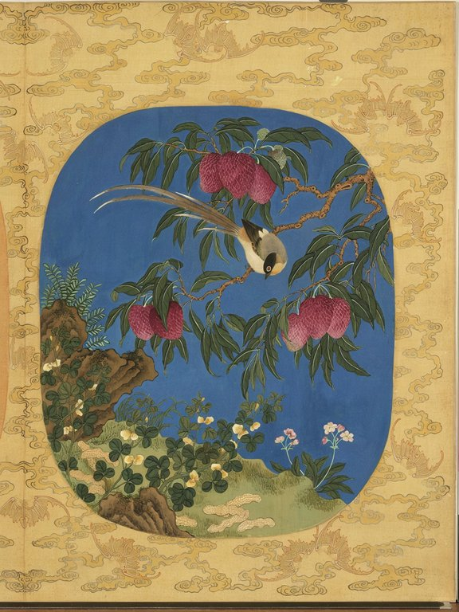 | 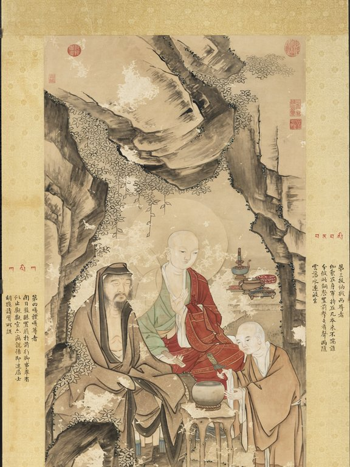 | 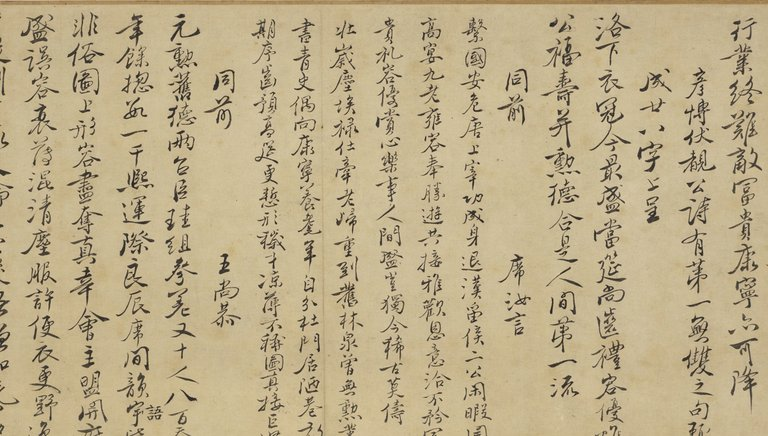 |
|:---:|:---:|:---:|
| Lychee and flycatcher, mounted album leaf | Arhats in a grotto, hanging scroll | Running-script calligraphy |

<details><summary>Statistics, sources and the four cropping rounds</summary>

Rows: 91,006 at 256p, 90,722 at 640p, 90,210 at 896p.

Five museum collections contribute: the National Palace Museum (Taiwan), the Met's Chinese collection, the Princeton University Art Museum, the Smithsonian's Freer|Sackler galleries (the National Museum of Asian Art), and the Art Institute of Chicago. Each row carries the cropped image, the original scan, the crop box, artifact labels, the artwork's title/artist/category metadata, OCR'd inscription text (with explicit markers for illegible characters and seal imprints), and bilingual captions.

**The four cropping rounds.** Museum scans of Chinese paintings do not frame the artwork; they frame the artwork plus its mounting, plus a ruler, plus a color calibration chart, plus a collection label, plus the desk. Train on them raw, and the model learns that paintings come with color charts.

Round one was mechanical: detect and cut the obvious borders. Rounds two and three sent the survivors to Gemini. I published the dataset, inspected samples, and considered it done.

At pretraining step ~340k, a full inspection of the published dataset found surviving color charts on its last pages. The lesson, in its uncomfortable form: a VLM does not always see an artifact as an artifact. When the surrounding pixels look plausible in context, the model describes the painting and ignores the chart.

Round four ran deepseek-v4.1-flash over the full collection, and the same pass added long captions; d2-museum got long captions in the same batch. The refreshed datasets entered training at the 400k stop-and-resume. Between step 0 and 400k the model had been training on {image with artifacts, prompt about art only} pairs, which means every surviving chart was implicitly labeled as part of the artwork. Data quality is a process, not a state.

| 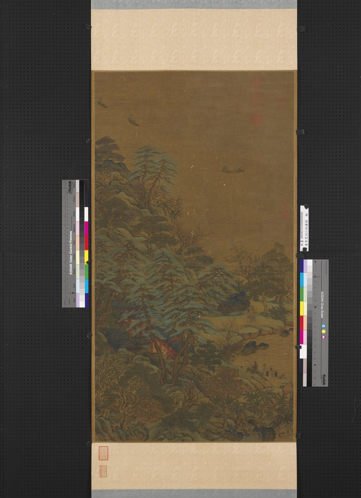 | 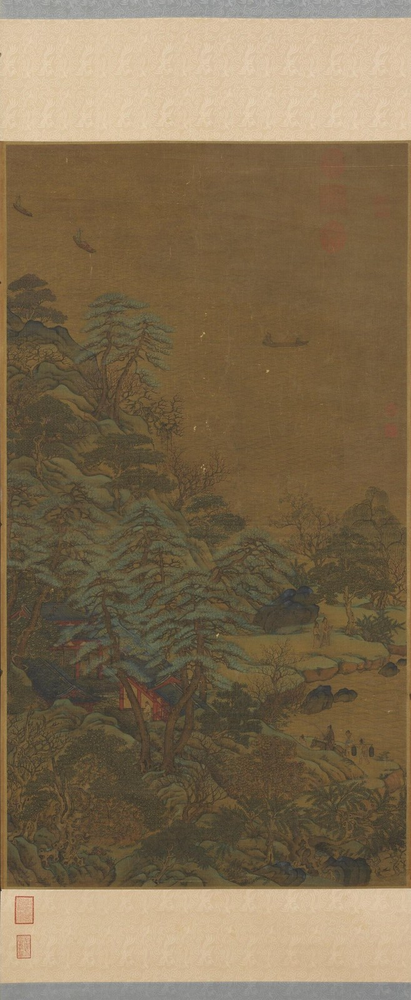 |
|:---:|:---:|
| As the scan arrives: color chart, gray scale, collection label, pegboard desk. This row's artifact labels: `color_chart, ruler, label, desk`. | The crop that enters training (`view_type: mounted` keeps the mounting and seals; the charts are gone). 唐李思訓江帆樓閣 軸 (*River Sails and Lofty Buildings*). |

A real d1 row, captioned by gemini-3.5-flash-lite: a detail view of *Snowy Mountains and Red Trees* (雪山紅樹圖).

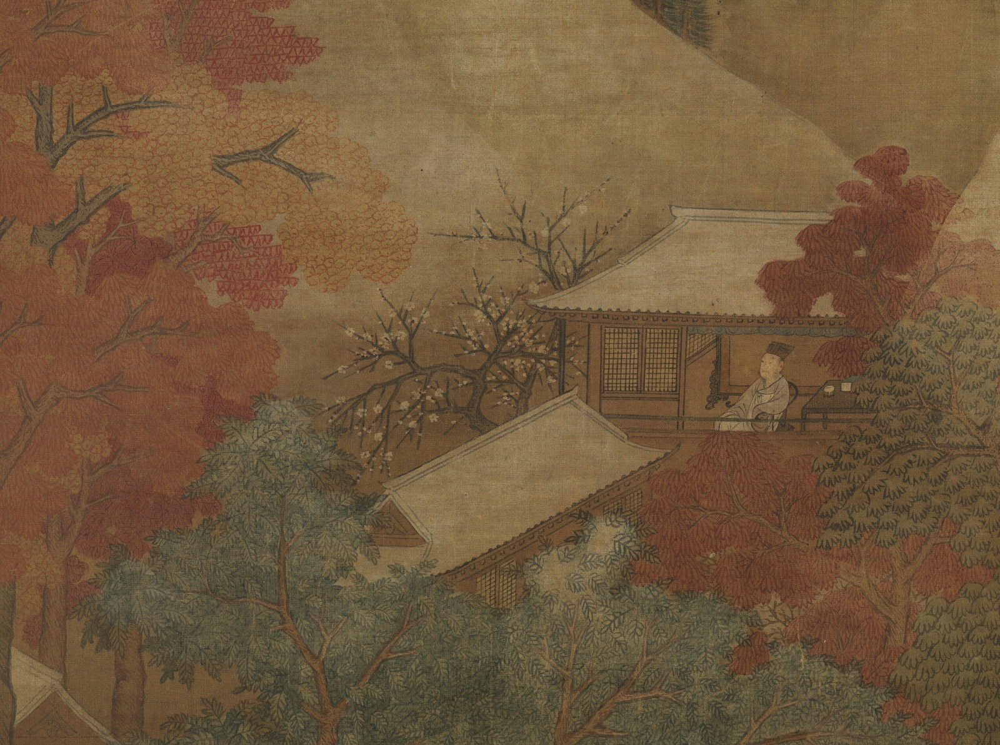

> **caption_zh**: 画面截取自一幅设色山水人物图卷的局部，展现了一处隐匿于深秋山林中的庭院精舍。左侧及右下是层叠繁密的树木，红叶、黄叶与墨绿松柏交织，呈现出深秋萧瑟而绚烂的氛围。中央坐落着青瓦白墙的殿宇楼阁，飞檐翘角，窗棂细腻。二层敞轩内端坐一位头戴高帽、身着宽袍大袖的古代文人高士，正倚栏远眺，神情闲适淡然，身旁几案上置有茶具。庭院中斜出一枝绽放的白梅，于红叶青树之间平添几分清雅。整体笔墨工细严谨，设色古朴典雅，丝绢质地泛着岁月的沧桑微黄，生动刻画了文人寄情山水、超然物外的隐逸生活场景。
>
> **caption_en**: This is a detailed section from a colored landscape and figure scroll, depicting a secluded courtyard nestled within deep autumn mountains. The left and lower right are filled with densely layered trees, where crimson leaves, golden foliage, and dark green pines intertwine to create a brilliant yet melancholy autumn atmosphere. At the center stands a pavilion with grey-tiled roofs and white walls, featuring upturned eaves and delicate window lattices. Inside the open second-story porch, a scholarly figure in traditional robes and a high cap sits gracefully, gazing into the distance with a tranquil expression, beside a small table set with utensils. A flowering white plum branch extends into the courtyard, adding a touch of elegance amidst the autumn colors. The brushwork is meticulous and rigorous, with refined and antique coloring on aged silk, vividly capturing the reclusive and serene lifestyle of a scholar harmonizing with nature.

Each training row keeps at most three captions (Chinese, English and long), and rows missing captions or image files are counted separately. The source inventory keeps full/mounted/detail views and drops rolled/junk. Rule-based cleaning handles color charts, mounting borders and invalid images, and bbox cropping happens at precompute. The training manifest merges the published metadata with long captions by `image_id`.

</details>

### Domain two: Western art

**d2-wikiart** is [`kaupane/wikiart-captions`](https://huggingface.co/datasets/kaupane/wikiart-captions), an earlier WikiArt recaption reused as-is. The set is English-only, since it predates Inko's bilingual rule.

| 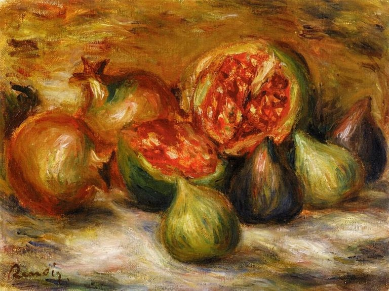 | 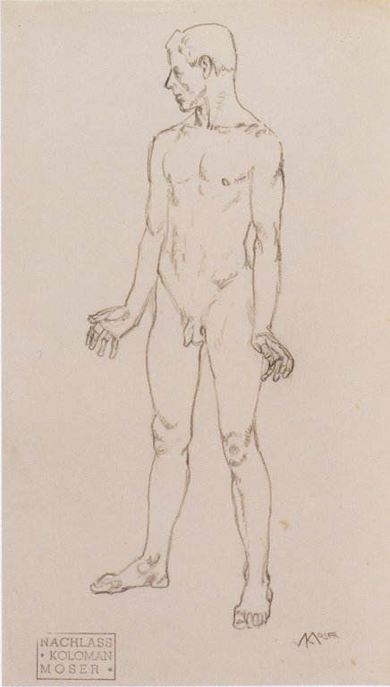 | 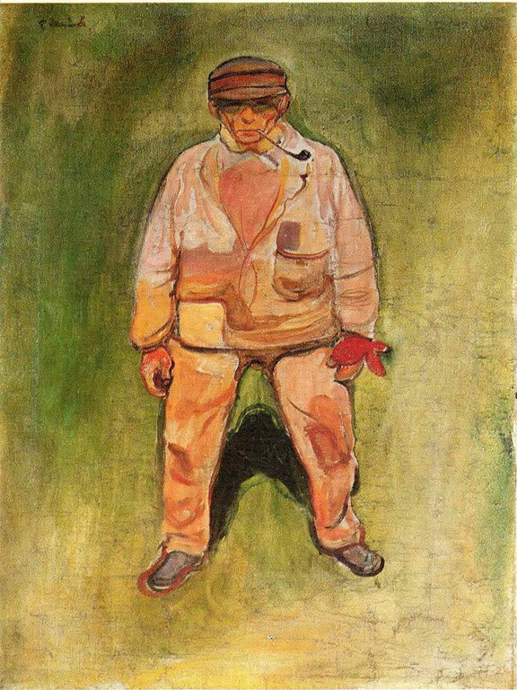 |
|:---:|:---:|:---:|
| Renoir, *Still Life with Figs* | Koloman Moser, figure study (1915) | Munch, *The Fisherman* (1902) |

<details><summary>Statistics and the caption variants</summary>

Rows: 214,041 at 256p, 138,125 at 640p, 33,222 at 896p.

Each artwork carries up to four caption types: the original WikiArt tag caption plus three Qwen-written variants (direct, spatial, reverse). One row, two of its texts:

> Still life with figs , by pierre auguste renoir , still life , impressionism style , still life photography

> A painting of figs and pomegranates. the painting is done in oil. the colors used are mostly earth tones. the figs are dark green and light green. there is a white cloth under the figs.

The tag caption carries the artist and style labels; the written variants carry the visual description. A long-caption top-up arrived later (see the caption strategy).

</details>

**d2-museum** was pulled directly from museum APIs for Inko; it is not uploaded to HF.

| 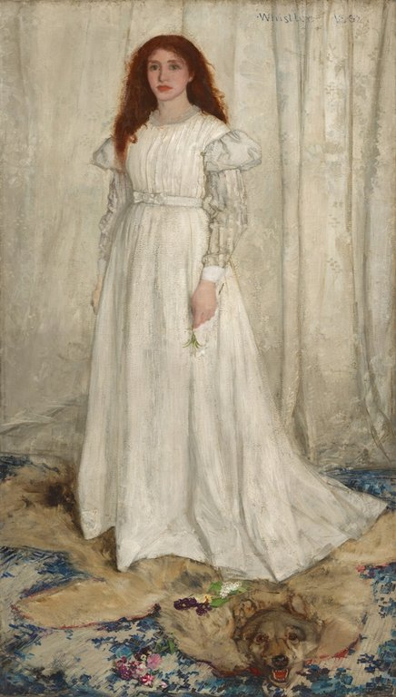 | 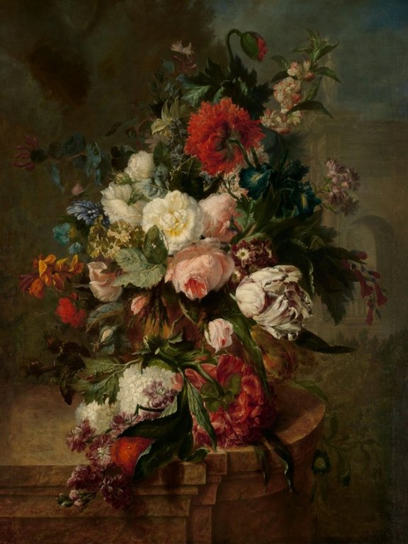 | 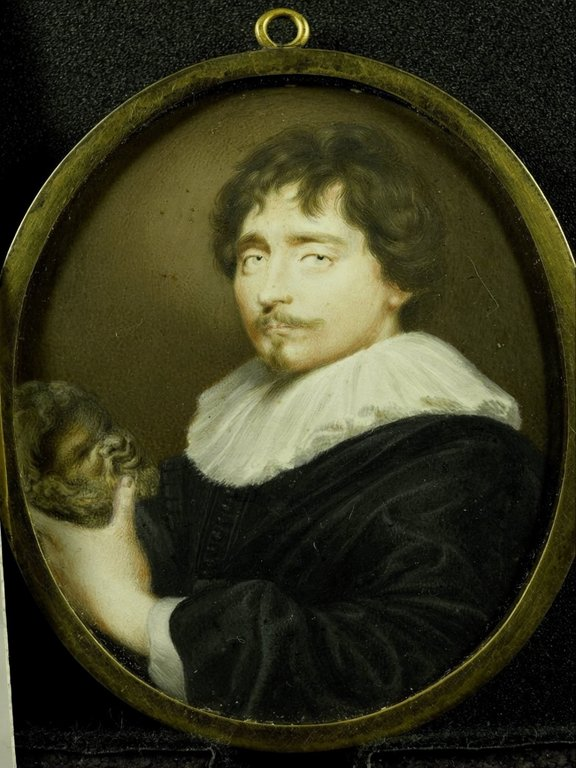 |
|:---:|:---:|:---:|
| Portrait on a fur rug | Floral still life in an urn | Oval miniature with ruff |

<details><summary>Statistics and the five sub-sources</summary>

Rows: 10,065 at 256p, 8,727 at 640p, 3,643 at 896p.

The five sub-sources are the Met's Impressionist and portrait collections, the National Gallery of Art's Impressionist and full-paintings catalogs, and the Rijksmuseum. The sets exist just how the museum APIs handed out data: one artist returns hundreds of works, another a handful, and the corpus inherits that skew. d2-museum received long captions in the same 400k refresh as d1.

One row's caption_zh:

> 一束繁茂绚丽的花卉静物占据画面中心，放置在石质的高挑案几或柱头之上。花束由多种花卉交织而成，包括醒目的红色虞美人、洁白与粉红的玫瑰、带有斑纹的郁金香以及深蓝色的鸢尾等，层层叠叠，错落有致。背景呈现出低调沉暗的棕褐色调，隐约可辨模糊的古典建筑轮廓与微弱天光，烘托出宁静且略带忧郁的巴洛克或古典主义氛围。

</details>

ArtBench-10 is the domain's missing member. I captioned and published [`kaupane/artbench-captions`](https://huggingface.co/datasets/kaupane/artbench-captions) and never trained on it. It should have been in d2. I forgot. A simple, stupid mistake.

### Domain three: People

Lesson one made people a domain of their own: faces, full bodies, motion and anatomy, with enough weight that the model cannot treat humans as decoration.

**d3-human** is [`kaupane/human-recaption`](https://huggingface.co/datasets/kaupane/human-recaption), a recaption of [`OpenFace-CQUPT/HumanCaption-HQ-311K`](https://huggingface.co/datasets/OpenFace-CQUPT/HumanCaption-HQ-311K) produced for Inko.

| 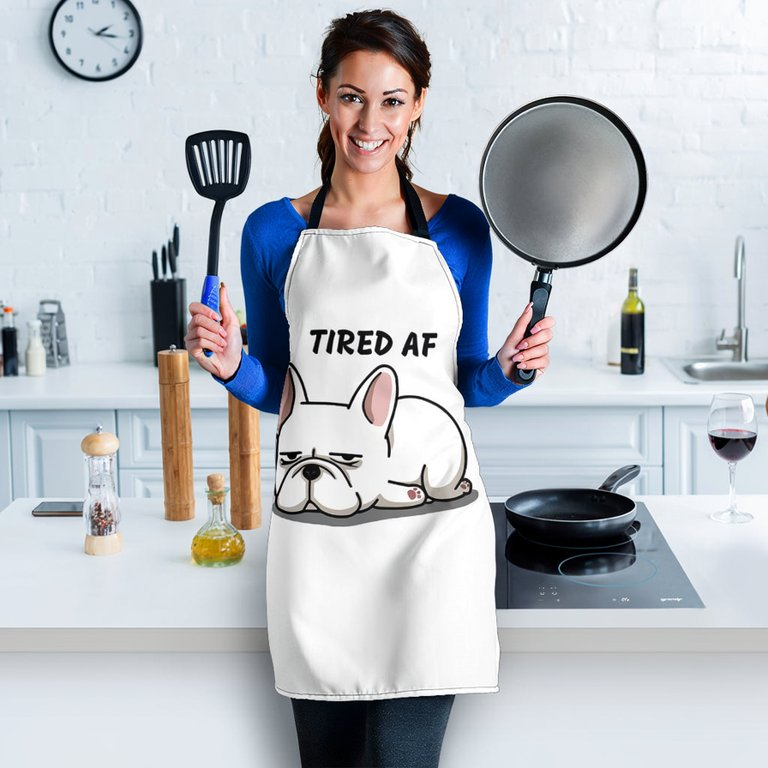 | 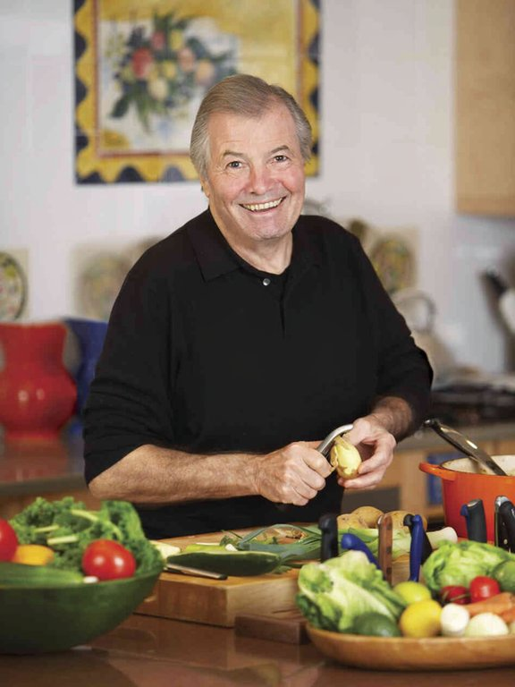 | 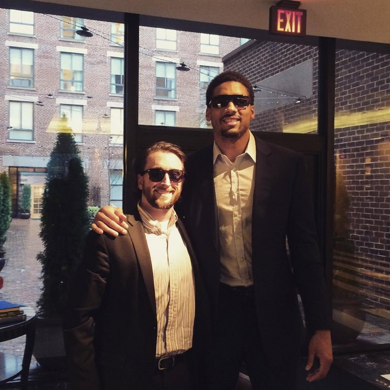 |
|:---:|:---:|:---:|
| Cooking with a "tired af" apron | Peeling fruit at the counter | Two men in suits |

<details><summary>Statistics and curation</summary>

Rows: 118,393 at 256p, 114,100 at 640p, 109,715 at 896p.

The original set ships English-only captions, and the image side has broken links and watermarks; retrieval here conditions on RGB, watermark and source-score checks. The recaption replaced the original English text rather than joining it. One row's caption:

> A young woman with long dark brown hair smiles brightly while standing in a modern kitchen. she wears a blue long-sleeve shirt and a white apron featuring a french bulldog graphic and the text 'tired af'. in her right hand she holds a spatula, and in her left, a frying pan.

</details>

**d3-people** is [`opendiffusionai/cc12m-a_woman`](https://huggingface.co/datasets/opendiffusionai/cc12m-a_woman), a third-party set used as published.

| 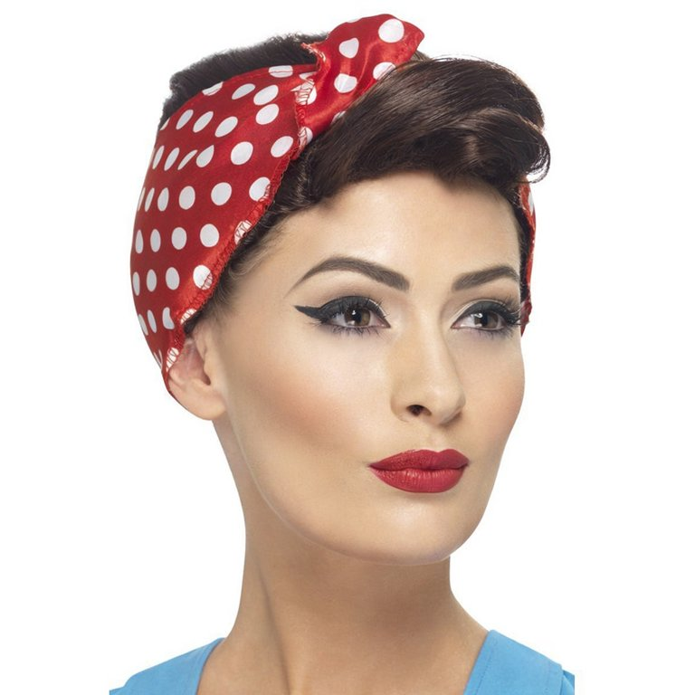 | 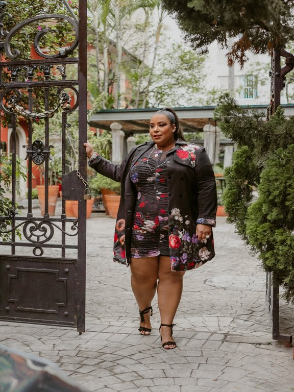 | 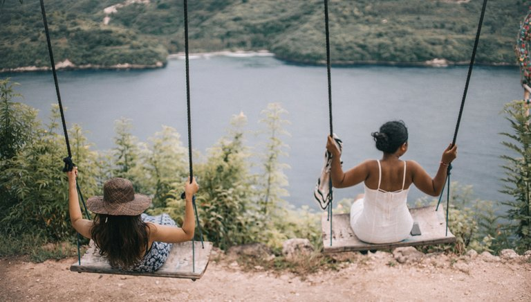 |
|:---:|:---:|:---:|
| Red polka-dot headband | Floral dress at an ornate gate | Swings suspended from a cliff |

<details><summary>Statistics and why this set</summary>

Rows: 114,345 at 256p, 109,990 at 640p, 56,824 at 896p.

The author filters their datasets manually, and the quality shows. CC12M was chosen so the content would not collide with the LAION/PD12M/Pexels material already in d4. Captions stay as published: one short English text per row. Two of them:

> A close-up portrait of a woman with dark hair styled in a bun, wearing a red headband with white polka dots, and red lipstick.

> A woman is standing in front of an ornate gate, wearing a floral dress and a black jacket, with greenery and a building in the background.

</details>

**d3-pexels** is [`kaupane/pexels-people-captions`](https://huggingface.co/datasets/kaupane/pexels-people-captions), curated for Inko through a custom Pexels query pipeline.

| 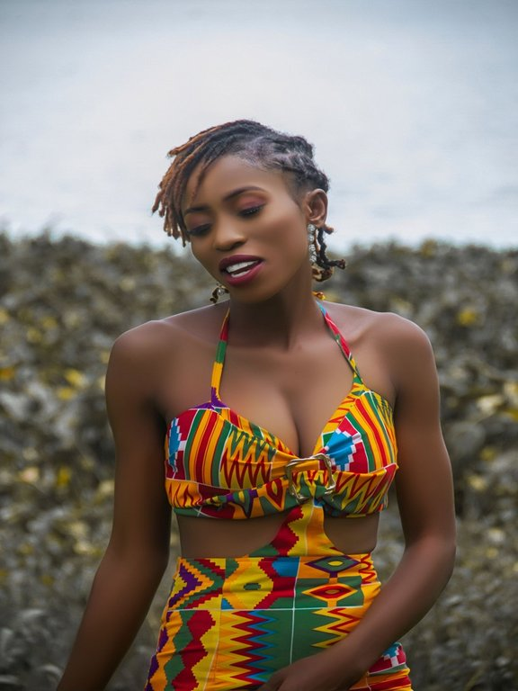 | 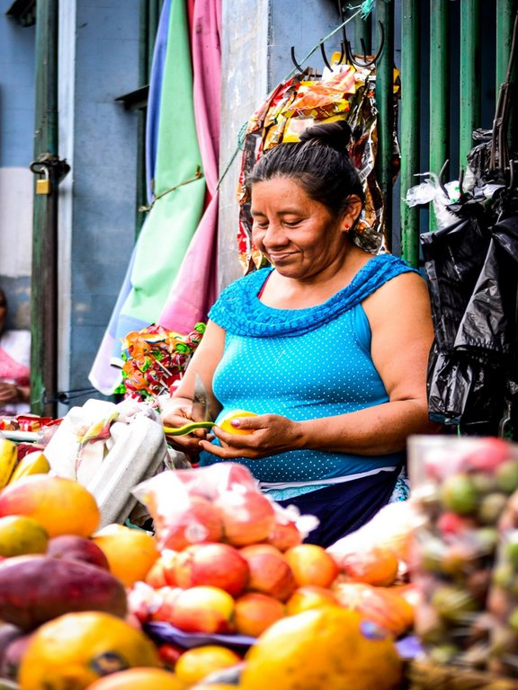 |  |
|:---:|:---:|:---:|
| Traditional attire, outdoors | Market fruit stall | Cappuccino among spring flowers |

<details><summary>Statistics and the query pipeline</summary>

Rows: 59,546 at 256p, 59,544 at 640p, 59,531 at 896p. Pexels images are large, so nearly every row survives every stage filter.

The queries targeted full bodies, sports and dance, regional dress and labor scenes. Each row keeps its short search-side text and adds a long recap. One row, both:

> African woman in colorful traditional attire posing outdoors on a sunny day.

> A photograph of a young black woman standing outdoors against a blurred background of grey-green foliage and pale sky. she wears a halter top and high-waisted bottoms in a bright kente-style print of yellow, red, green, and blue geometric bands, with a metal ring at the centre of the top.

</details>

**d3-synth-v2** is synthetic, generated for Inko, and unpublished.

| 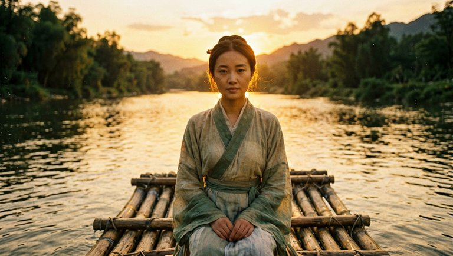 | 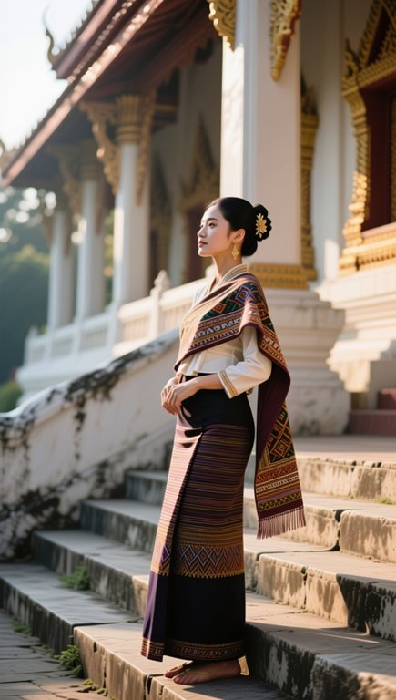 | 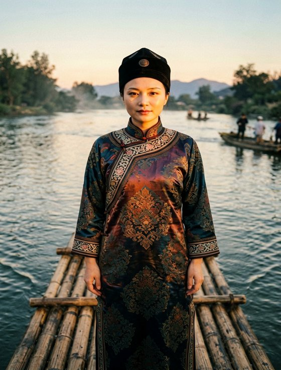 |
|:---:|:---:|:---:|
| Han ruqun on a bamboo raft | Dai dress on palace steps | Uyghur atlas silk and doppa |

<details><summary>Statistics and the 20k-to-10k trim</summary>

Rows: 10,893 at 256p and 640p. The images are 640p material, so there is nothing to train on at 896p.

The first 20k images came from Qwen-Image, which turned out to be weak at exactly this subject: broken anatomy, inaccurate garments. Manual review trimmed the set to about 10k, which became `v2`. A separate captioning round wrote the training captions, since prompt-to-image alignment is exactly what is imperfect in this domain. One row, its prompt against its caption:

> Generation prompt: A three-quarter-length portrait of a uyghur woman in an atlas-silk dress and a doppa cap, standing on a bamboo raft on the li river, side light at dawn, film-grain.

> Caption: A photograph shows a woman of east asian descent standing on a bamboo raft in a river. she wears a dark, ornate robe with a high collar and a diagonal closure. the fabric of the robe is a rich brocade, featuring intricate patterns in shades of deep blue, purple, gold, and rust.

</details>

### Domain four: World knowledge

d4 keeps the model honest outside art: objects, architecture, nature, scenes, and the long tail of concepts a user can name.

**d4-relaion** is [`kaupane/relaion-art-recap-zh`](https://huggingface.co/datasets/kaupane/relaion-art-recap-zh), an earlier bilingual recaption of the relaion art subset, reused as-is.

| 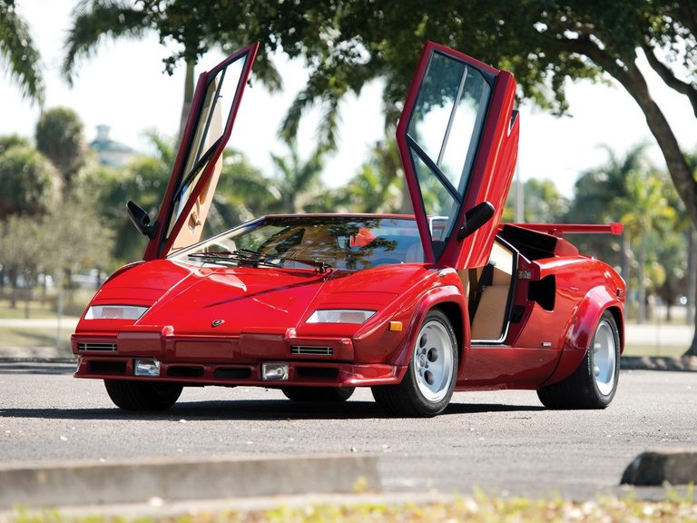 | 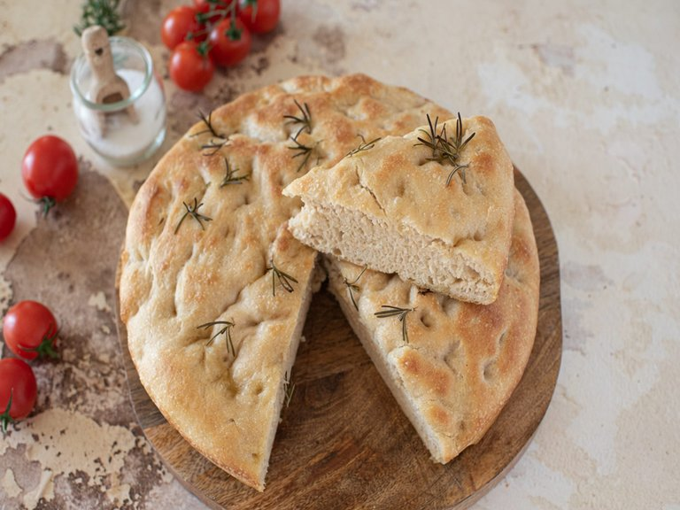 | 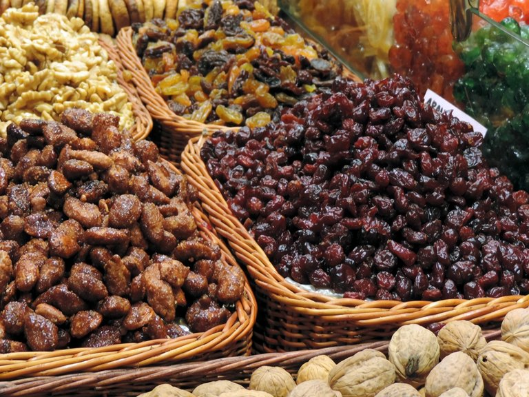 |
|:---:|:---:|:---:|
| Lamborghini Countach | Focaccia on a wooden board | Dried fruits and nuts |

<details><summary>Statistics and what the recaption bought</summary>

Rows: 621,773 at 256p (the largest single pool in the corpus), 391,406 at 640p and 162,170 at 896p.

The take was partial, at an acceptable broken-link rate. The typo "relaion" is upstream's; it survived into the config and now lives forever. One row shows what the recaption bought, original alt-text against new zh caption:

> Lamborghini countach

> 一辆鲜红色的兰博基尼countach跑车停在户外柏油路面上，车门呈标志性的向上开启的剪刀门姿态。车身线条锐利，前脸配有方形大灯和宽大的进气格栅，侧面可见经典的侧翼通风口和多辐条轮毂。

</details>

**d4-pd12m** is [`Spawning/PD12M`](https://huggingface.co/datasets/Spawning/PD12M), a third-party set used as published, taken partially.

| 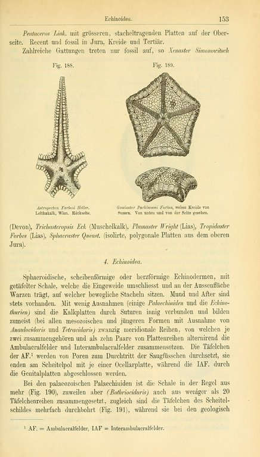 | 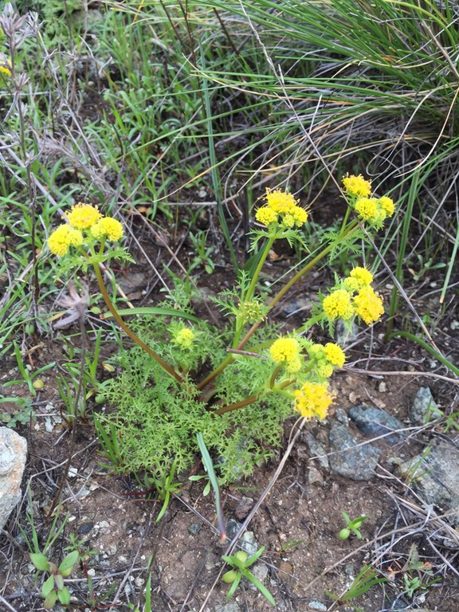 | 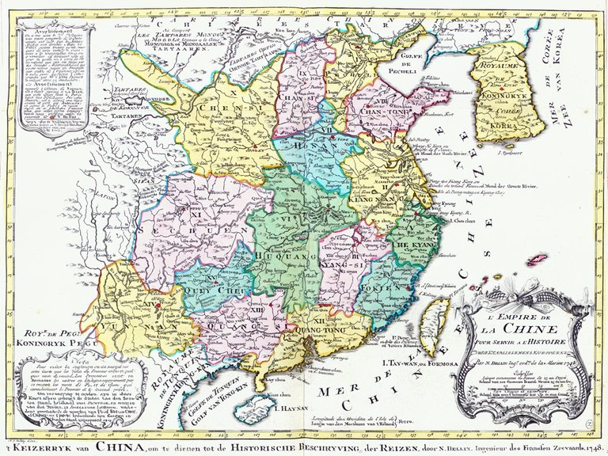 |
|:---:|:---:|:---:|
| Starfish drawing in an open book | Yellow flowers among stones | Antique map of China (1748) |

<details><summary>Statistics</summary>

Rows: 162,307 at 256p, 155,299 at 640p, 38,875 at 896p.

The download was too slow to justify the full set. Captions stay as published: single English texts on the short side. One of them:

> An open book with a drawing of a starfish on it, along with some text. the starfish is depicted in great detail, with its five arms and spines clearly visible. the text on the book provides further information about the starfish, such as its size, shape, and color.

</details>

**d4-vintage** is [`kaupane/vintage-photography-captions`](https://huggingface.co/datasets/kaupane/vintage-photography-captions), an earlier caption set reused as-is.

| 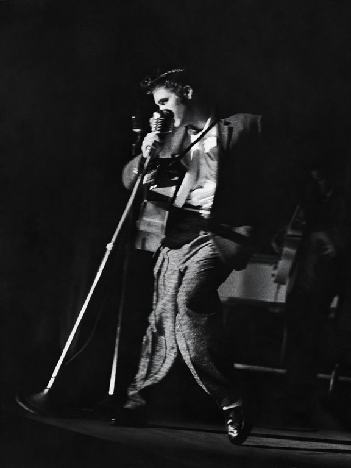 | 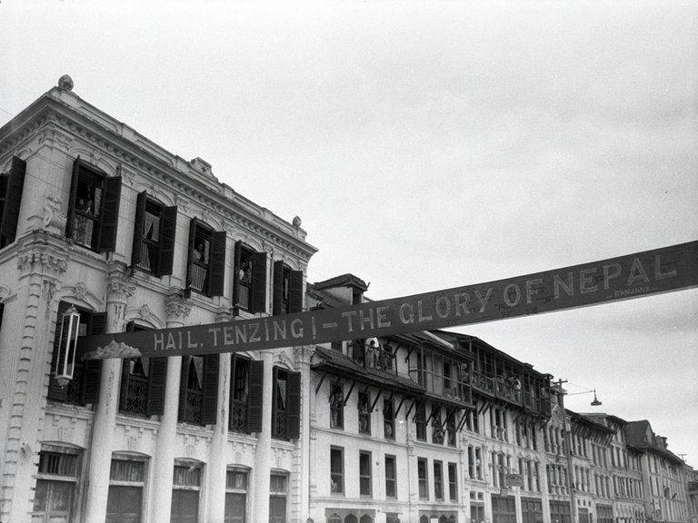 | 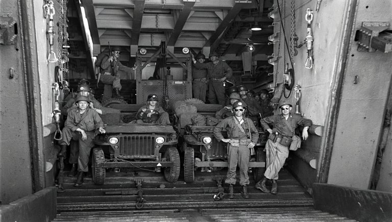 |
|:---:|:---:|:---:|
| Stage performer, black-and-white | "Hail Tenzing" banner | Soldiers on a landing craft |

<details><summary>Statistics and origin</summary>

Rows: 194,625 at 256p, 158,531 at 640p, 16,416 at 896p. Vintage prints are small; the 896p size check keeps only about one row in twelve.

I captioned this set earlier because I like vintage photography. It was never a training target; it entered the corpus because it was ready. No specific reason. The captions transcribe visible text, which pays off here:

> 这是一张黑白历史照片，展示了一座多层欧式建筑，其立面有多个窗户和柱式结构。一条横幅从建筑前方斜跨而过，上面用英文写着"hail tenzing — the glory of nepal"。

</details>

**d4-zimage** is [`kaupane/z-image-turbo-gen`](https://huggingface.co/datasets/kaupane/z-image-turbo-gen), an earlier Z-Image-Turbo generation set reused as-is.

| 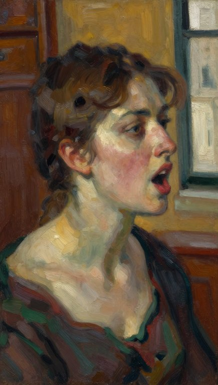 | 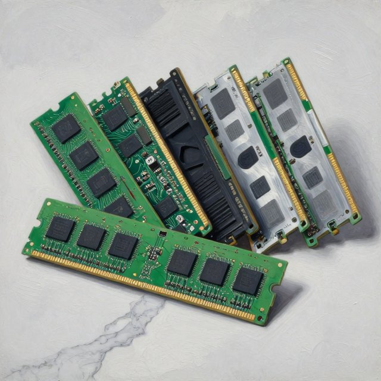 | 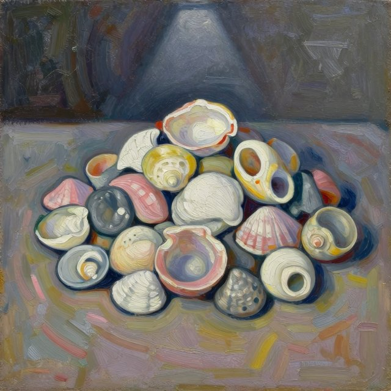 |
|:---:|:---:|:---:|
| Impressionist portrait study | Realist RAM-stick still life | Post-impressionist seashells |

<details><summary>Statistics and origin</summary>

Rows: 45,228 at 256p, 45,248 at 640p. The images are 640p material, so the set stops there.

They entered the corpus because the set was already prepared. The corrupted `1/9/16.parquet` shards are excluded. The generation prompts swing between eras and media; one of them:

> A still life painting in realism style, depicting six computer ram sticks arranged in a dynamic, staggered composition on a polished white marble surface. the scene is a close-up view, focusing on the intricate details of the ram modules.

</details>

**d4-inat** is [`sirus/inaturalist-2024-2.8k-claude-opus-5-recaptioned`](https://huggingface.co/datasets/sirus/inaturalist-2024-2.8k-claude-opus-5-recaptioned), a third-party recaption used as published, shown here at its 256p training view.

| 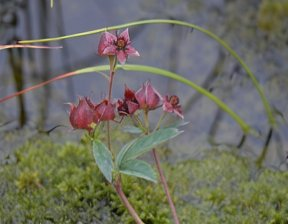 | 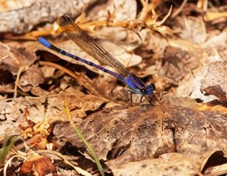 | 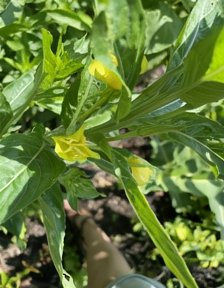 |
|:---:|:---:|:---:|
| Wine-red wetland flowers | Damselfly in leaf litter | Yellow four-petalled flower |

<details><summary>Statistics and the Claude captions</summary>

Rows: 2,823 at 256p. iNaturalist's images are too small to survive the 640p and 896p size checks, so the set exits after 256p.

It entered for one reason: the Claude Opus 5 captions. A sample:

> A damselfly perches on a curled brown leaf in deep leaf litter, shown in tight side profile with its abdomen angled up and back toward the upper left. the long, needle-thin abdomen is metallic violet-blue along its upper surface, darkening to near-black bands at the segment joints, and it ends in a pale blue-tipped segment.

</details>

**d4-megalith** is [`sirus/megalith-10m-5.5k-claude-opus-5-recaptioned`](https://huggingface.co/datasets/sirus/megalith-10m-5.5k-claude-opus-5-recaptioned), a third-party recaption used as published, shown here at its 256p training view.

| 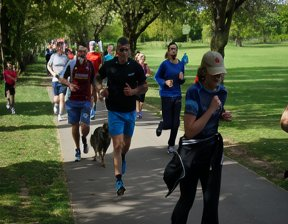 | 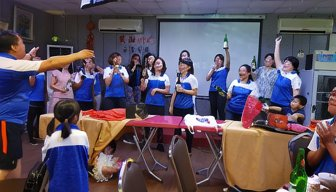 | 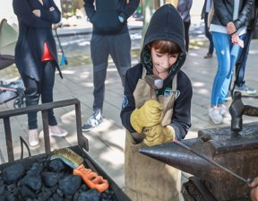 |
|:---:|:---:|:---:|
| Park runners, long lens | Banquet-room group | Boy at the anvil |

<details><summary>Statistics and the Claude captions</summary>

Rows: 5,504 at 256p. Like d4-inat it exits after 256p; megalith content continues inside d4-extra.

Same reason as d4-inat: the Claude Opus 5 captions. A sample:

> A boy in a black hooded sweatshirt and an oversized tan leather apron leans over an anvil with a hammer raised in both gloved hands, his heavy yellow gauntlets closed around the handle and his face set in concentration under the pulled-up hood.

</details>

**d4-extra** pools the concept additions, curated for Inko and unpublished.

| 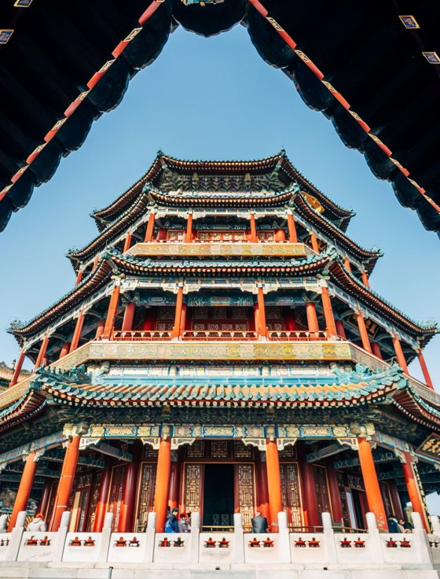 | 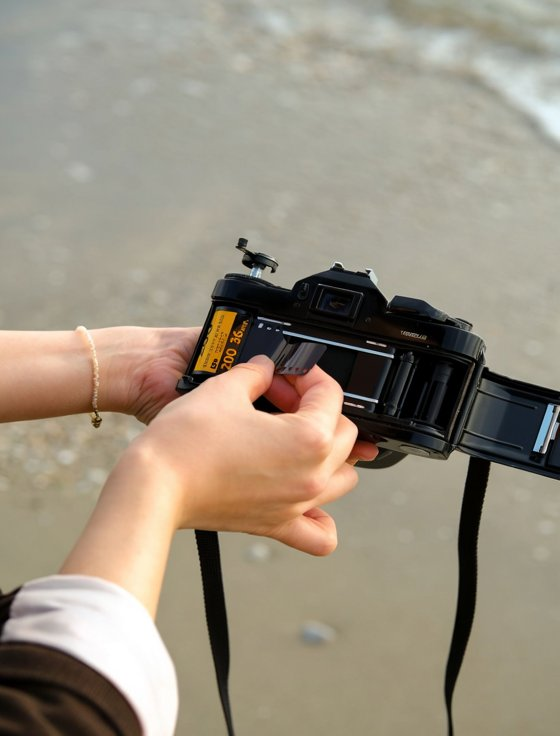 | 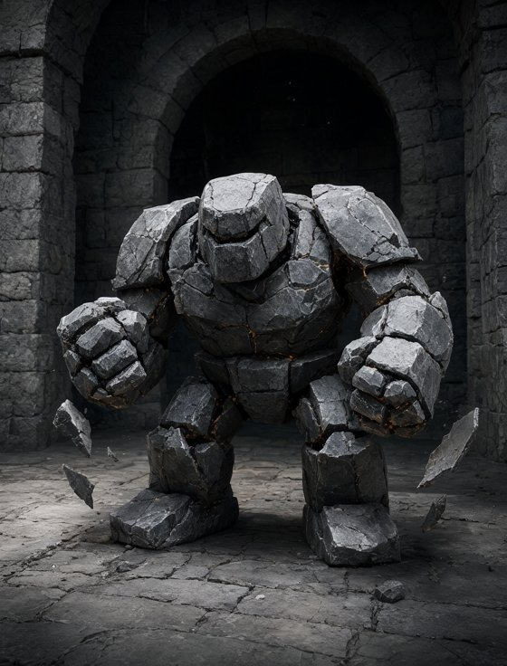 |
|:---:|:---:|:---:|
| Summer Palace pavilion (extra) | Loading film on a beach (extra2) | Granite golem (extra3) |

<details><summary>Statistics and the concept-addition story</summary>

Rows: 49,402 at 256p (extra2 and extra3 only; the d4-extra entry itself was forgotten when the 256p pool was built), then 83,608 at 640p and 79,166 at 896p with all three entries.

At step ~200k, a concept-bench probe used k-means over LAION captions to find concept clusters; a fixed prompt set built from the clusters generated about 2k images. The probe revealed real failures, and the failing concepts mapped directly onto three groups: world wonders, buildings, clothing. The additions were produced by Z-Image, Qwen-Image and Pexels queries. Beyond the probe's three groups they also cover wider picks: limb anatomy, Chinese classical buildings, nature, urban scenes, cosplay, facial-feature details (including animal close-ups) and aesthetic scenes, with megalith folded in. Whether the additions paid off is unknown, because I never ran the comparison. That is a methodological gap, recorded here as one.

One row, its short query-side text against its long recap:

> Stunning view of the summer palace in beijing showcasing traditional chinese architecture.

> A photograph of a tall, multi-tiered chinese pavilion, shot from a low angle looking upward so the building rises steeply toward a clear blue sky. the structure is framed at the top and upper corners by the dark underside of a heavy overhanging roof, its deep black beams and rafters edged with red and gold.

</details>

Most d4 sources are partial takes. Storage limits and network conditions, not sampling design, decided where each cut landed.

### The caption strategy

**Bilingual.** Chinese/English captions are a hard requirement, and have been since the Inko project started. The earlier sets predate the rule, and their captioners predate it too: the first recaptions (wikiart, relaion, vintage) were written by Qwen3-VL-32B and other Qwen/GLM models of that period, with wikiart English-only and relaion bilingual. The recent rounds (d1, d2-museum, pexels) used gemini flash-lite generations (2.5/3.1/3.5/3.8) and deepseek-v4.1-flash. No grand design; the rule was the best available model affordable at the time each batch was produced.

Every Inko-era caption request draws its language deterministically at 50:50 Chinese/English; the specialized Chinese-painting enrichment draws 80% Chinese. A few sources carry small amounts of other languages in their original captions, Japanese and Russian among them. Those rows are kept as they are.

**Length.** The first assembly of the corpus had a systematic gap at the long end: in a pool of roughly one million image rows at the time, the longest caption was under 1024 tokens and fewer than a hundred captions exceeded 256. The pool was enriched with a dedicated long-caption program, on the evidence of the recaptioning literature. [Betker et al. 2023](https://cdn.openai.com/papers/dall-e-3.pdf), the DALL·E 3 report, showed that training on long, densely descriptive captions improves prompt following, with a known tradeoff: the model then underperforms on short user prompts.

The program works in length bands: 256–511 / 512–895 / 896–1280 tokens at 55% / 30% / 15% by default, with the Pexels recipe running its own four-band split that adds a 64–255 band (44.9% / 27.5% / 16.6% / 11.0%). Each request states its target in words or characters, converted at 0.757 words per English token and 1.21 characters per Chinese token. Detail crops and small images are capped at the second-longest band, since a 300px detail cannot support an honest 900-word description.

Five datasets were captioned under the long-favoring contract from the start: d1, d2-museum, d3-pexels, d3-synth-v2 and the d4-extra group. Three received an additional top-up later: d1, d2-wikiart and d2-museum. The third-party recaptions that arrived already long (relaion, vintage, the two Claude-captioned sets) needed no program of their own.

The result on the 256p pool, the corpus at its widest: 3.28M captions across the 15 sources. The per-dataset view shows exactly which sets carry long captions and which stayed short; the pool-wide view shows the cumulative profile against the pre-program gap, when fewer than 100 captions in the whole pool exceeded 256 tokens.

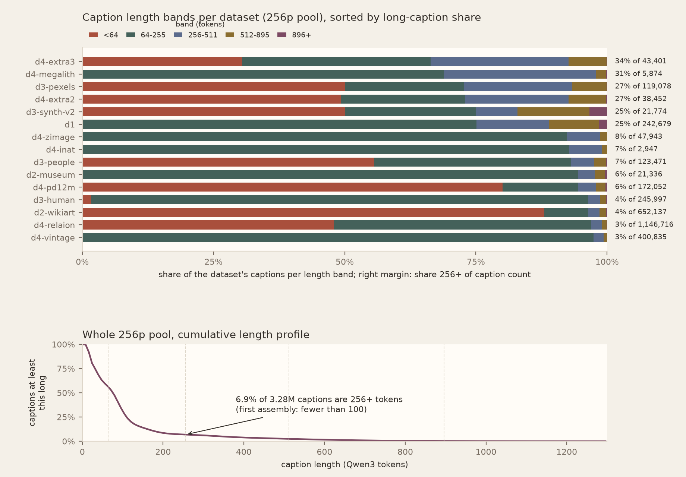

**Style.** Every request carries an exact spec (language, format, length band, domain) under one prompt contract, `cap-v7` in `src/dataset/caption_prompts.py`. The template fixes the register: name the medium early, with its visible evidence (grain, brushstrokes, paper texture); no hedging ("appears", "seems"), no praise, no speculation; transcribe inscriptions in quotation marks; give garments their own names when known (hanfu, kimono, sari); museum metadata may name the artist and title and adds nothing beyond itself.

Prose and structured formats are assigned by deterministic hash, 50:50 and independent of band and source, with the structured format collapsing to a single paragraph in the shortest band. Freezing checks each result against the training text contract for quality and length; rejected text never enters a row's accepted caption list, and the request cache keeps raw responses and model/prompt versions so an identical request is never sent twice. On the training side, text cleaning strips template prefixes such as "The image shows".

### Weights, splits and events

Every draw is three choices in sequence: the sampler picks a source with probability proportional to its configured weight, takes the next row from that source's shuffled cycle (every row appears exactly once per cycle), and selects one caption from the row's list under the caption curriculum. The configured weight of a source is

```text
                       eligible_rows(source) × multiplier(source)
weight(source) = 100 × ───────────────────────────────────────────
                        Σ over the stage's sources of rows × mult
```

A row is eligible when it holds at least one caption of 16 raw tokens or more at 640p, or 50 or more at 896p. The multiplier upweights the two painting domains, the curated people set and the concept additions: ×1.8 for `d1`, `d2-wikiart`, `d2-museum`, `d3-pexels`, ×1.5 for `d4-extra`, ×1.0 for everything else. A source split into shards (`d3-people` a/b, `d4-relaion` p0–p4) contributes its shards' rows separately, so splitting a source does not multiply its weight. The sampler renormalizes at draw time, so only the ratios matter; the config stores them as percentages. The completed 256p stage keeps the weights recorded in its checkpoint's recipe.

Worked example, 896p: d1 holds 90,210 eligible rows; 90,210 × 1.8 = 162,378 against a stage mass of 838,639.8, so d1 gets 19.36% of all draws. Across the stages d1's share runs 8.09% → 9.92% → 19.36%: the corpus leans harder into Chinese painting as resolution rises, because d1 survives the size filters almost intact while the web pools shed most of their rows.

Data events during training:

| Step | What happened | What changed |
|---|---|---|
| 250k | Stop-and-resume | d4-extra2/3 joined |
| 400k | Stop-and-resume | Refreshed d1 and d2-museum entered |
| 450k | 640p stage begins | d4-extra joined, 256p -> 640p |
| 480k | Stop-and-resume | Source weights corrected (d1 7.91% → 9.92%) |
| 570k | 896p stage begins | 640p -> 896p |

---

## Part 2: the post-training pool

RL post-training needs two things from data: prompts to roll out, and a reward to optimize. Both are constrained by the training target. Inko is a painting model, so the reward must cover style fidelity, medium conventions and defect detection, which general-purpose scorers such as HPS or PickScore do not measure; fitting them would pull the model toward general photographic taste. The rollout pool is therefore custom, and the reward is primarily rubric-based VLM judging. Public prompt sets (DrawBench, GenEval, PickScore, HPS) stay held-out: they are general-domain, English-first and photographic, and training on them would contaminate the evaluation.

The prompts are seeded from the pretraining corpus, so RL sharpens abilities the model already has instead of forcing new ones at the risk of ability and diversity. It was produced in one pass and published as [kaupane/inko-rollout-25k](https://huggingface.co/datasets/kaupane/inko-rollout-25k).

### The pool at a glance

- 24,579 rows: 50% image-seeded, 40% caption-seeded and 10% short-band.
- Three partitions: 23,572 train, 505 dev, 502 confirmation. Rows derived from the same seed content or sharing prompt text are kept in the same partition: 21,813 scene groups in train, 463 in dev and 470 in confirmation.
- Each row carries a prompt, a rubric, a seed kind and a length tier (`mid` or `short`); image-seeded rows also embed their reference image, and the production manifest assigns each row an aspect ratio.
- A separate `specialized` split serves the specialized track described in the [post-training chapter](posttraining.md).

At 48 prompts per round the size gives roughly two repeats per 1,000 rounds. Six design axes shape the pool:

- **Style.** A quarter Chinese-painting prompts, a quarter Western-art prompts, and half seeded from captions where style emerges from the caption itself.
- **Subject.** Content images are drawn from all four domains at 25% each, independent of the style branch. The uniform share is deliberate: it creates cross subject-style pairs without ruling out the most natural ones.
- **Language.** Chinese and English, 50/50.
- **Length.** About 90% of prompts are medium (31 to 512 tokens, peaking near 256). About 10% are short (at most 30 tokens).
- **Aspect.** 30% square, 40% landscape, 30% portrait, assigned in the manifest rather than written into the prompt text.
- **Rendered text.** When a prompt asks for rendered text, the exact characters are quoted in the prompt (「瑤臺霧浄」, not "a poetic inscription"), and the rubric checks them verbatim.

Two rows from the finished pool show how the axes combine.

<details><summary>Two rows from the pool: c05088 and i00004, with their rubrics</summary>

**c05088** (caption-seeded, English). A d3 caption rewritten by the prompt writer.

> A portrait of a fashionable woman wearing a floral dress and a hat, posing outdoors with a relaxed expression. She is the sole subject, centered in the frame, standing in a lush outdoor setting. Her dress features a lively floral pattern with soft fabric folds, and her hat is a stylish wide-brimmed sun hat, casting a gentle shadow over part of her face. Her posture is natural and at ease, shoulders relaxed, hands loosely held, weight shifted comfortably. Her expression is calm and unforced, with a subtle smile and a direct but gentle gaze. She appears confident yet approachable, as if pausing during a garden stroll or an outdoor event. The background includes blurred greenery, leaves, and hints of blooming flowers, creating depth while keeping focus on her. Natural daylight falls softly, enhancing skin texture, the print of the dress, and the weave of the hat. The atmosphere is airy, warm, and feminine, with a gentle breeze suggested by slight movement in the dress and hat ribbon. The camera captures her from a medium or three-quarter angle, allowing the floral dress and hat to remain prominent. The color palette comes from the dress and natural surroundings, with fresh greens and soft blossoms balanced against the fabric's floral hues. Lighting wraps gently around her, creating soft highlights and subtle shadows that give the image dimension and immediacy. Overall, it is an outdoor portrait focused on a fashionable woman, her floral dress, her hat, and her relaxed, pleasant mood.

Two of its criteria:

> **Content alignment.** 画面中「fashionable woman」存在且为唯一主体，符合「sole subject」，无其他人物或动物成为主体。(high)
>
> Whether the 「fashionable woman」 in the picture exists and is the sole subject, matching 「sole subject」, with no other person or animal becoming the subject. (high)

> **Style and medium.** 符合户外人像摄影的「medium or three-quarter angle」取景，浅景深使「blurred greenery」虚化，焦点落在人物面部与服装。(high)
>
> Whether the framing matches the 「medium or three-quarter angle」 of outdoor portrait photography, with shallow depth of field blurring the 「blurred greenery」 and the focus falling on the subject's face and clothing. (high)

The rubric's working language is Chinese, quoting the prompt verbatim in 「」 brackets, even when the prompt itself is English. The trailing (high) is the criterion's priority.

**i00004** (image-seeded, Chinese). The style source is an album leaf from a painted catalogue of things; the content source is a photograph of a couple at the seaside.

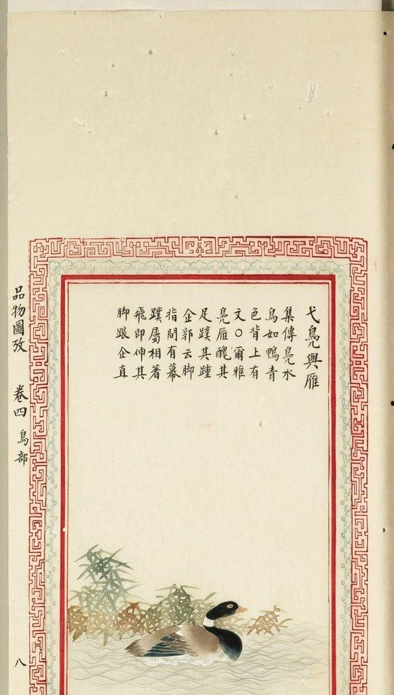

> 绢本工笔淡彩册页，画面四周环以朱红回纹连续边栏，内侧另衬一道淡青绿细线界栏。底质为泛黄的米白绢面，散布细小褐色霉斑与淡淡水渍痕迹。上部大面积留白处竖排楷书题识，自右向左依次为「海濱雙侶」，旁附小字一行「碧波千頃，遠岫如屏，扁舟一葉」。画面下部近岸浅水中，一男一女并肩背立，男子赤膊、着灰蓝短裤，女子着玄色泳衣、长发披肩，二人手臂相挽，一同望向海面。水波以极细匀密的墨线勾出，淡花青与石绿薄染，近岸一道碎白浪花；沙滩上以赭石与淡墨点染散落的珊瑚碎石与海藻。右侧水面浮一叶白色小舟，带低矮篷舱。远景以淡赭石写连绵干燥山峦，轮廓细线勾勒，天际留白，仅以淡蓝细线勾出几缕流云。
>
> A meticulous-brushwork, light-color album leaf on silk. The picture is framed on all four sides by a continuous vermilion key-pattern border, lined inside by an additional thin pale blue-green boundary line. The ground is a yellowed off-white silk surface, scattered with tiny brown mildew spots and faint water-stain marks. In the large blank reserve at the top, a vertical regular-script inscription reads from right to left as 「海濱雙侶」, with one accompanying line of smaller text, 「碧波千頃，遠岫如屏，扁舟一葉」. In the shallow near-shore water at the bottom of the picture, a man and a woman stand side by side, backs to the viewer; the man is bare-chested and wears grey-blue shorts, the woman wears a black swimsuit, her long hair over her shoulders; their arms are linked, and together they face the sea. The waves are outlined in extremely fine, evenly dense ink lines and thinly washed with pale indigo and mineral green, with a strip of broken white surf near the shore; on the beach, scattered coral fragments and seaweed are dotted in ochre and pale ink. On the water at the right floats a small white boat with a low covered cabin. In the distance, continuous dry mountain ridges are painted in pale ochre, their contours drawn in fine lines; the sky is left blank, with only a few strands of drifting cloud outlined in pale blue.

Three of its criteria:

> **Content alignment.** 上部留白处竖排楷书主文「海濱雙侶」四字是否逐字存在且字符序列与原文一致，排列方向为自右向左，无缺字、多字或顺序颠倒。(high)
>
> Whether the four characters of the main vertical regular-script inscription 「海濱雙侶」 in the upper blank reserve exist one by one, whether the character sequence matches the original, and whether the arrangement runs right to left, with no missing characters, extra characters or reversed order. (high)

> **Style and medium.** 与参考图相比，四周朱红回纹连续边栏及内侧淡青绿细线界栏的形制、纹样密度与线宽粗细的接近度。(high)
>
> Compared with the reference image, the closeness of the four-sided continuous vermilion key-pattern border and the inner pale blue-green thin boundary line, in form, pattern density and line weight. (high)

> **Defects.** 已渲染的「海濱雙侶」与「碧波千頃，遠岫如屏，扁舟一葉」字形是否存在错字、伪字、笔画粘连或结构崩坏。(high)
>
> Whether the rendered glyphs of 「海濱雙侶」 and 「碧波千頃，遠岫如屏，扁舟一葉」 contain wrong characters, pseudo-characters, fused strokes or structural collapse. (high)

</details>

### Production pipeline


Rows come from three branches, shown above. The image-seeded branch (50% of the pool) draws a style image from d1 or d2 (half each, manifest crop applied) and a content image from any of the four domains (25% each); the prompt writer, deepseek-v4.1-flash, sees both images and writes the prompt, and the original captions are never shown. The style image is recorded on the row as the reference image. The caption-seeded branch (40%) rewrites a caption drawn from d3 or d4 (half each) with the same model. The short band (10%) is written by the same model conditioned on nothing. The branches stay separate through rubric writing and merge only at the pool.

Every prompt is written to one standard: self-contained, with no references to the seed images, no negations of seed attributes, no imperative openings, and a caption-style register. Compliance is checked mechanically at the quality gates; non-conforming rows are discarded.

The rubric writer is the judge model itself, Qwen3.8-27B with thinking enabled, so the criteria are phrased the way the judge reads them. It reads the prompt alone for caption-seeded and short-band rows, and the prompt plus the reference image for image-seeded rows, where it is explicitly required to ground the Style-and-medium criteria on the reference image rather than on the prompt. The judge was chosen before the pool was produced; the rubric writing followed from that choice.

### The rubric contract

Each rubric has five categories, one-to-one with the reward channels used at training time:

| Category | What it checks | What it excludes |
|---|---|---|
| Content alignment | Existence and correctness of prompt-specified objects, attributes, counts, relations, actions, text | Quality |
| Form and structure | Anatomy, perspective, physical plausibility | Existence |
| Aesthetic composition | Composition, color, light, rhythm | Alignment |
| Style and medium | Technique closeness to the reference or to medium conventions | Content |
| Defects | Artifacts, collapse, extra limbs, watermarks, wrong or pseudo characters, color charts, pegboard textures | |

The taxonomy is inspired by how art is graded: the entrance-exam review logic (modeling, composition, color, technique) and Xie He's Six Laws. The style category is anchored to a reference image because the judge cannot score style in the absolute; comparing two candidates against a shared reference turns the check into a similarity judgment. Criteria are MECE within a row. Each criterion quotes concrete words from the prompt, describes a visible feature and carries a priority, such as the (high) marks in the examples above. The priorities guide the judge, which returns one verdict per category (A wins, B wins, or tie) plus one sentence of rationale; judging per category rather than per criterion greatly reduced scoring time. The category, not the criterion, is the scoring unit.

### Quality gates

Every row passed a mechanical gate before entering the pool: schema validation, language and length checks, and criteria validation, with failures hard-discarded. The pool was then decontaminated against the DrawBench, GenEval, PickScore and HPS prompts by n-gram hard hits plus a multilingual embedding pass for paraphrases; hits are discarded, never rewritten. A final embedding pass removes near-duplicates inside the pool.
