# Data

## Two lessons from weak models

In April 2025 I trained a series of diffusion transformers on WikiArt, [DiT-Wikiart](https://huggingface.co/kaupane/DiT-Wikiart-Large). They were score-matching models that needed 1000 denoising steps to produce an image, mapped tags to images rather than text to images, and generated at a fixed 256px. They were also weak.

Two failures from those models shaped Inko's corpus.

**Anatomy is much harder than style.** The models picked up ink painting and oil painting styles quickly, while bodies and faces broke constantly. Style lives in textures and palettes, and a weak model can fake it. Anatomy requires precise global structure.

**Eastern art is severely underexposed.** The open collections I used leaned overwhelmingly Western. Chinese painting, with its mounting formats, inscriptions, seals, handscrolls and detail crops, barely appeared in them, and almost never had usable captions.

The response was four domains: Chinese painting (d1), Western art (d2), people and anatomy (d3), and general world knowledge (d4). When I later adopted flow matching, these domains became the foundation for a new text-to-image model.

## The corpus and its training timeline

Training runs at progressive resolutions: 256p, then 640p, then 896p. Each stage filters the pools again by image size, crops, decode checks and caption length. The counts below are eligible image rows, so the table shows both the corpus size and the coverage lost as resolution rises.

| Domain | Rows @256p | Rows @640p | Rows @896p |
|---|---:|---:|---:|
| d1 Chinese painting | 91,006 | 90,722 | 90,210 |
| d2 Western art | 224,106 | 146,852 | 36,865 |
| d3 People | 303,177 | 294,527 | 226,070 |
| d4 World knowledge | 1,081,662 | 834,092 | 296,627 |
| **Total** | **1,699,951** | **1,366,193** | **649,772** |

The galleries below are training views: rows decoded from the stored latents, with the same bucket crop the trainer saw. Each resolution uses five aspect buckets (16:9, 4:3, 1:1, 3:4 and 9:16). The dataset introductions distinguish sources curated for Inko, earlier public sets reused by the author, and third-party sets used as published.

Several pools changed during the run. These events provide the timeline for the curation stories that follow.

| Step | What happened | What changed |
|---|---|---|
| 250k | Stop-and-resume | d4-extra2/3 joined |
| 400k | Stop-and-resume | Refreshed d1 and d2-museum entered |
| 450k | 640p stage begins | d4-extra joined, 256p -> 640p |
| 480k | Stop-and-resume | Source weights corrected (d1 7.91% → 9.92%) |
| 570k | 896p stage begins | 640p -> 896p |

## Domain one: Chinese painting

D1 was curated for Inko from five museum collections and published as [`kaupane/chinese-painting-collection`](https://huggingface.co/datasets/kaupane/chinese-painting-collection). Nearly all of its rows survive the resolution filters, giving it an unusually stable presence through 896p.

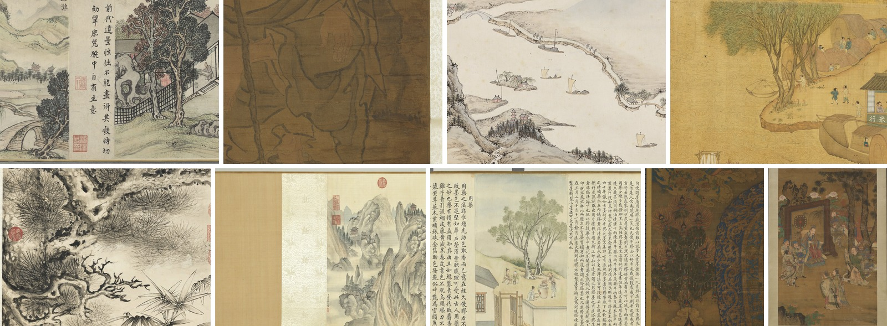

<details><summary>Captions for the training views</summary>

Ordered left to right, top row first.

1. 画面局部展示了一幅设色山水人物手卷的中间片段，呈现出虚实相生的文人画意境。右侧为一处临水庭院，苍劲的老树下立着玲珑的太湖石，篱笆环绕，屋舍之中可见一文士正在案前执笔沉思。中景处有一竖行精心书写的行书题跋，笔力沉着劲健，结构端庄秀润，跋文左侧上下钤有两方红文印章，增添了古雅气息。左侧画面过渡至开阔的远景，隐约可见石拱桥、错落的村舍以及层叠连绵的淡墨远山，水墨青绿交织，设色淡雅清新，笔法细腻工整，营造出宁静幽远、文人隐逸的诗意氛围。

   *English translation:* This detail of the painting shows a middle section of a handscroll of figures in a colored landscape, presenting the literati-painting mood in which the solid and the void give rise to each other. On the right is a waterside courtyard: beneath a vigorous old tree stands an exquisite Taihu rock, a fence surrounds the compound, and inside the house a scholar can be seen at his desk, brush in hand, deep in thought. In the middle ground is a vertical line of carefully written running-script colophon, its strokes steady and forceful, its structure upright and elegantly supple; above and below to the left of the colophon are impressed two red-character seals, adding an air of classical elegance. To the left the picture passes into a broad distant view, where a stone arch bridge, scattered farmhouses and range upon range of pale-ink distant mountains can faintly be made out; ink and green-blue interweave, the coloring is pale, elegant and fresh, the brushwork fine and well ordered, creating a poetic atmosphere of quiet remoteness and literati seclusion.

2. 画面为一幅绢本设色画作的局部特写，聚焦于人物衣褶与手部的细节描绘。画面主体采用粗重而流畅的墨线勾勒出宽大的袍服，线条沉着有力，转折处见顿挫，展现出衣料厚重的质感。手部造型写实，手指细节清晰可见，带有淡淡的肉色晕染。人物右侧手持一根枯木手杖，杖身曲折粗糙，质感逼真。绢地呈现出深沉的褐黄色调，岁月侵蚀带来的横向织纹与自然斑驳清晰可见，右侧可见带有淡雅纹样的浅色绢质边料。整体风格古朴庄重，笔墨精炼，氛围静谧而充满宗教或文人隐逸气息。

   *English translation:* The picture is a close-up detail of a colored painting on silk, focusing on the folds of a figure's garments and on the hands. The main subject is outlined with thick, fluent ink lines that describe a voluminous robe; the lines are steady and forceful, showing pauses and stresses at the turns, and convey the heavy texture of the cloth. The hands are modeled realistically, the details of the fingers clearly visible and tinged with a faint flesh color. At the figure's right side is held a staff of dead wood, its shaft crooked and rough, its texture lifelike. The silk ground shows a deep brownish-yellow tone, and the horizontal weave and natural mottling brought by the erosion of time are clearly visible; on the right can be seen a strip of pale silk border with a subtle pattern. The overall style is antique and solemn, the brushwork distilled, the atmosphere quiet and filled with a religious or literati-reclusive feeling.

3. 画面局部描绘了一幅传统中国山水与江岸行旅图卷，视角开阔，构图呈鸟瞰式的全景布局。江面水波不兴，几艘挂帆的小船与无帆小舟错落其间，或顺流而下，或停泊于岸边。岸线上弯曲曲折，沿岸点缀着疏密有致的树木、错落的民居村舍，以及一座掩映在树丛中的多层塔式建筑。远处的江堤上有数名纤夫正弯腰合力拉纤，生动还原了古代内河航运的生活场景。左侧可见雄伟的山岩断崖，山势险峻，树木丛生。整体设色清雅淡润，以淡墨勾勒山石轮廓并作微弱渲染，屋舍与船帆微染粉红与淡黄，笔触细腻流畅，水墨交融间营造出江南水乡宁静悠远、生机盎然的诗意氛围。

   *English translation:* This detail shows a section of a traditional Chinese handscroll of landscape and riverbank travel, with a broad view and a bird's-eye panoramic composition. The river surface is unstirred by waves; several small boats with sails and small boats without sails are scattered across it, some running downstream, some moored at the bank. The shoreline winds and turns, dotted along its length with well-spaced trees, scattered dwellings and farmhouses, and a multi-storey pagoda-like building screened among the trees. On the distant embankment several trackers are bending together to haul a boat, vividly recreating the life of inland river transport in former times. On the left can be seen a majestic rocky cliff, steep and densely wooded. The coloring throughout is clear, elegant and lightly moistened; pale ink outlines the rocks and gives them faint washes, while the houses and sails are tinted with touches of pink and pale yellow; the brushwork is fine and fluent, and where ink and water blend it creates the peaceful, remote and vividly alive poetic atmosphere of the Jiangnan water country.

4. 画面描绘了一派江南水乡繁荣的市井生活场景。左侧为波涛汹涌的滔滔江水，水纹细密卷曲，极具动感。岸边垂柳依依，枝繁叶茂，树荫下错落有致地排列着几间用竹篾穹顶搭建的船屋或民居，其间隐约可见数名妇女或端坐交谈、或倚门远眺、或在罐边劳作，生动自然。岸上空地与树旁散落着几位形态各异的人物，或躬身劳作、或漫步交谈、或奔跑嬉戏，衣着色彩分明。右下角停泊着一艘巨大的带舱木船，船身局部可见写有“米行”字样的招牌，舱内有人探头张望。整体画面设色古朴典雅，工笔细腻精细，人物动态捕捉生动传神，充分展现了古代市镇河道边的日常风俗与烟火气息。

   *English translation:* The picture depicts a thriving scene of everyday market life in a Jiangnan water town. On the left is a surging, torrential river, its ripples fine and curling, full of movement. On the bank weeping willows sway, lush and leafy; under their shade stand several boat houses or dwellings with domed roofs built of split bamboo, and among them a number of women can faintly be seen, some seated and talking, some leaning at a doorway gazing into the distance, some working beside jars, all vivid and natural. On the open ground by the bank and beside the trees are scattered several figures in various poses, some bending to their work, some strolling and talking, some running in play, their clothes clearly distinguished in color. In the lower right corner a large wooden boat with a cabin is moored; on part of its hull a sign bearing the words "米行" (rice shop) can be seen, and someone is poking his head out of the cabin to look. The coloring of the whole picture is antique and refined, the fine-line brushwork delicate and precise, and the figures' movements captured vividly and expressively, fully displaying the daily customs and the warmth of everyday life along the waterways of an old market town.

5. 画面局部特写了一株盘曲苍劲的古松与下方的翠竹，展现出文人画中常见的岁寒三友题材。苍松干身盘曲，鳞皴斑驳，浓墨与淡墨干湿并用，表现出老干的质感。松针采用散锋细笔细密攒簇，根根挺拔且富有层次，密集处浓重苍茫，疏落处见飞白，极具力量感。右下角衬以挺拔的竹丛，竹叶以劲利的撇笔写出，浓淡相宜，与苍松的沉厚形成动静对比。画面左侧有一枚醒目的圆形朱文印章，右侧边沿亦叠压数枚清代内府鉴藏朱印，包括诸如“嘉庆御览之宝”、“石渠宝笈”、“宝笈三编”、“嘉庆鉴赏”、“三希堂精鉴玺”等玺印，为其流传有序提供了视觉佐证。整幅作品笔墨酣畅淋漓，水墨晕染自然，充满文人雅趣与高洁孤傲的艺术氛围。

   *English translation:* This detail features an ancient pine of gnarled, vigorous form and the green bamboo below it, presenting the theme of the Three Friends of Winter common in literati painting. The old pine's trunk twists and coils, its scaly texture strokes mottled; dark and pale ink are used both dry and wet to convey the texture of the aged trunk. The pine needles are laid down in dense clusters with the brush tip splayed into fine strokes, each upright and richly layered; where dense they are heavy and vast, where sparse the flying-white of the brush shows through, giving a strong sense of power. In the lower right corner a stand of upright bamboo sets them off, its leaves written with crisp, sharp flicking strokes, dark and pale in due measure, forming a contrast of movement against the pine's weighty stillness. On the left of the picture is a striking round seal in red characters, and along the right edge several Qing imperial-collection red seals are superimposed, including seals such as "嘉庆御览之宝" (Treasure for the Jiaqing Emperor's Imperial Inspection), "石渠宝笈" (Precious Box of the Stone Canal), "宝笈三编" (Third Compilation of the Precious Box), "嘉庆鉴赏" (Jiaqing's Connoisseurship) and "三希堂精鉴玺" (Seal of Careful Connoisseurship of the Three Rarities Hall), providing visual evidence of its well-documented transmission. The brushwork of the whole work is ample and unrestrained, the ink washes natural, filling it with literati refinement and an artistic atmosphere of lofty purity and proud solitude.

6. 浅绛设色山水卷局部，带有精细的绫绢装裱和隔水。画面主体为重峦叠嶂的群山，山石用细密的披麻皴结合淡彩晕染，山间云雾缭绕，其间点缀着古松、亭台楼阁与蜿蜒小路，展现出深远幽静的文人山水意境。左侧依次可见素色绢质引首和织有云龙纹的隔水。画幅右上角钤有圆形朱文玺印“嘉庆御览之宝”，左上方钤有长方朱文连珠印“三希堂精鉴玺”与“宜子孙”，画面下端近边界处有题款“江贯道碑春斋”及方形朱文印“臣江贯道”。整幅作品设色清雅淡润，笔墨工致细密，兼具北方山水的雄奇与南方山水的秀润，装裱考究，古意盎然。

   *English translation:* A detail of a landscape handscroll in pale-ochre coloring, with fine silk-damask mounting and a divider. The main subject is range upon range of mountains; the rocks are rendered with fine hemp-fiber texture strokes combined with pale color washes, clouds and mist wreathe among the peaks, and ancient pines, pavilions and towers and winding paths are dotted through them, displaying the deep and quiet mood of literati landscape. On the left can be seen in turn the plain silk frontispiece and a divider woven with a cloud-and-dragon pattern. In the upper right corner of the painting is impressed a round red-character seal, "嘉庆御览之宝" (Treasure for the Jiaqing Emperor's Imperial Inspection); at the upper left are a rectangular red-character linked-pearl seal, "三希堂精鉴玺" (Seal of Careful Connoisseurship of the Three Rarities Hall), and "宜子孙" (May It Benefit Sons and Grandsons); near the lower edge of the picture is an inscription, "江贯道碑春斋" (Jiang Guandao bei chun zhai), together with a square red-character seal, "臣江贯道" (Your Servant Jiang Guandao). The coloring of the whole work is clear, elegant and lightly moistened, the brushwork meticulous and dense, combining the grandeur of northern landscape with the lush softness of southern landscape; the mounting is carefully done and the air of antiquity abundant.

7. 此幅中国画手卷段落画面呈现制墨工艺场景，兼有详细的制墨技艺说明文字。画面中央为一处院落外景，左侧有房屋屋檐与雕花窗棂，前设木栅栏门。院外土坡上立有两株枝叶繁茂的大树，树干苍劲，地面敷以浅色晕染。树下及空地上分布着几位古代工匠人物：左侧两人似在研磨搅拌，右侧一人蹲在炉火旁扇风点火，另一人正手持工具操作大缸进行蒸煮。画面左右两侧及上方均布满工整的直行繁体楷书文字，详细记载了制墨用胶、用药之法以及配方禁忌。整幅作品笔墨细腻，工笔人物生动自然，设色淡雅清新，图文并茂地记录了传统制墨的手工业生产流程。

   *English translation:* This section of a Chinese painting handscroll shows a scene of ink-cake making, together with detailed explanatory text on the craft. At the center is the exterior of a courtyard; on the left are the eaves of a house and carved window lattices, with a wooden fence gate in front. On the earthen slope outside the courtyard stand two large trees with luxuriant branches and leaves, their trunks vigorous, the ground laid with pale washes. Under the trees and on the open ground are several figures of ancient craftsmen: the two on the left appear to be grinding and stirring, one on the right squats by the stove fanning the fire, and another is operating a large vat with a tool in his hand, steaming or boiling something. The left and right sides and the upper part of the picture are filled with neat vertical columns of traditional-character regular-script text, recording in detail the methods of using glue and medicinal ingredients in ink making and the prohibitions of the formula. The brushwork of the whole work is fine, the gongbi figures lively and natural, the coloring pale, elegant and fresh, recording the traditional handicraft process of ink making in both text and picture.

8. 画面局部呈现了一件古代佛教绘画的细节，主要描绘了复杂庄严的背光与带有装饰华盖的树木或宝伞形制。右侧为巨大的环形头光或身光，底色深沉，其上遍布细腻繁复的金线缠枝纹样与卷草纹，边缘环绕火焰纹饰，内部隐约可见精细的轮状或宝瓶等吉祥图案。左侧绘有一株造型奇特的植物或宝树，其枝叶层层叠叠呈扇形展开，挂满由各色珍珠、璎珞、宝珠串成的华丽珠串，树冠顶部及各层错落有致地安坐着微型的化佛或金刚造像，周围火焰背光环绕。上方及下方点缀着瑞云与炽燃的火焰纹。整体设色古朴深沉，以石青、石绿、朱红等矿物颜料与描金勾勒结合，呈现出神秘肃穆的宗教艺术氛围。

   *English translation:* This detail of an ancient Buddhist painting mainly depicts an intricate, solemn halo and a tree or precious-parasol form with a decorative canopy. On the right is a huge circular head halo or body halo on a deep-toned ground, covered all over with delicate, elaborate gold-line scrolling-vine patterns and curling-grass motifs, edged with flame ornament, within which fine auspicious patterns such as wheels or precious vases can faintly be seen. On the left is drawn a plant or precious tree of strange form, its branches and leaves layered and spreading in a fan, hung all over with gorgeous strings of beads made of pearls of various colors, necklaces and precious beads; at the top of the crown and at each tier sit miniature transformation Buddhas or vajra figures in well-arranged fashion, surrounded by flaming halos. Above and below are dotted auspicious clouds and blazing flame patterns. The coloring throughout is antique and deep, combining mineral pigments such as azurite, malachite and vermilion with gold outlining, presenting a mysterious and solemn atmosphere of religious art.

9. 这是一幅中国传统人物故事画，画面描绘了一场宫廷或仙界会见场景。中心人物端坐于屏风前，周围有多位文官、侍从与武将恭敬侍立或跪拜。背景为松树、奇石与牡丹花卉，构图严谨，人物造型生动细腻，衣纹线条流畅，设色古朴沉稳，呈现出精致的工笔重彩风格。

   *English translation:* This is a traditional Chinese narrative figure painting, depicting a scene of a meeting in a court or a celestial realm. The central figure sits upright before a screen, surrounded by several civil officials, attendants and military officers standing respectfully or kneeling in salute. The background consists of pine trees, fantastic rocks and peony flowers; the composition is rigorous, the figures vivid and finely modeled, the lines of the garment folds fluent, the coloring antique and steady, presenting a refined gongbi heavy-color style.

</details>

Museum scans often contain more than the artwork: mounting, rulers, color charts, collection labels and the desk beneath the scroll. A caption about the painting does not make those objects disappear from the image. Training on an uncropped scan therefore teaches the model that they belong to the artwork. The cropping below keeps the mounting and seals, which belong to the work's presentation, and removes everything else.

The first cropping round removed obvious borders mechanically, and two Gemini rounds handled the survivors. At pretraining step ~340k, a full inspection of the published dataset found color charts that all three rounds had missed. The VLMs had often described the plausible painting while overlooking the artifact beside it.

A fourth round used deepseek-v4.1-flash over the full collection and added long captions. D2-museum received the same caption refresh. Both datasets entered training at 400k. Until then, every surviving chart had been implicitly presented to the model as part of the artwork.

|  |  |
|:---:|:---:|
| The original scan contains a color chart, gray scale, collection label and pegboard desk. | The training crop removes the artifacts while retaining the mounting and seals. 唐李思訓江帆樓閣 軸 (*River Sails and Lofty Buildings*). |

<details><summary>Statistics, sources and a long-caption example</summary>

Rows: 91,006 at 256p, 90,722 at 640p, 90,210 at 896p.

The five sources are the National Palace Museum (Taiwan), the Met's Chinese collection, the Princeton University Art Museum, the Smithsonian's Freer|Sackler galleries (the National Museum of Asian Art), and the Art Institute of Chicago. Each row carries the cropped image, original scan, crop box, artifact labels, artwork metadata, OCR'd inscriptions and bilingual captions. Full, mounted and detail views are retained; rolled and junk images are dropped.

A full-view row illustrates the level of detail targeted by the long-caption program:


> *Long caption:* A Chinese ink and colour painting on silk, mounted as a hanging scroll, showing a mountain valley in late autumn or early winter with a scholar seated in a pavilion among red and green trees. The silk ground is visible throughout as a fine, even weave with a warm brownish tone, darkened and stained in places, and the brushwork sits on the surface of the silk rather than sinking into it, so that the outlines of the mountains and the texture strokes remain crisp and legible. The mountains are built up in pale ochre and light brown washes, laid down in broad, dilute passes that leave soft edges where one wash meets the next, and the ridges and slopes are defined by long, thin ink outlines that follow the contours of the rock forms. Inside those outlines, the rock faces are modelled with dry, sparse texture strokes, short fibrous lines that run down the slopes and gather at the crests, and with small clusters of dark ink dots placed along the ridge lines and at the shoulders of the peaks to suggest scrub and loose stone. The ink tonality is restrained: the outlines and dots are the darkest passages, while the washes stay light and transparent, so the mountains read as pale silhouettes against the slightly darker silk.
>
> The composition is dense and layered rather than sparse. The mountains rise in overlapping folds that fill the upper two-thirds of the picture, their outlines interlocking so that each ridge sits behind the one in front, and the empty space between the peaks is not left blank but filled with pale wash, so there is no true void in the upper section. Depth is built by stacking these folds and by the gradual lightening of the washes toward the top of the scroll, where the distant slopes are almost the colour of the bare silk. In the upper left corner, a section of a walled compound is visible: a brown-roofed building with a tiled roof, a white wall running along a ridge, and a gateway, all drawn with fine, even outlines and flat colour, with no texture strokes inside the roofs. Below and to the right of the compound, a band of dark green conifers descends the slope, painted with dense, wet ink and short vertical strokes that give the trees a solid, almost black mass against the pale mountain behind them.
>
> In the lower left, a cluster of deciduous trees stands out in strong red and orange, painted with flat, opaque colour rather than wash, the leaves rendered as small rounded dabs and the branches drawn with dark, angular ink lines that fork and taper. Among them, a few bare branches are drawn with thin, dry ink, and a scattering of small dark dots along the upper slopes suggests distant trees or shrubs. Below the red trees, a group of green trees with rounded, layered foliage fills the lower left corner, painted in a denser, more saturated green than the conifers above, with the individual leaf clusters outlined and then filled with colour. A low roof with a grey-green tiled surface sits among these green trees at the very bottom left, partly cut by the edge of the picture.
>
> At the centre of the lower half, a pavilion with a hipped roof stands on a low platform, its roof tiles painted in flat grey-green, its walls and lattice windows drawn with fine, straight ink lines, and its eaves supported by thin wooden posts. Inside the pavilion, a figure sits at a low desk or table, facing left, wearing a pale robe with a dark collar and a dark cap, the face and hands rendered with a few fine lines and no shading. A second, smaller roof, also grey-green, sits just below and to the left of the pavilion, partly hidden by the green trees. To the right of the pavilion, a large red tree rises, its leaves painted in the same flat red as the trees on the left, and behind it the mountain slope continues upward with the same pale wash and dry texture strokes. On the right side of the picture, a narrow path or ledge runs diagonally down the slope, marked by a line of small dark dots and a short section of wooden fence drawn with thin ink lines, and the slope below it is left almost bare, with only a few scattered dots and a faint wash. In the upper left, near the edge of the silk, a small vertical inscription in dark ink sits above the walled compound, and a red seal is stamped below it; the characters are too faint to read. The overall treatment is meticulous in the architecture and figures, with even outlines and flat colour, and freer in the mountains and trees, where the brush is used more loosely and the washes are allowed to bleed into one another.

Each training row keeps at most three captions: Chinese, English and long. Missing captions and image files are excluded before training.

</details>

## Domain two: Western art

Western art comes from a broad WikiArt recaption and smaller, more targeted museum pulls. Their coverage changes differently across resolutions: WikiArt supplies most of the rows at 256p, but size filtering removes most of them before 896p.

**d2-wikiart** is [`kaupane/wikiart-captions`](https://huggingface.co/datasets/kaupane/wikiart-captions), an earlier WikiArt recaption reused as-is. It is English-only because it predates Inko's bilingual rule.

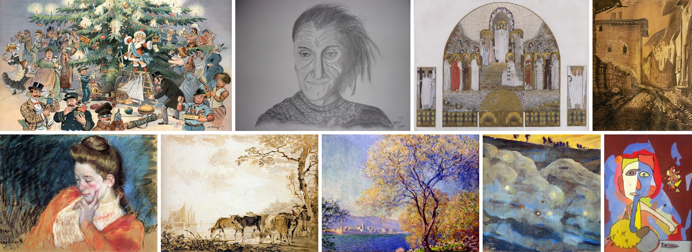

<details><summary>Captions for the training views</summary>

Ordered left to right, top row first.

1. Puck’s christmas tree , by samuel ehrhart , art nouveau (modern) style

2. Retrato de antonin artaud , by martin pereira , portrait , impressionism style

3. Am steinhof church, mosaic design for the main altar , by koloman moser , 1905 , design , art nouveau (modern) style , holy places, religious item, convent, arch, religious institute

4. Pérouges, rue des rondes, le grenier à sel , by fernand combes , 1919 , cityscape , impressionism style , medieval architecture

5. Portrait of a young woman , by mary cassatt , 1898 , portrait , impressionism style , female portraits, lady, nose, cheek

6. Landscape with cows , by jacob van strij , animal painting , neoclassicism style , animals, cows, herd, bovine, wildlife

7. Antibes seen from the salis gardens 01 , by claude monet , 1888 , landscape , impressionism style , from the series antibes , tree, nature, natural landscape, sky, bank, woody plant

8. Sparks (i) , by mikalojus ciurlionis , 1906 , landscape , symbolism style , from the series sparks , fields and plains, sky

9. Visage aux hachoirs , by gaston chaissac , portrait , art brut style

</details>

<details><summary>Statistics and the caption variants</summary>

Rows: 214,041 at 256p, 138,125 at 640p, 33,222 at 896p.

Each artwork carries up to four caption types: the original WikiArt tag caption plus three Qwen-written variants (direct, spatial, reverse). One row, two of its texts:

> Still life with figs , by pierre auguste renoir , still life , impressionism style , still life photography

> A painting of figs and pomegranates. the painting is done in oil. the colors used are mostly earth tones. the figs are dark green and light green. there is a white cloth under the figs.

The tag caption carries the artist and style labels; the written variants carry the visual description. A later top-up added a fifth, longer set of texts.

</details>

**d2-museum** was pulled directly from museum APIs for Inko and is not uploaded to HF. It received long captions in the same 400k refresh as d1.

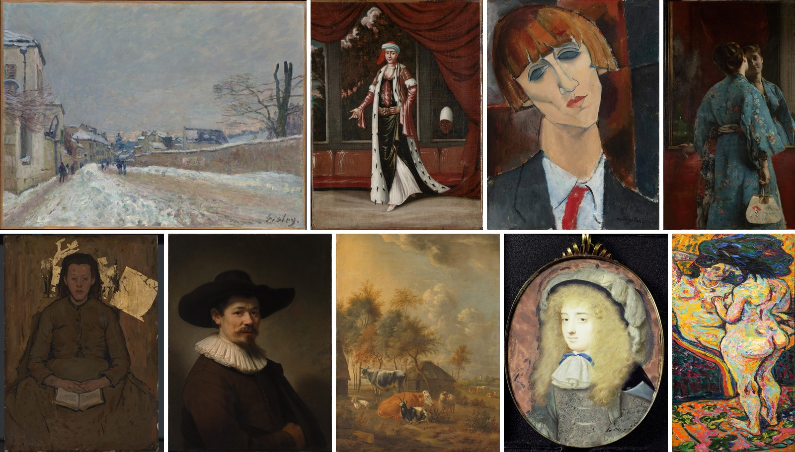

<details><summary>Captions for the training views</summary>

Ordered left to right, top row first.

1. 这是一幅表现冬日街景的西洋油画作品，画面呈现一派被积雪覆盖的欧洲小镇风光。构图采用透视法则，左侧为带有阴影的建筑立面，右侧为矮墙和枯树，积雪斑驳的街道向远方延伸，几位行人在雪中漫步。整体色调偏向冷灰与淡蓝，天空呈现阴郁的多云质感，远处隐约透出微弱的暖色霞光，笔触轻盈灵动，具有典型印象派捕捉光影与气象变化的风格特征。

   *English translation:* This is a Western oil painting depicting a winter street scene, showing a view of a European town covered in snow. The composition follows the rules of perspective: on the left is a building facade in shadow, on the right a low wall and bare trees, and the snow-patched street stretches into the distance, where several pedestrians stroll through the snow. The overall tone leans toward cold gray and pale blue; the sky has a gloomy, cloudy quality, and a faint warm glow of sunset is dimly visible in the distance. The brushwork is light and lively, carrying the typical Impressionist characteristic of capturing light, shadow, and weather changes.

2. 一幅描绘身着传统奥斯曼服饰人物的油画肖像。画面中央站立一位头缠头巾、身披毛皮长袍的贵族男性，他身体微侧，右手向前伸展，姿态优雅庄重。内部衣物层次丰富，带有深绿色的长裙与白色长裤，腰间系有精致的饰带。背景为室内场景，厚重的深红色帷幔高高垂挂于右侧，窗外隐约可见树木与天空。窗下设有红色长椅，右侧窗框阴影中隐约探出一个面部特异的人物头像，增添了一丝神秘的戏剧感。整体色调偏暗，色彩对比鲜明，笔触细腻而写实，展现出古典肖像画的庄重氛围与异域风情。

   *English translation:* An oil portrait of a figure in traditional Ottoman dress. Standing at the center of the picture is an aristocratic man with a turban wrapped around his head and a fur robe draped over his shoulders; his body is slightly turned, his right hand extended forward, his posture elegant and dignified. The garments beneath are richly layered, with a dark green long skirt and white trousers, and a fine sash tied at the waist. The background is an interior scene: heavy dark red drapery hangs high on the right, and trees and sky are faintly visible beyond the window. Below the window stands a red bench, and from the shadow of the window frame on the right a head with distinctive features peeks out, adding a touch of mysterious theatricality. The overall tonality is dark with vivid color contrasts, and the brushwork is delicate and realistic, conveying the solemn atmosphere and exotic flavor of classical portraiture.

3. 画面呈现了一幅表现主义风格的肖像油画，描绘了一位留着短刘花发型、面容清瘦的人物。人物头部微微倾斜，五官经过拉长处理，修长的脖颈占据了画面的显着位置。眼睑低垂呈幽暗的灰蓝色，鼻梁挺直而纤细，微抿的红唇带有一丝神秘感。人物身着深色西装外套，内搭白色衬衫并系着醒目的红色领带，色彩对比强烈。背景由大面积的深褐色与墨绿色几何块面交织而成，呈现出粗粝厚重的质感，凸显了人物内敛而忧郁的现代主义气质。画面右下角隐约可见模糊的署名痕迹，整体笔触凝重饱满，洋溢着独特的人文关怀与表现力。

   *English translation:* The picture presents an Expressionist portrait painting of a lean-faced figure with a short bangs hairstyle. The head tilts slightly, the facial features are elongated, and a slender neck occupies a prominent position in the composition. The eyelids droop in a dim gray-blue, the bridge of the nose is straight and slender, and slightly pursed red lips carry a hint of mystery. The figure wears a dark suit jacket over a white shirt with a striking red necktie, creating strong color contrast. The background is woven from large geometric planes of dark brown and dark green, with a coarse, heavy texture that sets off the figure's reserved and melancholic modernist temperament. A blurred trace of a signature is faintly visible in the lower right corner; the brushwork throughout is weighty and full, brimming with a distinctive humanistic care and expressiveness.

4. 这是一幅西方油画作品，描绘了一位身着蓝色印花和服的女性背影，她正对着一面镜子端详自己的面容。画面构图巧妙，运用了镜像反射效果增加空间感。人物衣着色彩艳丽，手持一把精致的折扇，背景布满深红色的垂幔，整体笔触细腻写实，展现出唯美的西方学院派或印象主义风格。

   *English translation:* This is a Western oil painting depicting the back of a woman wearing a blue patterned kimono as she examines her face in a mirror. The composition is ingenious, using the effect of mirror reflection to increase the sense of space. The figure's clothing is brightly colored, and she holds an exquisite folding fan; the background is covered with deep red hanging drapery. The brushwork throughout is delicate and realistic, displaying an aesthetic Western academic or Impressionist style.

5. 一位年轻女子端坐于画面中央，低头闭目，双手交叠在膝上摊开的微型书本上，神情内敛且虔诚。她身着暗棕色简朴长袖上衣与厚重裙装，轮廓线深沉有力，衣褶处理厚重自然。背景为深沉的土褐色调，隐约带有粗粝的笔触肌理，人物头顶上方及右侧错落有致地贴有几块亮丽的金箔碎片，与幽暗的背景形成强烈对比，增添了神秘而神圣的宗教氛围。整体色调偏向沉郁的暗色系，笔法表现力强，结合了传统写实与现代装饰性元素，呈现出一种静谧、内省且略带象征意味的精神风貌。

   *English translation:* A young woman sits upright at the center of the picture, head bowed and eyes closed, her hands folded over a miniature book spread open on her lap, her expression inward and devout. She wears a plain dark brown long-sleeved top and a heavy skirt; the contour lines are deep and forceful, and the folds of the clothing are handled with weight and naturalness. The background is a deep earth-brown tone, faintly carrying a coarse brushwork texture. Above the figure's head and to the right, several pieces of bright gold leaf are applied in a well-spaced arrangement, forming a strong contrast with the dim background and adding a mysterious and sacred religious atmosphere. The overall palette leans toward a somber dark range; the brushwork is highly expressive, combining traditional realism with modern decorative elements to present a quiet, introspective spiritual character with a slight symbolic overtone.

6. 这是一幅西洋油画肖像作品，描绘了一位头戴黑色宽边礼帽、身穿深色上衣并佩戴白色精致蕾丝领饰的中年男子。画面采用经典的明暗对比技法（chiaroscuro），深沉暗淡的背景突出了人物面部与领饰的立体感。人物神态自然，目光直视前方，细腻的笔触和柔和的光影处理展现了典型的巴洛克艺术风格。

   *English translation:* This is a Western oil portrait of a middle-aged man wearing a black wide-brimmed hat, a dark jacket, and a fine white lace collar. The painting uses the classic technique of light and dark contrast (chiaroscuro); the deep, dim background emphasizes the three-dimensionality of the man's face and collar. His expression is natural and his gaze looks straight ahead. The delicate brushwork and soft handling of light and shadow display a typical Baroque art style.

7. 一幅宁静的田园风景油画，描绘了乡村农舍旁的牲畜群落。画面中景左侧立着一头黑白相间的斑驳奶牛，右侧有一头红棕色卧牛及一只黑白花色的山羊，前景与中景还点缀着几只羊只。背景左侧为带有草顶的简陋农舍，四周环绕着秋意渐浓的树木，枝叶呈现出黄褐与深绿交织的色调。远处隐约可见平缓的田野、河流以及一座小型村镇的轮廓。天空占据了画面的上半部分，大片柔和的云层在金黄色夕阳或微光映衬下显得格外辽阔，整体色调偏向温暖的棕褐色与柔和的金黄，营造出一种恬淡、古朴且充满十七世纪荷兰黄金时代乡村风情的艺术氛围。

   *English translation:* A tranquil pastoral landscape painting depicting a group of livestock beside a rural farmhouse. In the left middle ground stands a mottled black-and-white dairy cow; on the right are a red-brown reclining cow and a black-and-white patterned goat, and several more sheep are dotted through the foreground and middle ground. On the left of the background is a humble farmhouse with a thatched roof, surrounded by trees deepening into autumn, their leaves showing interwoven tones of yellow-brown and dark green. In the distance the gentle outlines of fields, a river, and a small village are faintly visible. The sky occupies the upper half of the picture, where broad, soft clouds look especially vast against the golden sunset or faint light. The overall palette leans toward warm brown and soft gold, creating an artistic atmosphere that is serene and rustic and full of the rural flavor of the seventeenth-century Dutch Golden Age.

8. 椭圆形微型肖像画描绘了一位拥有卷曲金发的年轻贵族女性或长发男子，其面容柔和清秀，眼神平静地望向观者。人物身着饰有精致蕾丝花边的白色领饰与带有华丽暗纹的灰色外衣，领口处系着亮眼的蓝色缎带蝴蝶结，头戴饰有羽毛或蓬松织物的夸张宽檐帽。背景呈现斑驳的红褐色调，带有类似金属箔底或做旧晕染的细腻纹理。整体技法细腻工整，通过精细的笔触展现出衣物材质的质感与发丝的蓬松感。微型画被镶嵌在精致的金属挂坠框架内，顶部带有挂环，营造出一种私密而典雅的巴洛克或洛可可时期肖像艺术氛围。

   *English translation:* An oval miniature portrait depicts a young aristocratic woman, or a long-haired man, with curly blond hair, a soft and refined face, and eyes calmly regarding the viewer. The figure wears a white collar trimmed with fine lace and a gray outer garment with ornate subtle patterns, with a striking blue ribbon bow tied at the neck, and an exaggerated wide-brimmed hat decorated with feathers or fluffy fabric. The background shows a mottled red-brown tone with a fine texture resembling a metal-foil ground or an aged wash. The technique throughout is delicate and meticulous, using refined brushwork to convey the texture of the clothing materials and the fluffiness of the hair. The miniature is set in an elaborate metal pendant frame with a hanging loop at the top, creating an intimate and elegant atmosphere of Baroque or Rococo portrait art.

9. 这是一幅采用西方表现主义风格的油画作品，画面描绘了两位女性人体。构图呈垂直长幅，左侧人物半卧，右侧人物背立，姿态亲密。色彩极为浓烈跳跃，大量使用厚涂法（impasto），以黄色、橙色、红色与蓝绿色交织出强烈的视觉张力和光影流动感。

   *English translation:* This is an oil painting in the Western Expressionist style, depicting two female nudes. The composition is a tall vertical format: the figure on the left half-reclines, and the figure on the right stands with her back turned, in an intimate pose. The colors are extremely intense and vibrant, with extensive use of impasto; yellow, orange, red, and blue-green interweave to create strong visual tension and a sense of flowing light and shadow.

</details>

<details><summary>Statistics and the five sub-sources</summary>

Rows: 10,065 at 256p, 8,727 at 640p, 3,643 at 896p.

The five sub-sources are the Met's Impressionist and portrait collections, the National Gallery of Art's Impressionist and full-paintings catalogs, and the Rijksmuseum. The sets exist just how the museum APIs handed out data: one artist returns hundreds of works, another a handful, and the corpus inherits that skew.

</details>

ArtBench-10 should have joined them. I captioned and published [`kaupane/artbench-captions`](https://huggingface.co/datasets/kaupane/artbench-captions), then forgot to include it in training.

## Domain three: People

D3 addresses the anatomy lesson through faces, full bodies, motion and regional dress. Its curation problems vary by source: broken links and watermarks in an existing people set, overlap with other web pools, and failed anatomy or garments in synthetic images.

**d3-human** is [`kaupane/human-recaption`](https://huggingface.co/datasets/kaupane/human-recaption), a recaption of [`OpenFace-CQUPT/HumanCaption-HQ-311K`](https://huggingface.co/datasets/OpenFace-CQUPT/HumanCaption-HQ-311K) produced for Inko. The new captions replace the original English text.

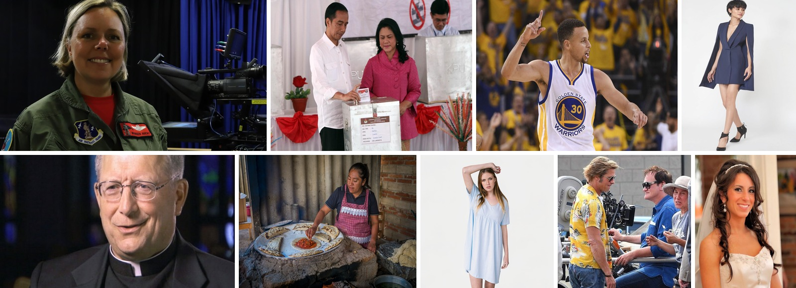

<details><summary>Captions for the training views</summary>

Ordered left to right, top row first.

1. 一位金发女性面带微笑，身穿绿色飞行夹克，内搭红色t恤，夹克上有徽章和臂章。她直视镜头，姿态端正，背景为蓝色幕布和专业摄影设备，场景似在演播室或拍摄现场。整体光线柔和，人物表情自然亲切。

   *English translation:* A blonde woman smiles, wearing a green flight jacket over a red t-shirt, with badges and arm patches on the jacket. She looks straight at the camera with an upright posture, and the background is a blue backdrop and professional photography equipment; the scene appears to be a studio or a filming location. The overall lighting is soft, and the person's expression is natural and friendly.

2. 画面中三位人物，前景左侧为一位穿白色衬衫、黑色长裤的男性，黑发，面部表情专注，正将选票投入透明投票箱；中间是一位穿粉色外套、深色内搭的女性，黑发微卷，神情严肃，双手扶着投票箱；右侧背景中可见一位穿白衬衫的男性，低头注视。背景为浅色幕布，有红色装饰物和花卉点缀，氛围庄重。整体场景似为选举投票现场。

   *English translation:* Three people appear in the frame. In the left foreground is a man in a white shirt and black trousers, with black hair and a focused expression, placing a ballot into a transparent ballot box; in the middle is a woman in a pink coat over a dark inner top, with slightly curly black hair and a serious expression, her hands resting on the ballot box; in the background on the right, a man in a white shirt can be seen, looking down. The background is a light-colored backdrop with red decorations and floral accents, and the atmosphere is solemn. The overall scene appears to be an election polling site.

3. 一名身穿金州勇士队30号球衣的男性篮球运动员，肤色较深，短发，面部表情专注且充满激情，右手指向天空，左臂微张，身体略微侧转，呈现出庆祝或激励的姿态。他身着白色主调、黄色与蓝色边饰的球衣，胸前印有球队标志和号码。背景是模糊的观众席，多数观众穿着黄色服装，营造出热烈的比赛氛围。灯光聚焦于球员，使主体突出。

   *English translation:* A male basketball player wearing a Golden State Warriors No. 30 jersey, with dark skin and short hair, his facial expression focused and full of passion, his right hand pointing to the sky, his left arm slightly spread, his body turned slightly to the side, presenting a celebratory or encouraging posture. He wears a jersey mainly white with yellow and blue trim, with the team logo and number printed on the chest. The background is a blurred spectator stand, most of the spectators wearing yellow clothing, creating an enthusiastic game atmosphere. The lighting focuses on the player, making the subject stand out.

4. 一位短发女性，肤色较深，面部表情自然，正侧身站立并微微低头。她身穿一件深蓝色无袖连衣裙，配有宽大披肩式袖子，裙摆不对称，长度在膝盖以上。脚穿黑色高跟鞋，鞋带系于脚踝。背景为纯白色，光线均匀柔和，突出人物轮廓与服装细节。

   *English translation:* A woman with short hair and darker skin, with a natural facial expression, stands turned to the side and slightly lowers her head. She wears a dark blue sleeveless dress with wide shawl-style sleeves, an asymmetrical hem, and a length above the knees. She wears black high heels, with straps tied at the ankles. The background is pure white, and the lighting is even and soft, highlighting the person's outline and the details of the clothing.

5. 一位戴眼镜的年长男性，身穿黑色神职人员服装，领口有白色镶边。他面带温和微笑，目光直视镜头，表情从容亲切。背景模糊，可见彩色玻璃窗的光影，暗示可能在教堂或宗教场所内。整体构图聚焦于人物面部，光线柔和均匀，营造出庄重而平和的氛围。

   *English translation:* An older man wearing glasses, dressed in black clerical clothing with white trim at the collar. He has a gentle smile, looks straight at the camera, and his expression is calm and kind. The background is blurred, and the light and shadow of a stained-glass window can be seen, suggesting he may be inside a church or a religious venue. The overall composition focuses on the person's face, and the lighting is soft and even, creating a solemn and peaceful atmosphere.

6. 一位中年女性正在户外的传统土灶旁制作食物。她穿着深色t恤和粉白格子围裙，头发向后梳起，面带专注的神情，右手正将红色酱料涂抹在圆形面饼上。背景是砖墙和金属波纹板，环境简朴自然。灶台由石头和泥土搭建，旁边放着未使用的面团和锅具，整体场景充满生活气息。

   *English translation:* A middle-aged woman is making food beside a traditional earthen stove outdoors. She wears a dark t-shirt and a pink-and-white checkered apron, her hair combed back, and she has a focused expression as her right hand spreads red sauce onto a round flatbread. The background is a brick wall and corrugated metal sheets, and the setting is simple and natural. The stove is built of stone and earth, with unused dough and pots placed beside it, and the whole scene is full of the flavor of everyday life.

7. 一位金发女性，面部特征清晰，眼神直视镜头，表情自然。她身穿一件浅蓝色短袖连衣裙，裙子有褶皱设计，长度及膝。她左手抬起轻触头发，右手自然下垂，姿态放松。背景为纯白色，无其他装饰或元素，整体画面简洁干净。

   *English translation:* A blonde woman with clear facial features, looking straight at the camera with a natural expression. She wears a light blue short-sleeved dress with a pleated design, knee-length. Her left hand is raised, lightly touching her hair, and her right hand hangs naturally; her posture is relaxed. The background is pure white, with no other decorations or elements, and the overall image is simple and clean.

8. 画面中三位人物在户外拍摄现场。左侧男子金发，戴墨镜，穿黄色花卉图案短袖衬衫和牛仔裤，身体微倾，正与中间男子交谈；中间男子黑发，戴墨镜，穿蓝色长袖衬衫，坐在摄影机控制台前，手部动作显示他在操作设备，表情专注；右侧女子戴浅色宽檐帽，穿浅灰色上衣，侧身站立，面带微笑注视前方。背景是灰色砖墙和部分影视设备，整体氛围为专业电影拍摄现场。

   *English translation:* Three people are at an outdoor filming site. The man on the left has blonde hair, wears sunglasses, a short-sleeved shirt with a yellow floral pattern, and jeans; his body leans slightly as he talks with the man in the middle. The man in the middle has black hair, wears sunglasses and a blue long-sleeved shirt, and sits in front of a camera control console; the movement of his hands shows he is operating the equipment, and his expression is focused. The woman on the right wears a light-colored wide-brimmed hat and a light gray top; she stands turned to the side, smiling and looking ahead. The background is a gray brick wall and some film and television equipment, and the overall atmosphere is that of a professional film set.

9. 一位面带微笑的年轻新娘，有着深棕色卷发和精致的妆容，佩戴着头饰和耳环。她身穿白色无肩带婚纱，肩部有蕾丝装饰，背景为室内环境，有砖墙和柔和光线。她的表情自然愉悦，目光直视镜头，姿态端庄优雅。

   *English translation:* A smiling young bride with dark brown curly hair and delicate makeup, wearing a headpiece and earrings. She wears a white strapless wedding dress with lace decoration at the shoulders, and the background is an indoor setting with a brick wall and soft light. Her expression is natural and joyful, she looks straight at the camera, and her posture is poised and elegant.

</details>

<details><summary>Statistics and curation</summary>

Rows: 118,393 at 256p, 114,100 at 640p, 109,715 at 896p.

The original set ships English-only captions, while its images have broken links and watermarks. Retrieval kept rows with usable RGB images that passed the watermark and source-score checks.

</details>

**d3-people** draws on [`opendiffusionai/cc12m-a_woman`](https://huggingface.co/datasets/opendiffusionai/cc12m-a_woman), a manually filtered third-party set used as published. The training pool also mixes in Pexels images, pulled with search terms distinct from the other Pexels-sourced sets, so the resulting set is not entirely centered on people. CC12M was chosen to avoid colliding with the LAION, PD12M and Pexels material already in the corpus.

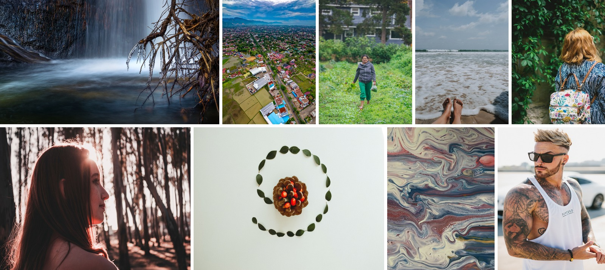

<details><summary>Captions for the training views</summary>

Ordered left to right, top row first.

1. The image captures a waterfall cascading down a dark rock face. the water appears to be icy, as evidenced by the icicles that are hanging from some branches in the foreground. these icicles are made of ice and are located on the right side of the image.

2. The image presents an aerial view of a city, with houses and buildings scattered throughout. the city is surrounded by green fields and roads that weave through the landscape. in the distance, mountains can be seen, adding depth to the scene. the sky above is filled with clouds, casting a soft light over the entire scene. there are no discernible actions taking place, and no specific individuals or objects are highlighted. the focus is on the overall layout of the city and its surroundings.

3. A woman is walking through a lush, green garden, holding a bunch of leafy greens in her hand.

4. The image captures a serene beach scene with the ocean's frothy waves crashing onto the shore. a person is lying on their stomach, with their feet visible in the foreground. the perspective of the photo suggests that it was taken from someone who is lying down, as evidenced by the close-up view of the feet and the foamy water surrounding them.

5. The image captures a woman with long, red hair wearing glasses. she is seen from behind, looking away from the camera. the woman is wearing a blue and white striped sweater and has a floral backpack on her back.

6. The image captures a young woman with long, brown hair standing in a forest. she is facing away from the camera, looking towards the right side of the frame. the sunlight filters through the trees behind her, casting a warm glow on her hair and creating a hazy effect.

7. The image displays a decorative arrangement of leaves and berries on a white surface. the arrangement consists of a circular pattern of green leaves surrounding a central cluster of red berries. the berries are arranged in the center, with some protruding outwards from the circle of leaves. the entire arrangement is set against a plain white background. there is no discernible action taking place within the scene, and all elements appear to be stationary.

8. The image displays a close-up view of a painting that features swirling patterns. the colors in the artwork are predominantly white, blue, and red. the brushstrokes create an abstract design with a sense of motion, as if the paint is swirling across the canvas. there's no specific object or figure to identify; instead, the focus is on the fluidity of the paint and the interplay of colors.

9. A man with tattoos on his arms and a white tank top with sunglasses is standing outdoors, with a car in the background.

</details>

<details><summary>Statistics and captions</summary>

Rows: 114,345 at 256p, 109,990 at 640p, 56,824 at 896p.

Captions stay as published: one English text per row.

</details>

**d3-pexels** is [`kaupane/pexels-people-captions`](https://huggingface.co/datasets/kaupane/pexels-people-captions), curated for Inko through queries targeting full bodies, sports, dance, regional dress and labor scenes.

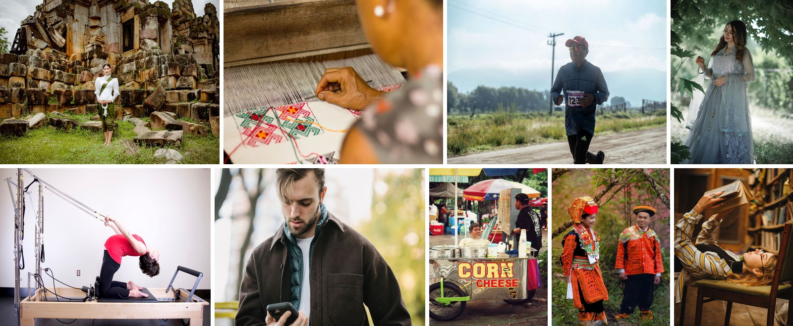

<details><summary>Captions for the training views</summary>

Ordered left to right, top row first.

1. A woman in traditional attire poses by ancient ruins, exuding cultural elegance.

2. A skilled woman weaver crafting intricate patterns on a textile loom using traditional techniques.

3. Man jogging in an outdoor race wearing a bib number in a scenic rural area.

4. A graceful woman in a beautiful traditional gown amidst lush greenery, embodying elegance.

5. Woman performing stretching exercise on a pilates reformer in a brightly lit gym environment.

6. Young bearded man in casual clothes receiving text message on smartphone while standing on street

7. Authentic street food scene with corn cheese vendor cart under colorful umbrellas.

8. Couple in vibrant traditional attire posing in a lush outdoor setting.

9. Woman lying on a chair, reading a book in a cozy library environment.

</details>

<details><summary>Statistics and captions</summary>

Rows: 59,546 at 256p, 59,544 at 640p, 59,531 at 896p. Pexels images are large, so nearly every row survives every stage filter.

Each row keeps its short search-side text and adds a long recap. One row, both:

> *Search-side text:* African woman in colorful traditional attire posing outdoors on a sunny day.

> *Long recap:* A photograph of a young black woman standing outdoors against a blurred background of grey-green foliage and pale sky. she wears a halter top and high-waisted bottoms in a bright kente-style print of yellow, red, green, and blue geometric bands, with a metal ring at the centre of the top.

</details>

**d3-synth-v2** was generated for Inko with a focus on traditional clothing of minority ethnic groups. It is unpublished.

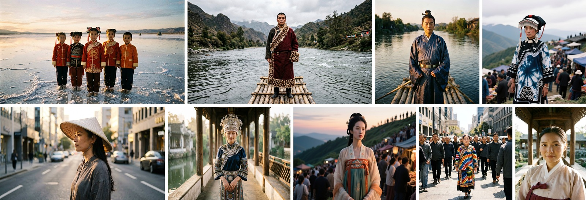

<details><summary>Captions for the training views</summary>

Ordered left to right, top row first.

1. A film-grain group photograph of a chinese child in new clothes for a festival, standing at the edge of a salt lake, side light at dawn.

2. 以一位藏族康巴男性穿镶豹皮边藏袍为主体的全身手机抓拍人像照片，站在漓江的竹筏上，阴天的柔光。

   *English translation:* A full-body candid phone portrait photograph featuring a Tibetan Khampa man wearing a Tibetan robe with leopard-fur trim, standing on a bamboo raft on the Li River, soft light on an overcast day.

3. A film-grain photograph of a han chinese man in a ming-style feiyu robe, waist-up composition, standing on a bamboo raft on the li river, side light at dawn.

4. 拍摄一位白族女性穿扎染服饰的135 胶片颗粒半身人像照片，站在山顶集市的人群中，阴天的柔光。

   *English translation:* A 135 film-grain half-body portrait photograph taken of a Bai woman wearing tie-dyed clothing, standing among the crowd at a hilltop market, soft light on an overcast day.

5. 以一位越南女性穿奥黛戴斗笠为主体的侧脸中画幅数码人像照片，站在现代城市的街道上，清晨的侧光。

   *English translation:* A medium-format digital portrait photograph in profile, featuring a Vietnamese woman wearing an ao dai and a conical hat, standing on a street in a modern city, side light in the early morning.

6. 中画幅数码人像照片：七分身，一位瑶族女性穿盘王印纹样服饰，站在江南园林的回廊里，清晨的侧光。

   *English translation:* A medium-format digital portrait photograph: three-quarter-length composition, a Yao woman wearing clothing with Panwang seal patterns, standing in the corridor of a Jiangnan garden, side light in the early morning.

7. A medium-format photograph of a han chinese woman in a tang-style chest-high ruqun, waist-up composition, standing among the crowd at a hilltop market, backlight at dusk.

8. 站在现代城市的街道上的手机抓拍照片，画面里是群像：一位白族女性穿扎染服饰，正午的硬光。

   *English translation:* A candid phone photograph taken on a street in a modern city, showing a group scene: a Bai woman wearing tie-dyed clothing, hard light at noon.

9. 135 胶片颗粒人像照片：面部特写，一位韩国女性穿韩服，站在江南园林的回廊里，清晨的侧光。

   *English translation:* A 135 film-grain portrait photograph: facial close-up, a Korean woman wearing hanbok, standing in the corridor of a Jiangnan garden, side light in the early morning.

</details>

Qwen-Image generated the first 20k images, but review found broken anatomy and inaccurate garments in exactly the subject the set was meant to teach. Manual filtering reduced the pool to about 10k images, which became `v2`.

The generation prompts could not double as faithful training captions because they described the requested image rather than the image actually produced. A separate recaption round therefore described the generated result. The pair below makes that difference concrete: the requested Uyghur atlas silk and doppa cap are absent from the caption's description of the generated clothing.

<details><summary>Statistics and the generation-prompt/recaption pair</summary>

Rows: 10,893 at 256p and 640p. The images are 640p material, so there is nothing to train on at 896p.

> *Generation prompt:* A three-quarter-length portrait of a uyghur woman in an atlas-silk dress and a doppa cap, standing on a bamboo raft on the li river, side light at dawn, film-grain.

> *Caption:* A photograph shows a woman of east asian descent standing on a bamboo raft in a river. she wears a dark, ornate robe with a high collar and a diagonal closure. the fabric of the robe is a rich brocade, featuring intricate patterns in shades of deep blue, purple, gold, and rust.

</details>

## Domain four: World knowledge

D4 supplies objects, architecture, nature, scenes and the long tail of concepts outside art, accounting for about 64% of the 256p rows. It is a patchwork of partial takes: storage limits and download conditions determined how much of several large sources entered the corpus. Its share falls to about 46% at 896p as the resolution filters remove small web images.

**d4-relaion** is [`kaupane/relaion-art-recap-zh`](https://huggingface.co/datasets/kaupane/relaion-art-recap-zh), an earlier bilingual recaption of the relaion art subset, reused as-is. The subset's "art" is aesthetic-filtered general web imagery rather than fine art, which is why it sits in this domain.

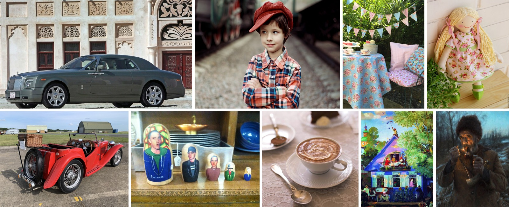

<details><summary>Captions for the training views</summary>

Ordered left to right, top row first.

1. 一辆深灰色劳斯莱斯幻影轿车停在一座具有传统阿拉伯建筑风格的建筑物前，车身线条流畅，车头标志性“欢庆女神”立标清晰可见，多辐式合金轮毂设计精致。背景建筑墙面呈米白色，装饰有精美的几何与花卉纹样窗格及拱形门廊，右侧门扇为深红色木质雕花门，整体画面呈现古典与奢华并存的视觉效果。

   *English translation:* A dark grey Rolls-Royce Phantom sedan is parked in front of a building in a traditional Arabic architectural style; the car's bodywork has smooth lines, the iconic “Spirit of Ecstasy” hood ornament at the front is clearly visible, and the multi-spoke alloy wheels are finely designed. The walls of the building in the background are cream white, decorated with exquisite geometric and floral patterned window screens and an arched portico; the door leaf on the right is a dark red carved wooden door, and the overall picture presents a visual effect in which the classical and the luxurious coexist.

2. 一个戴着红色帽子的男孩站在铁轨旁，身穿红蓝格子衬衫，双臂交叉于胸前，目光望向一侧。背景是模糊的旧式火车车厢，地面铺满碎石，整体画面色调温暖，具有复古胶片质感。

   *English translation:* A boy wearing a red hat stands beside the railway tracks, in a red-and-blue plaid shirt, his arms crossed over his chest, his gaze directed to one side. The background is a blurred old-style train carriage, the ground is covered with gravel, and the overall picture has a warm tone and a vintage film texture.

3. 户外绿意盎然的庭院中，一张铺着浅蓝色碎花桌布的圆桌旁摆放着精致茶点与瓷器，桌上点缀着蛋糕、茶杯与银质托盘；一旁是金属框架的椅子，坐垫为粉色格纹与蓝底花卉图案拼接，上方悬挂着粉蓝相间的三角旗串，营造出温馨浪漫的英式下午茶氛围。

   *English translation:* In a lush green outdoor courtyard, beside a round table spread with a light blue floral tablecloth are arranged delicate tea snacks and porcelain; the table is dotted with cakes, teacups and a silver tray; to one side stands a metal-framed chair whose cushion is pieced together from a pink check pattern and a blue-ground floral pattern, and above hangs a string of pink-and-blue bunting, creating a warm and romantic English afternoon tea atmosphere.

4. 一个手工布艺娃娃坐在木质台面上，背景是浅色砖墙。娃娃有着金色长发，扎成两条辫子并系着粉色蝴蝶结，面部为简洁的刺绣表情，带着微笑。她身穿一件白色底、印有粉色玫瑰花图案的连衣裙，领口和袖口饰有绿色边，脚穿绿色小鞋。娃娃身旁有一丛绿植，整体风格温馨可爱，充满手作质感。

   *English translation:* A handmade cloth doll sits on a wooden countertop, with a light-coloured brick wall in the background. The doll has long blonde hair tied into two braids and fastened with pink bows, and a simple embroidered expression on its face, wearing a smile. She wears a dress with a white ground printed with a pink rose pattern, with green trim on the neckline and cuffs, and green little shoes on her feet. Beside the doll is a clump of green plants; the overall style is warm and cute, full of a handmade texture.

5. 一辆鲜红色的复古敞篷跑车停在开阔的机场停机坪上，车身线条流畅，配有外露式轮毂和复古风格的辐条轮圈。车尾装有备用轮胎，后保险杠上挂有牌照。车内可见方向盘与仪表盘，车顶已收起。背景中是草地、远处的飞机库和几辆车辆，天空晴朗，光线明亮，整体呈现出经典汽车在户外展示的场景。

   *English translation:* A bright red vintage convertible sports car is parked on an open airport apron; the bodywork has smooth lines and is fitted with exposed wheels and vintage-style spoked rims. A spare tyre is mounted at the rear, and a licence plate hangs on the rear bumper. Inside the car the steering wheel and the dashboard are visible, and the roof has been folded down. In the background are grass, distant aircraft hangars and several vehicles; the sky is clear and the light is bright, presenting as a whole a scene of a classic car on display outdoors.

6. 木质桌面上摆放着一组五层俄罗斯套娃，每个娃娃上都绘制了不同人物的肖像，其中最左侧较大的套娃画有“eminem”字样及对应形象，其余四层依次缩小，分别绘有穿着西装、戴帽子或围巾的人物。背景中可见叠放的盘子、金色碗状器皿和蓝色陶瓷制品，整体场景呈现复古陈列风格。

   *English translation:* On a wooden tabletop is arranged a set of five nested Russian dolls, each painted with a portrait of a different figure; the larger doll on the far left bears the word “eminem” and the corresponding figure, while the remaining four tiers shrink in turn, each painted with a figure wearing a suit, a hat or a scarf. In the background can be seen stacked plates, a gold bowl-shaped vessel and blue ceramic ware; the whole scene presents a vintage display style.

7. 一杯热巧克力盛在白色陶瓷杯中，表面撒有可可粉并绘有漩涡状拉花，置于带有纹理边缘的碟子上。旁边斜放一把银质小勺，背景中可见另一盘甜点与匙，整体场景铺着蕾丝桌布，光线柔和，营造出温馨雅致的下午茶氛围。

   *English translation:* A cup of hot chocolate is served in a white ceramic cup, dusted with cocoa powder on the surface and decorated with a swirl of latte art, and set on a saucer with a textured rim. Beside it a small silver spoon lies at an angle, another plate of dessert and a spoon are visible in the background, and the whole scene is laid on a lace tablecloth; the light is soft, creating a warm and elegant afternoon tea atmosphere.

8. 一座色彩鲜艳的蓝紫色尖顶小屋，屋顶上有人举着旗帜，窗台和阳台摆满鲜花与装饰物，窗内可见人物活动。房屋前有木栅栏，周围聚集多人，有的在交谈，有的在闲坐。背景是绿树成荫的乡村景象，远处可见一座带有彩色洋葱头穹顶的教堂建筑。画面整体色调明亮，笔触粗犷，充满生活气息与童话般的浪漫氛围。

   *English translation:* A brightly coloured blue-purple cottage with a pointed roof, on which a person holds up a flag; the windowsills and balconies are filled with flowers and ornaments, and figures can be seen moving inside the windows. In front of the house there is a wooden fence, and many people are gathered around, some talking, some sitting idly. The background is a tree-shaded countryside scene, and in the distance a church building with a colourful onion dome can be seen. The overall tone of the picture is bright and the brushwork bold, full of the flavour of everyday life and a fairy-tale romantic atmosphere.

9. 一位蓄着浓密胡须、头戴毛皮帽的男子身处雪地，身着厚实外套，双手各持一物——左手握着烟斗，右手点燃打火机，火焰映亮其面部与衣领。背景是模糊的冬日树林与灰蓝色天空，整体色调偏冷，画风写实而略带油画质感，光影聚焦于人物动作与表情，营造出寒冷环境中专注的瞬间。

   *English translation:* A man with a thick beard and a fur hat stands in the snow, wearing a heavy coat and holding one object in each hand — a pipe in his left hand, a lit lighter in his right, the flame illuminating his face and collar. The background is a blurred winter woodland and a grey-blue sky; the overall tone is cool, the style realistic with a slight oil-painting texture, and the light and shadow focus on the man's action and expression, creating a moment of concentration in a cold environment.

</details>

<details><summary>Statistics and what the recaption bought</summary>

Rows: 621,773 at 256p (the largest single pool in the corpus), 391,406 at 640p and 162,170 at 896p.

The take was partial, with an acceptable broken-link rate. The spelling "relaion" comes from upstream. One row shows the change from original alt-text to the new Chinese caption:

> *Alt text:* Lamborghini countach

> *New caption:* 一辆鲜红色的兰博基尼countach跑车停在户外柏油路面上，车门呈标志性的向上开启的剪刀门姿态。车身线条锐利，前脸配有方形大灯和宽大的进气格栅，侧面可见经典的侧翼通风口和多辐条轮毂。

> *English translation:* A bright red Lamborghini Countach supercar parked outdoors on asphalt, its doors raised in the iconic upward-opening scissor-door position. The bodywork is sharply angular, with a front end square headlights and a wide air intake; along the side are the classic side air vents and multi-spoke wheels.

</details>

**d4-pd12m** is [`Spawning/PD12M`](https://huggingface.co/datasets/Spawning/PD12M), a third-party set used as published, taken partially because the full download was too slow.

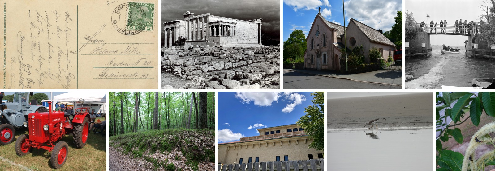

<details><summary>Captions for the training views</summary>

Ordered left to right, top row first.

1. An old postcard with a green stamp on it. the postcard has text written on it, likely indicating that it is a german postcard.

2. The erechtheion temple on the acropolis hill in athens, greece. it is a black and white image with a few rocks on the ground in front of the temple, and a few trees in the background. the sky is visible at the top of the image.

3. An old church with a red car parked in front of it, surrounded by houses, street poles, street lights, grills, plants, trees and a sky with clouds in the background.

4. A group of people standing on top of a bridge over a body of water, with a boat in the foreground. the boat is filled with people, and the bridge is surrounded by trees on either side. the sky is visible in the background.

5. A red tractor parked in a field next to other tractors, with people sitting on chairs to the right of it. in the background, there are trees and a clear blue sky.

6. A dirt road winding through a forest of tall trees, with lush green grass and dried leaves scattered along the path. the sky is visible in the background, adding to the peaceful atmosphere of the scene.

7. A large brick building with a wooden fence in front of it, surrounded by trees on the right side and a sky with clouds in the background.

8. A greater yellowlegs (tringa totanus) walking on the beach, its reflection visible in the water below.

9. A close up of a white flower on a tree, with a few insects on it. in the background, there is a road and grass on the ground.

</details>

<details><summary>Statistics and captions</summary>

Rows: 162,307 at 256p, 155,299 at 640p, 38,875 at 896p.

Captions stay as published: single English texts on the short side.

</details>

**d4-vintage** is [`kaupane/vintage-photography-captions`](https://huggingface.co/datasets/kaupane/vintage-photography-captions), an earlier caption set reused because it was already prepared.

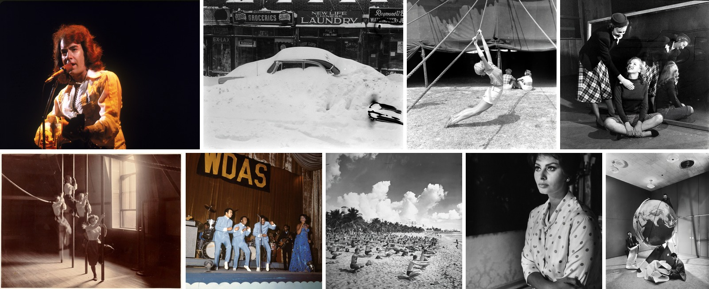

<details><summary>Captions for the training views</summary>

Ordered left to right, top row first.

1. 一位红发男性歌手在舞台上表演，身着浅黄色衬衫和深色马甲，正对着麦克风演唱。背景为纯黑色，舞台灯光从正面偏上方照射，突出人物轮廓并营造聚光灯效果。光线使衬衫表面呈现柔和的纹理与光泽，头发蓬松自然。人物位于画面中央偏左，麦克风支架从左侧延伸至其嘴部，整体构图聚焦于表演者，氛围集中而富有现场感。

   *English translation:* A red-haired male singer performs on stage, wearing a pale yellow shirt and a dark vest, singing directly into a microphone. The background is pure black; the stage lighting shines from the front and slightly above, highlighting the figure's outline and creating a spotlight effect. The light gives the shirt's surface a soft texture and sheen, and the hair is voluminous and natural. The figure is positioned slightly left of centre, the microphone stand extends from the left to his mouth, and the overall composition focuses on the performer, with a concentrated atmosphere rich in the feel of a live performance.

2. 一张黑白照片，展示了一场猛烈暴风雪后的街景。一辆老式汽车被厚厚的积雪几乎完全掩埋，仅车顶和部分车身露出。背景是几家店铺的招牌，包括‘groceries’和‘laundry’，显示了城市街道的日常氛围。积雪表面粗糙不平，呈现出被风塑造的纹理，与光滑的汽车外壳形成对比。画面整体光线均匀，但因雪量巨大而显得压抑，营造出冬日严寒的静谧感。

   *English translation:* A black-and-white photograph showing a street scene after a fierce blizzard. An old-fashioned car is almost completely buried by thick snow, with only the roof and part of the body showing. In the background are the signs of several shops, including ‘groceries’ and ‘laundry’, showing the everyday atmosphere of a city street. The surface of the snow is rough and uneven, presenting wind-shaped textures that contrast with the smooth shell of the car. The light across the picture is even, but because of the enormous quantity of snow it feels oppressive, creating the quiet of a bitterly cold winter.

3. 黑白照片中，一名女杂技演员在马戏团帐篷外做吊索表演，她身着短裤与无袖上衣，身体舒展，双手抓绳，双腿伸直。背景是巨大的帆布帐篷，阴影投射在地面，远处有两人坐着休息。光线从一侧照来，形成明显的光影对比，突显人物肌肉线条与动态美感。草地纹理清晰可见，整体构图平衡，充满复古马戏氛围。

   *English translation:* In the black-and-white photograph, a female acrobat performs on a rope outside a circus tent; she wears shorts and a sleeveless top, her body extended, both hands gripping the rope, her legs straight. The background is a huge canvas tent, shadows are cast on the ground, and in the distance two people sit resting. The light comes from one side, forming a pronounced contrast of light and shadow that brings out the muscle lines of the figure and the beauty of the movement. The texture of the grass is clearly visible, the overall composition is balanced, and the picture is full of a vintage circus atmosphere.

4. 黑白影像中，一名身穿格子裙和深色外套的女性正俯身按住一名盘腿坐在地上的金发女性，后者仰头大笑。背景中另有一名女性在镜前弯腰，镜面反射出她的身影。整体光线集中在前景人物，营造戏剧性对比；地面为木质纹理，衣物褶皱清晰可见，空间层次分明。

   *English translation:* In the black-and-white image, a woman in a plaid skirt and a dark coat is bending over and holding down a blonde woman sitting cross-legged on the floor, who is laughing with her head tilted back. In the background another woman bends over in front of a mirror, and her figure is reflected in the mirror surface. The light is concentrated on the foreground figures, creating a dramatic contrast; the floor has a wooden texture, the folds of the clothing are clearly visible, and the spatial layers are distinct.

5. 这张复古风格的黑白照片捕捉了室内体操训练场景，三名身着浅色运动服的年轻女性在垂直吊环上进行训练。前景中一名女孩单手抓环、身体悬空，姿态专注；背景中两人分别在不同高度摆动或悬挂，动作动态模糊，暗示运动瞬间。光线从右侧大窗户斜射入内，形成明暗对比强烈的光影效果，地板与墙壁纹理清晰可见。整体构图利用纵深感和人物错落分布营造空间层次，画面色调统一为灰阶，质感温润，充满怀旧氛围。

   *English translation:* This vintage-style black-and-white photograph captures an indoor gymnastics training scene: three young women in light-coloured sportswear train on vertical rings. In the foreground a girl grips a ring with one hand, her body suspended, her posture focused; in the background two others swing or hang at different heights, their movements blurred with motion, suggesting the moment of exercise. Light slants in from the large window on the right, creating a light-and-shadow effect with strong contrast, and the texture of the floor and walls is clearly visible. The overall composition uses the sense of depth and the staggered distribution of the figures to create spatial layers; the picture's tone is unified in greyscale, the texture is warm and soft, and it is full of a nostalgic atmosphere.

6. 这张彩色照片捕捉了一个舞台表演场景，四位穿着浅蓝色西装的男性歌手并排站在舞台中央，正在热情演唱和表演。右侧一位身穿深蓝色长裙的女性歌手手持麦克风，与他们同台演出。背景是带有金色字母“wdas”的黑色横幅，舞台后方可见鼓组和吉他手等乐队成员。灯光聚焦在表演者身上，营造出温暖而明亮的氛围。整体色调以蓝色系为主，搭配暖色灯光，呈现出复古音乐演出的质感。舞台前方有波浪形装饰边框，增添了视觉层次感。

   *English translation:* This colour photograph captures a stage performance scene: four male singers in light blue suits stand side by side in the centre of the stage, singing and performing with enthusiasm. On the right, a female singer in a dark blue gown holds a microphone and performs on the same stage with them. The background is a black banner bearing the gold letters “wdas”, and behind the stage band members such as a drum kit and a guitarist can be seen. The lighting focuses on the performers, creating a warm and bright atmosphere. The overall tone is dominated by blues, paired with warm lighting, presenting the texture of a vintage music performance. In front of the stage there is a wavy decorative border, adding a sense of visual depth.

7. 黑白照片中，众多人们在沙滩上集体做瑜伽或伸展运动，背景是茂密的棕榈树和远处的建筑物。天空布满蓬松的云朵，光线明亮但柔和，整体氛围宁静而有序。沙地纹理清晰可见，人物排列密集但分布均匀，前景与背景层次分明。画面传达出一种复古的休闲度假气息。

   *English translation:* In the black-and-white photograph, many people are doing yoga or stretching together on the beach, with dense palm trees and distant buildings in the background. The sky is filled with fluffy clouds, the light is bright but soft, and the overall atmosphere is calm and orderly. The texture of the sand is clearly visible, the figures are densely arranged but evenly distributed, and the foreground and background are distinctly layered. The picture conveys a vintage air of leisure and holiday.

8. 这是一张黑白肖像照，主角是一位穿着波点衬衫的女性，她侧身坐着，双臂交叉于胸前，目光投向画面左侧。背景昏暗，仅人物面部和上半身被柔和光线照亮，形成强烈的明暗对比。她的发型利落，耳饰隐约可见，衬衫纹理清晰。整体构图简洁，聚焦于人物神态与姿态，营造出沉静而富有戏剧性的氛围。

   *English translation:* This is a black-and-white portrait photograph. The subject is a woman wearing a polka-dot shirt; she sits turned to the side, her arms crossed over her chest, her gaze directed to the left of the picture. The background is dim, and only the woman's face and upper body are lit by soft light, forming a strong contrast of light and dark. Her hairstyle is neat, her earrings are faintly visible, and the texture of the shirt is clear. The overall composition is simple, focusing on the subject's expression and posture, creating a quiet and dramatic atmosphere.

9. 黑白照片中，一个巨大的地球仪占据房间中央，几位人物围绕其活动。左侧一人跪坐于地，手持纸张；右侧一人俯身整理散落的纸张；背景墙上投影出阴影，天花板有嵌入式灯具。整体空间现代简约，墙面与地板材质呈现哑光质感，光影对比强烈，营造出科学展览或设计展示的氛围。

   *English translation:* In the black-and-white photograph, a huge globe occupies the centre of the room, and several figures move around it. On the left, one person kneels on the floor holding papers; on the right, another person bends over to gather the scattered papers; shadows are projected on the back wall, and the ceiling has recessed light fixtures. The overall space is modern and minimal, the materials of the walls and floor have a matte texture, and the contrast of light and shadow is strong, creating the atmosphere of a science exhibition or a design display.

</details>

<details><summary>Statistics and captions</summary>

Rows: 194,625 at 256p, 158,531 at 640p, 16,416 at 896p. Vintage prints are small; the 896p size check keeps only about one row in twelve.

The captions transcribe visible text, which is especially useful for historical photographs.

</details>

**d4-zimage** is [`kaupane/z-image-turbo-gen`](https://huggingface.co/datasets/kaupane/z-image-turbo-gen), an earlier Z-Image-Turbo generation set reused as-is.

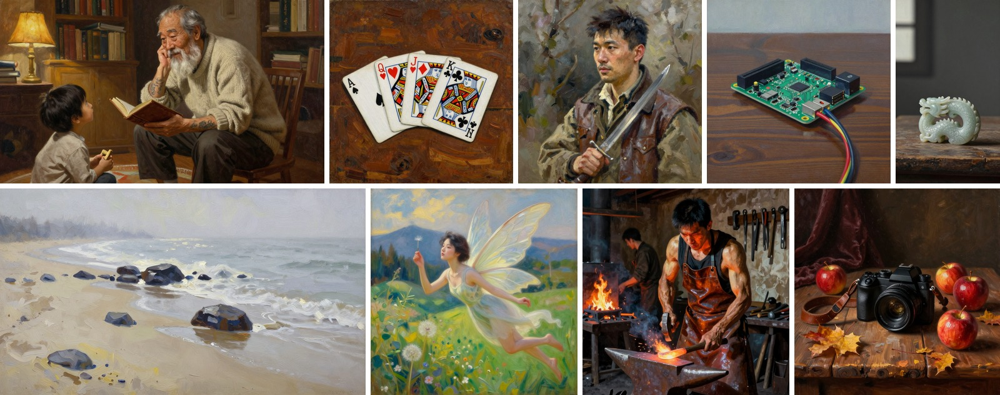

<details><summary>Captions for the training views</summary>

Ordered left to right, top row first.

1. A storytelling grandfather of east asian descent, with a weathered face and a full white beard, sits in a three-quarter view on a wooden stool in a cozy, book-filled study. he rests his chin thoughtfully on his left hand, his right hand holding an open, leather-bound book on his lap. intricate, faded tattoos of dragons and waves are visible on his forearm. a young child of about six sits on a rug at his feet, looking up at him with rapt attention, holding a small wooden toy. the grandfather's expression is animated and warm, his eyes crinkled with a smile as he speaks. the scene is illuminated by the soft, golden light of a nearby table lamp, casting deep, warm shadows and highlighting the texture of his knitted sweater and the worn pages of the book. the painting is executed with visible, expressive brushstrokes that emphasize the texture of the canvas, the roughness of his skin, and the softness of his beard, rendered in a palette of warm browns, amber, and cream.

2. A post-impressionist still life painting. the composition is a close-up view on a worn wooden table with a pronounced, rough grain texture. four playing cards are arranged in a loose, overlapping fan shape on the table's surface. one card is the ace of spades, another is the queen of hearts, the third is the jack of diamonds, and the fourth is the king of clubs. the cards show slight wear on their edges. visible, thick impasto brushstrokes define the forms of the cards and the wood grain. the color palette is dominated by deep browns and ochres of the wood, contrasted with the stark blacks, reds, and whites of the playing cards. the lighting is diffuse, casting soft shadows beneath the cards and highlighting the textured peaks of the paint.

3. 一位亚洲面孔的狼人猎人半身肖像，采用印象派风格。猎人穿着皮革与粗布制成的狩猎外套，手持一把银质匕首，手指轻抚刀柄，头部微转向左侧，眼神柔和而沉思地望向画外。自然光从画面右侧照射，在面部与衣物上形成细腻的明暗过渡，突出脸颊轮廓与衣褶质感。色彩以柔和的大地色调为主，包括灰棕色、暗橄榄绿与米黄色，笔触鲜明可见，画布纹理融入短促的色块堆叠。背景模糊，以抽象笔触暗示森林深处的枝叶阴影。

   *English translation:* A half-length portrait of a werewolf hunter with an Asian face, in the impressionist style. The hunter wears a hunting coat made of leather and coarse cloth, holds a silver dagger, fingers lightly stroking the hilt, head turned slightly to the left, gazing softly and thoughtfully out of the picture. Natural light shines from the right side of the picture, forming delicate transitions of light and shade on the face and clothing, highlighting the contours of the cheeks and the texture of the clothing folds. The colors are dominated by soft earth tones, including grey-brown, dark olive green and cream, with distinct, visible brushstrokes, and the canvas texture is integrated into the stacking of short color patches. The background is blurred, with abstract brushstrokes suggesting the shadows of branches and leaves deep in the forest.

4. 一幅现实主义风格的静物画，主体是一台绿色的raspberry pi微型电脑主板，放置于一张表面有自然木纹的深色木桌上。主板略微倾斜，其上的黑色gpio引脚、银色usb端口、红色电源指示灯与绿色电路板清晰可见。几根彩色杜邦线从主板引脚处松散地垂落，在木桌表面形成柔和的曲线。背景是虚化的、色调偏冷的浅灰色墙壁。画面采用侧光照明，在主板元件和杜邦线上形成清晰的高光与阴影，突出其立体感。绘画笔触可见，颜料堆积营造出电路板塑料与金属的质感，以及木桌的粗糙纹理。整体色彩以绿色、黑色、木色为主，辅以杜邦线的红、黄、蓝色点缀，处于统一的冷色调系中。

   *English translation:* A still life painting in the realist style, whose main subject is a green Raspberry Pi microcomputer board, placed on a dark wooden table with a natural wood grain surface. The board is tilted slightly, and its black GPIO pins, silver USB ports, red power indicator light and green circuit board are clearly visible. Several colored Dupont wires hang loosely from the board's pins, forming soft curves on the surface of the wooden table. The background is a blurred, cool-toned light grey wall. The picture uses side lighting, forming clear highlights and shadows on the board's components and the Dupont wires, emphasizing their three-dimensionality. The painting's brushstrokes are visible, and the accumulation of paint creates the texture of the circuit board's plastic and metal, as well as the rough texture of the wooden table. The overall colors are dominated by green, black and wood tones, supplemented by red, yellow and blue accents from the Dupont wires, within a unified cool color scheme.

5. A still life painting in the romanticism style. the composition is a close-up view of a single, intricately carved jade artifact resting on a sparse, worn wooden surface. the carving depicts a coiled dragon, its sharp, defined edges catching the light. the surface of the jade is smooth and cool-toned, with subtle variations in its pale green monochromatic hue. visible, textured brushstrokes define the form. the lighting is soft, diffused daylight from a single window, casting long, soft shadows and creating a dramatic, contemplative atmosphere. the background is a deep, muted grey, emphasizing the solitary object.

6. 一幅后印象派风格的风景画，描绘一个沙质海滩。画面中央是一系列从沙滩延伸至浅水区的深色天然踏脚石，表面湿润，反射着天光。时间是上午十点左右，一层薄雾笼罩着海面与天空的交界处，柔和了远处的地平线。阳光穿透雾气，形成漫射的、银灰色的光线，均匀地洒在沙滩、石头和海浪上。沙滩呈现出淡米黄色，带有潮湿与干燥区域交错的纹理。海浪是细碎的白色泡沫，轻柔地拍打着沙滩和石头的基部。画面笔触可见、富有表现力，使用短而有力的色块堆叠来塑造形体与光影。颜料质感厚重，在画布上形成明显的肌理，特别是在描绘石头粗糙表面和沙滩颗粒感时。色彩以灰蓝、银白、淡黄和深褐为主，整体色调统一而柔和。

   *English translation:* A landscape painting in the post-impressionist style, depicting a sandy beach. At the center of the picture is a series of dark natural stepping stones extending from the beach into the shallow water, their surfaces wet and reflecting the sky light. The time is around ten in the morning, and a thin mist covers the boundary between the sea and the sky, softening the distant horizon. Sunlight penetrates the mist, forming diffuse, silvery-grey light that falls evenly on the sand, the stones and the waves. The beach is a pale cream yellow, with a texture of alternating wet and dry areas. The waves are fine white foam, gently lapping at the beach and the bases of the stones. The picture's brushstrokes are visible and expressive, using stacks of short, powerful color patches to shape form and light. The paint texture is thick, forming a distinct surface on the canvas, especially when depicting the rough surface of the stones and the granular feel of the beach. The colors are dominated by grey-blue, silver-white, pale yellow and dark brown, with an overall unified and soft tone.

7. A portrait painting in impressionism style, depicting a single asian young female fairy with delicate, translucent wings spread wide, captured in mid-motion as she hovers gracefully above a landscape. her face displays a thoughtful gaze, with elegant, symmetrical features, smooth skin, and a healthy complexion. she interacts with the environment by lightly touching a nearby floating dandelion seed, her body angled dynamically with wings fluttering. the background features a rolling landscape of green hills, scattered wildflowers, and a distant forest under soft, diffused sunlight that casts gentle shadows and highlights. the artwork exhibits visible, textured brushstrokes on a canvas surface, with a color palette of vibrant greens, muted blues, and warm golden yellows. the composition places the fairy in the foreground, creating depth through layered elements like foreground foliage and distant mountains.

8. 一个亚洲面孔的铁匠，穿着皮革围裙，在铁匠铺中正用锤子敲打烧红的铁块，表情专注而紧绷，肌肉线条明显。侧光从右侧照射，在铁匠的脸部、手臂和围裙上形成强烈明暗对比，照亮飞溅的火星和铁砧的金属反光。助手在背景中拉动风箱，火炉中火焰跃动，工具架上悬挂着钳子和锤子。画面呈现后印象派风格，笔触粗犷而可见，色彩以橙红、深褐和冷灰色调为主，突出皮革、金属和火焰的质感，营造动态和层次感。

   *English translation:* A blacksmith with an Asian face, wearing a leather apron, is striking a red-hot piece of iron with a hammer in a blacksmith's shop, his expression focused and tense, his muscle lines pronounced. Side light shines from the right, forming strong contrasts of light and dark on the blacksmith's face, arms and apron, illuminating the flying sparks and the metallic reflections of the anvil. In the background an assistant pulls the bellows, flames leap in the forge, and tongs and hammers hang from a tool rack. The picture presents a post-impressionist style, with rough and visible brushstrokes, and colors dominated by orange-red, dark brown and cool grey tones, highlighting the textures of leather, metal and flame, creating a sense of dynamism and layering.

9. A romanticism style still life painting centered on a newly harvested digital camera. the camera is placed on a rustic wooden table, its black plastic and glass lens reflecting soft light. the composition uses a radial grouping, with scattered autumn leaves, a small cluster of ripe red apples, and a worn leather camera strap arranged around the camera. visible, textured brushstrokes define the scene, with thick impasto highlighting the fruit's waxy skin and the camera's metallic details. the lighting is dramatic and directional, casting long, soft shadows and creating a warm, golden-hour glow that emphasizes the rich, earthy color palette of browns, deep reds, and amber. the background is a dark, muted interior space with a draped velvet cloth, adding depth and a sense of quiet contemplation.

</details>

<details><summary>Statistics</summary>

Rows: 45,228 at 256p, 45,248 at 640p. The images are 640p material, so the set stops there. The corrupted `1/9/16.parquet` shards are excluded.

</details>

**d4-inat** is [`sirus/inaturalist-2024-2.8k-claude-opus-5-recaptioned`](https://huggingface.co/datasets/sirus/inaturalist-2024-2.8k-claude-opus-5-recaptioned), a third-party recaption used as published, shown here at its 256p training view.

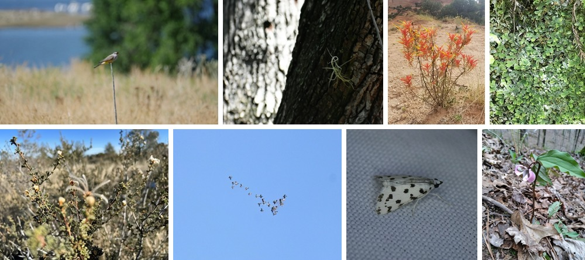

<details><summary>Captions for the training views</summary>

Ordered left to right, top row first.

1. A small pale grey songbird perches on the bare tip of a thin metal post that rises from a dense stand of dry, straw-coloured grass, the shot framed horizontally at roughly eye level with the bird placed just left of centre in the upper third. the bird sits upright and faces right, its rounded head and short conical bill in profile, its plumage soft grey over the head and back with warmer buff-brown tones on the wing and a hint of pale yellow along the underside toward the vent, and its long dark tail angled down and slightly back to balance it on the narrow perch. the post is little more than a slim grey rod, sharply defined against the blurred field and running down through the lower half of the frame until the grass swallows it. behind and below, the tawny grass heads fill the foreground and midground in a bright out-of-focus wash, while a band of flat blue water stretches across the upper left and a mass of dark green trees closes off the right side. strong daylight from the front left flattens the grass into pale gold and keeps the water bright and featureless, and the very shallow depth of field reduces everything except the bird and the top of the post to soft colour.

2. A small epiphytic air plant clings to the deeply furrowed bark of a tree trunk that runs diagonally across the right two-thirds of the frame. its leaves are thin, wiry and pale silvery green, curling and looping outward in a loose spray, with one shoot arching into a nearly complete circle above the rosette; the whole plant is no wider than a hand against the coarse trunk. the bark is dark grey-brown, split into hard ridged plates, and carries a faint sheen along the ridges where light grazes it. to the left the background falls completely out of focus into a bright field of white and grey bokeh from sunlight passing through a canopy, and a thin twig crosses the upper right corner. exposure holds detail in that bright background while leaving the trunk mostly in shadow, so the pale plant registers as a delicate luminous tangle on dark ground. shallow depth of field keeps only the plant and the bark immediately around it sharp.

3. A low, many-stemmed herbaceous plant grows alone on bare pinkish sand, photographed from a standing eye-level position looking slightly down so the whole clump fills the lower two-thirds of the vertical frame. thin, wiry, olive-brown stems radiate outward and upward from a single rooted base, each ending in a dense spike of narrow, finger-like bracts coloured brilliant scarlet-orange and tipped abruptly with acid yellow-green; the true flowers are reduced to slim greenish-yellow tubes projecting between the bracts. long, linear leaves in the same dull green cling close to the stems. the substrate is fine, pale reddish-tan sand and gravel, cracked and lightly scattered with dry grass tufts and small stones, and it slopes upward toward the background. behind the plant, sparse bunchgrass and dark low junipers dot the rising ground, and a band of eroded red-and-buff sandstone cliff crosses the top edge of the picture. flat, shadowless overcast light keeps contrast low and lets the orange bracts read as the single saturated element against a muted desert palette of tan, sage, and dusty rose.

4. A dense mat of thallose liverwort fills the entire vertical frame in an overhead close-up, its flat ribbon-like green thalli branching repeatedly into rounded, forked lobes with slightly ruffled, upturned margins. the lobes overlap in layers so that sunlit upper surfaces of mid-green sit above darker shaded gaps, and a heavy dusting of pale grey-white bloom coats large areas of the colony, concentrated on the older central lobes and washing out their colour. fine feathery yellow-green moss threads through the spaces between thalli, adding a contrasting filamentous texture along the left edge and lower right. three thin dry brown stems, one bearing wiry side branches, cross the top and upper right corner and supply the only strong linear shapes in an otherwise granular field. the surface reads as damp and faintly glossy where light strikes it. illumination is soft and nearly shadowless, and the depth of field runs just deep enough to keep most of the mat sharp while the extreme top and bottom edges blur. colour stays limited to greens, grey-white, and the brown of the dead stems, with no object in frame to give scale.

5. A low desert shrub with tiny scale-like leaves occupies the near foreground of a horizontal landscape shot taken from just above the plant, its dark wiry branches spreading upward and outward across the frame. the twigs are covered in minute crowded green leaflets and studded with numerous small rounded flower heads: pale cream to yellowish-tan tufts, some tightly closed into buttons and others opened into shaggy little pompoms with fine spreading filaments. slender silvery-grey grass blades and bleached stems tangle through the branches at mid-frame, and a denser cushion of brighter green scale foliage sits at the bottom centre. a very shallow depth of field puts only the middle band of branches in crisp focus, dissolving the near twigs at the edges and reducing the background to a soft wash of straw-yellow grassland and pale grey shrubs. along the top runs a strip of clear deep blue sky above a hazy horizon line of low vegetation. strong midday sunlight from behind and to the right rims the grasses and gives the whole scene a bleached, warm, high-key palette of tan, olive and bone against the cool sky.

6. A flock of roughly thirty birds crosses a completely cloudless pale blue sky, reduced to small dark silhouettes with outstretched wings and short necks, spread in a loose ragged chevron that runs from the upper left down toward the centre-right of this horizontal frame. the trailing arm of the formation is thin and strung out, with individual birds well separated and their wings caught at different points in the beat cycle, while the leading right-hand cluster bunches much more tightly into an overlapping knot of bodies. some birds show a paler underside where sunlight catches the belly, others read as solid dark marks, and the size differences between them convey depth within the flock. the sky is an unbroken gradient of light blue that darkens slightly toward the top of the frame, with no clouds, horizon or landmark of any kind, so the birds float in pure negative space and sit near the centre of the composition. bright, high, even daylight and a long lens flatten the scene into a simple two-tone graphic of dark specks on flat blue.

7. A small white moth rests on a sheet of pale grey woven fabric, photographed from above and slightly to the side so the insect is shown in three-quarter profile at the centre of a square frame. its wings are folded close and tent-like over the abdomen, chalk white and boldly marked with irregular black blotches and squarish dots that grow denser and more crowded toward the trailing edge and the wing base while the leading edge stays clean. the head carries a pair of large glossy black eyes and long fine antennae that sweep back over the wings, and pale slender legs splay forward and to the rear against the cloth. the fabric fills the entire background with a regular grid of tiny woven squares, sharp near the moth and softening toward the corners, curving into a faint fold at the lower left. diffuse frontal light from a small close source casts a soft shadow beneath the body and renders the whole scene in a narrow range of cool white and grey tones, so the black spotting on the wings supplies nearly all of the contrast in the picture.

8. A single nodding flower on a slender maroon stalk rises from the leaf litter of a hardwood forest floor, photographed from a low, close angle in vertical orientation. three broad, pointed green leaves spread in a whorl at the top of the stalk, their arching veins catching the light, and the flower hangs just beneath and to the left of them, its three pink petals curling outward around a paler grey-white and cream inner column of narrow segments. the stalk is dark reddish brown and bare, bending slightly before its base disappears into a mat of curled tan and grey dead leaves, small twigs, and one large pale leaf lying flat across the lower centre of the frame. behind the plant the ground climbs away in soft focus, littered with more brown leaves, scattered green shoots, and the thin grey trunks of leafless saplings along the top edge. flat overcast light mutes the browns and lets the pink petals and the green whorl register as the only saturated colour. the narrow depth of field keeps the flower and its three leaves crisp while the slope behind dissolves into undifferentiated brown texture.

</details>

<details><summary>Statistics and source coverage</summary>

Rows: 2,823 at 256p. iNaturalist's images are too small to survive the 640p and 896p size checks, so the set exits after 256p.

It entered for its Claude Opus 5 captions.

</details>

**d4-megalith** is [`sirus/megalith-10m-5.5k-claude-opus-5-recaptioned`](https://huggingface.co/datasets/sirus/megalith-10m-5.5k-claude-opus-5-recaptioned), another third-party Claude recaption used as published, shown here at its 256p training view.

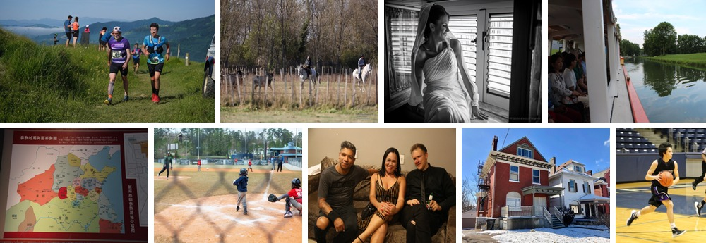

<details><summary>Captions for the training views</summary>

Ordered left to right, top row first.

1. Two trail runners climb a narrow track worn through steep grassy pasture, photographed from a low eye-level position ahead of them in a wide letterbox crop. the leading man wears a purple and white technical singlet with small sponsor lettering across the chest, black shorts, a white cap and a race bib printed "428", a dark moustache and a grimace of effort as he pushes up the slope; a grey compression sleeve with vertical lettering covers his left calf above orange-soled shoes. the runner to his right wears a turquoise and black hydration vest over a matching short-sleeved top, black shorts, a wrist watch and bib "476", arms swinging as he keeps pace. behind them a third competitor in a blue vest descends the same line, and a cluster of spectators in shorts and running kit stands on the grassy shoulder at upper left near a low stone marker. tall seed-heavy grass and yellow wildflowers fill the left foreground, while ridge after ridge of green hills recedes into blue haze with a low bank of cloud pooling in a valley. bright overhead sun, a clear pale sky, and the white flank and mud tyre of a vehicle intruding at the right edge complete the frame.

2. Two riders on grey-white horses work a small herd of dark, long-horned cattle across a dry pasture, photographed from a distance with a long lens so that a foreground wire fence of rough wooden posts crosses the whole frame in soft blur. the rider on the right wears a wide-brimmed black hat, a grey long-sleeved shirt and blue jeans, sitting upright on a stocky white horse that walks to the left with its head up. the second rider, further back at centre-left, wears sunglasses, a dark jacket over a bright yellow sleeve and pale trousers, and carries a long pale stick angled forward while the mount trots with one foreleg lifted. three or four bulls and cows with pale muzzles, mottled grey-brown hides and upswept horns move left along the fence line at the far left edge. behind them a second post-and-wire fence and a band of bare deciduous trees mixed with a dark evergreen fill the upper half, lit from the side by low sun that picks out golden dry grass. a grey watermark reading apnphotographie photographe www.apnphotographe.com sits in the lower right corner.

3. A bride sits sideways on a broad windowsill in a black-and-white photograph, turned in near profile toward the bright louvred window at the right, chin lifted and eyes closed in a wide open smile. her dark hair is pinned up and a long sheer veil drapes over the crown of her head, falling down her back and pooling in the folds of her dress. the gown is a one-shouldered column with a beaded strap at the left shoulder, ruched across the bodice and gathered into deep soft folds over her lap and legs. her right hand rests flat on the marble sill at the lower right of the frame with a lace cuff at the wrist, while her left arm braces behind her on the ledge. horizontal glass louvres and a heavy dark window latch pattern the background with strong parallel bands of blown highlight, and wooden shutters frame the left and right edges. a watermark reading fabriziofedericofotografo sits in the lower right corner.

4. A canal glides past the open side of a passenger excursion boat, photographed from a seat near the rail so the white superstructure and a bright red gunwale stripe slice diagonally from the lower left toward the centre. the boat's white painted columns, panelled bulkhead and rolled canvas awning frame the left half, and along a bench beneath them sit several passengers in profile: a woman in a floral-print blouse with a lanyard nearest the camera, another in a pale grey top with a patterned shoulder bag, a woman in green, and a man in a dark shirt further back, all facing forward toward the water. a man in a dark cap stands at the far end near an open doorway. beyond the rail the canal spreads flat and glassy, its dark green surface holding mirror reflections of the trees on the far bank and of pale streaked cloud. a mown grass embankment runs along the right side to a broad-crowned tree, and a small white footbridge and low buildings close the perspective in the distance under a soft blue sky. shadowed interior tones on the left contrast with the bright open water at right.

5. A large printed exhibition panel carries a colour-coded historical map of ancient china, photographed slightly off-square in a dim room so that the dark red border frames it unevenly and glare washes the lower left. the white headline 春秋时期列国形势图 sits at the top left of a deep red banner, with a block of small white chinese text to its right beginning 公元前770年. the map beneath tints each state a different flat colour: 秦国 in orange across the west, 晋国 in pale grey-green to its north-east, 楚国 in olive yellow spanning the south, 齐国 in sand at the east, a small crimson 周国 near the centre, and blocks labelled 鲁国, 宋国, 郑国, 蔡国, 陈国, 徐国, 吴国, 越国, 燕国, 中山国, 蜀国 and 巴国 around them, with 西戎 and 林胡部落 in the pale north-west. thin blue river lines and dense small place names thread the whole surface. a vertical white column of characters at the right reads 新郑郑国贵族墓地分布图, beside an inset line-drawn street plan on white.

6. A young batter in a navy hooded sweatshirt, grey pants and a black helmet swings from the left side of home plate as a white baseball hangs in the air just past him, photographed from behind the backstop so blurred diagonal shadows of the fence mesh stripe the dirt across the foreground. a catcher in a red jersey and grey pants crouches at the right edge in mask, chest protector and shin guards with a black mitt extended, his shoulder lettering and number cut off by the frame. on the left a man in a dark hooded pullover and black cap follows through after delivering the pitch, and a child in a red jersey stands beyond him on the infield. packed orange dirt chalked with white lines gives way to patchy grass, a padded outfield fence hung with rectangular sponsor banners whose small print and phone numbers stay illegible, and a blue-roofed press box with a spectator deck on the right. tall pines and bare hardwoods close the background under flat grey light.

7. Three people sit shoulder to shoulder on a brown crushed-velvet sofa against a plain beige wall, lit by a hard direct flash that carves crisp shadows behind them and blows out skin highlights. in the centre a woman with straight shoulder-length black hair smiles wide at the camera, wearing a black and gold vertically striped slip dress with thin straps and a tied bust, dangling red earrings, a ring, and bright red nail polish on hands folded over her crossed legs; a small black studded handbag rests against her thigh. on the left a man with short greying spiked hair and stubble leans in with one arm stretched along the sofa back behind her, wearing a charcoal t-shirt printed in black with play again inside a rectangular outline, ripped black jeans and a black knee brace, with tattoos on his forearm. on the right a man in an all-black long-sleeved shirt and black tie tips his head toward her and holds a green glass beer bottle with a red-and-white label low in his lap, one knee showing through torn black jeans. a cream light switch and a white power socket punctuate the wall behind, and folded white towels sit on the sofa arm at the far left.

8. A two-and-a-half-storey red brick house stands three-quarters on to the camera in bright winter sun, its front corner pointing at the viewer and its roofline framed against a deep, cloudless blue sky. a gabled dormer with a wide multi-pane window caps the front, sitting above a heavy cream cornice carried on a long row of blocky brackets, and a tall brick chimney rises at the left. the porch roof below is trimmed in sage green with painted swag decoration on its fascia, supported by square columns, and it shelters a white front door reached by a straight run of stone steps with white railings; a white balustrade encloses the porch above a rendered stone foundation. a black metal fire escape zigzags down the left side wall past shuttered basement openings, and a green rubbish bin sits on the drive at the lower left. to the right a white-painted brick house with dark green shutters, a hipped dormer and a striped awning stands close by, with another red brick facade beyond it. trampled snow covers the lawn and pavement, and bare branches and a dark garage intrude at the far left.

9. A basketball player drives up a polished maple court, caught mid-stride with both hands cupping an orange ball at chest height and his head turned to look ahead to the right. he wears a black sleeveless jersey with purple shoulder trim and light outlined lettering arched across the chest that his own arm and the ball obscure past reading, black shorts with a white and purple side stripe and a small purple bird logo on the left leg, white ankle socks and black-and-white low-top sneakers. his dark hair is thick and windswept and his mouth is set in concentration. another player in black crosses the right edge in motion blur, only legs and white-soled shoes within the frame. a navy padded wall runs across the background beneath rows of empty blue folding bleacher seats and a stair rail, and large cream key markings and a dark sideline stripe cut across the varnished floorboards, which reflect the players in soft streaks. the panning exposure keeps the driving player sharp while smearing the floor grain and background, and the cool blue and purple palette is broken only by the ball and the warm wood.

</details>

<details><summary>Statistics and source coverage</summary>

Rows: 5,504 at 256p. Like d4-inat it exits after 256p; megalith content continues inside d4-extra.

</details>

**d4-extra** pools concept additions curated for Inko and is unpublished; it enters the configs as three entries, `d4-extra`, `d4-extra2` and `d4-extra3`.

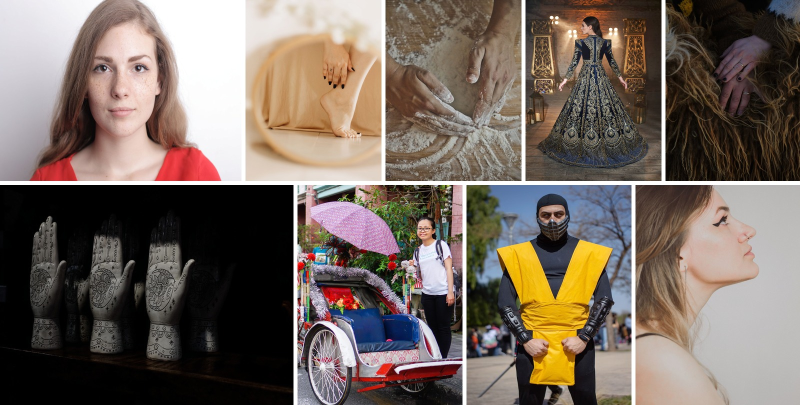

<details><summary>Captions for the training views</summary>

Ordered left to right, top row first.

1. A close-up portrait of a young woman with freckles, long hair, and a calm demeanor.

2. Artistic portrayal of a woman's foot and hand in a round mirror reflection, creating an elegant and minimalist vibe.

3. Close-up of hands mixing flour on a wooden board for baking.

4. Luxurious gold embroidered gown worn by a woman in an elegant setting, perfect for bridal or evening wear.

5. Close-up of hands on the wool of an icelandic sheep, showcasing rustic textures.

6. Artistic hand sculptures with intricate designs displayed in low light.

7. A smiling young woman in glasses stands at the right of this vertical street photograph beside an elaborately decorated cycle trishaw that occupies the left two-thirds of the frame. she wears a white t-shirt printed with small blue script, of which the word "mermaid" reads clearly on the second line, black trousers and a dark backpack whose strap she holds with one hand. the trishaw's passenger cab has a white and red painted body with a folded black hood, a deep blue vinyl bench and backrest, a red woven cane panel, and a skirt of pink-and-white diamond-patterned fabric below the seat; silver tinsel garland is looped along the hood edge, a bunch of red and orange artificial roses rests on the seat, and clusters of red pompom flowers and painted poles decorate the front. a large lilac umbrella printed with a small floral repeat is mounted above as a canopy, tilted toward the camera. two big chrome-spoked wheels flank the cab on the wet grey road surface. behind, a pink-washed shophouse wall, shuttered green door, hanging shell ornaments and lush green shrubs fill the background under flat overcast daylight.

8. Man in yellow warrior costume posing outdoors on a sunny day.

9. Side profile portrait of a young woman with winged eyeliner and nose piercing on a minimalist background.

</details>

At step ~200k, a probe used k-means clusters over LAION captions to build a fixed set of world-concept prompts. About 2k generations exposed failures that mapped to world wonders, buildings and clothing. The first additions targeted those gaps; later batches broadened into limb anatomy, Chinese classical buildings, nature, urban scenes, cosplay, close-ups and aesthetic scenes.

Z-Image, Qwen-Image and Pexels queries produced the new material. No dedicated follow-up isolated its effect. Extra2 and extra3 entered at 250k, and all three entries were present at 640p.

<details><summary>Statistics and a text pair</summary>

Rows: 49,402 at 256p (extra2 and extra3 only; I forgot the d4-extra entry itself when building the 256p pool), then 83,608 at 640p and 79,166 at 896p with all three entries.

One row, its short query-side text against its long recap:

> *Generation prompt:* Stunning view of the summer palace in beijing showcasing traditional chinese architecture.

> *Long recap:* A photograph of a tall, multi-tiered chinese pavilion, shot from a low angle looking upward so the building rises steeply toward a clear blue sky. the structure is framed at the top and upper corners by the dark underside of a heavy overhanging roof, its deep black beams and rafters edged with red and gold.

</details>

## The caption strategy

**Bilingual.** Inko was designed for Chinese and English prompting, so new captioning made bilingual coverage a requirement. The earlier sets predate that rule: the first recaptions (wikiart, relaion and vintage) used Qwen3-VL-32B and other Qwen or GLM models of that period, with wikiart English-only and relaion bilingual. More recent rounds for d1, d2-museum and Pexels used Gemini Flash-Lite generations and deepseek-v4.1-flash, following the models available and affordable for each batch.

Every Inko-era caption request draws its language deterministically at 50:50 Chinese/English; the specialized Chinese-painting enrichment draws 80% Chinese. Some original captions contain small amounts of Japanese, Russian and other languages. Those texts remain in the pool.

**Length.** The first assembly had a systematic gap at the long end: among roughly one million image rows, the longest caption was under 1024 tokens and fewer than a hundred captions exceeded 256. The DALL·E 3 report ([Betker et al. 2023](https://cdn.openai.com/papers/dall-e-3.pdf)) had shown that long, densely descriptive captions improve prompt following, with a tradeoff: performance can suffer on short user prompts. That evidence motivated a dedicated long-caption program, and the tradeoff became relevant again when short-prompt ability weakened during pretraining; the caption-length curriculum and a later specialized run each pushed back on it.

The program targets three bands by default: 256–511, 512–895 and 896–1280 tokens at 55%, 30% and 15%. Pexels uses a four-band split that adds 64–255 tokens, with proportions 44.9%, 27.5%, 16.6% and 11.0%. Requests express their targets in words or characters, converted at 0.757 words per English token and 1.21 characters per Chinese token. Detail crops and small images stop at the second-longest band because a 300px detail cannot support an honest 900-word description.

D1, d2-museum, d3-pexels, d3-synth-v2 and d4-extra used the long-favoring contract from the start. D1, d2-wikiart and d2-museum also received later top-ups. Relaion, vintage, zimage and the two Claude-captioned sets entered without an additional top-up.

The final 256p pool contains 3.28M captions, of which 6.9% are at least 256 tokens. That is a substantial change from fewer than 100 above the threshold, but the growth is uneven. Long captions concentrate in the concept additions, d1, d3-pexels, d3-synth-v2 and d4-megalith; the large relaion, WikiArt and vintage pools remain mostly short.


**Style.** The caption prompt specifies language, format, length band and domain. It asks the captioner to name the medium early with visible evidence such as grain, brushstrokes or paper texture; avoid hedging, praise and speculation; transcribe inscriptions in quotation marks; and use specific garment names such as hanfu, kimono and sari when known. For museum rows the prompt also supplies tidied artist and title fields the captioner may use or omit; the description itself must come from the image.

Evaluation and hedging phrases were counted in batch telemetry rather than used as hard rejection rules, so interpretive phrasing can survive in accepted captions.

Prose and structured formats are assigned independently by a deterministic 50:50 hash, with the structured format collapsing to one paragraph in the shortest band. Empty and repeated outputs were rejected. Falling outside the requested length band did not itself discard a caption: the achieved length was recorded for sampling. Training-side cleaning also strips template openings such as "The image shows".

## Sampling and weights

Every draw is three choices in sequence: the sampler picks a source with probability proportional to its configured weight, takes the next row from that source's shuffled cycle so every row appears once per cycle, and selects one caption from the row under the caption curriculum. The configured weight of a source is

```text
                            eligible_rows(source) × multiplier(source)
weight(source) = 100 × ───────────────────────────────────────────────
                         Σs eligible_rows(s) × multiplier(s)
```

The denominator sums over all sources in the stage, and the factor of 100 expresses the result as a percentage. At 640p a row is eligible when it holds at least one caption of 16 raw tokens or more; at 896p the threshold is 50. The multiplier upweights the two painting domains, the curated people set and the concept additions: ×1.8 for `d1`, `d2-wikiart`, `d2-museum` and `d3-pexels`, ×1.5 for the d4-extra group, and ×1.0 for everything else. Shards of one source contribute their rows separately, so splitting a source does not multiply its influence.

At 896p, d1 has 90,210 eligible rows. Multiplying by 1.8 gives 162,378 against a total stage mass of 838,639.8, hence 19.36% of all draws. Its share is 8.09% at 256p. At 640p, a weight-calculation error initially left it at 7.91%; the 480k correction raised it to 9.92%. D1's rising share across resolutions comes from its near-complete survival of the size filters while the large web pools lose most of their rows.
