# Evaluation

## Inko among compact and larger models

Inko is the released post-trained model; Inko base is the 600k pretrain EMA, retained as a reference. Inko's trainable backbone has 532,496,992 parameters. The near-Inko-size references span 0.390B to 0.611B: [DreamLite-Base](https://huggingface.co/carlofkl/DreamLite-base) at 0.390B, [SANA-0.6B](https://huggingface.co/Efficient-Large-Model/Sana_600M_1024px_diffusers) at 0.592B and [PixArt-Σ](https://huggingface.co/PixArt-alpha/PixArt-Sigma-XL-2-1024-MS) at 0.611B. [SD3.5 Medium](https://huggingface.co/stabilityai/stable-diffusion-3.5-medium) supplies a 2.243B reference and [MOSS-Image-SFT](https://huggingface.co/OpenMOSS-Team/MOSS-Image-SFT) a 5.082B reference.

Every entry generated the same five catalogs: 12,506 images per model and 112,554 images across the nine entries. External models kept their native inference recipes at 1024-native shapes, apart from [SD 1.5](https://huggingface.co/stable-diffusion-v1-5/stable-diffusion-v1-5) and [SDXS](https://github.com/IDKiro/sdxs) at 512-native shapes. Those two legacy models use English-centric [CLIP](https://github.com/openai/CLIP) conditioning, which truncates long prompts at 77 tokens. Inko uses 896p shapes, 20 Euler steps and text exit layer 20. The two Inko sampling recipes differ only in guidance: CFG 5.0 for the base and 4.5 for the release.

The columns come from five instruments. [GenEval](https://arxiv.org/abs/2310.11513) checks object-focused alignment with detectors. [DPG-Bench](https://arxiv.org/abs/2403.05135) evaluates dense prompt graphs. [OneIG-Bench](https://arxiv.org/abs/2506.07977) covers alignment, diversity, reasoning, style and text. [TIIF-Bench](https://arxiv.org/abs/2506.02161) tests fine-grained short and long instructions. [Qwen-Image-Bench](https://arxiv.org/abs/2605.28091) measures creator-centric quality, alignment and related capabilities.

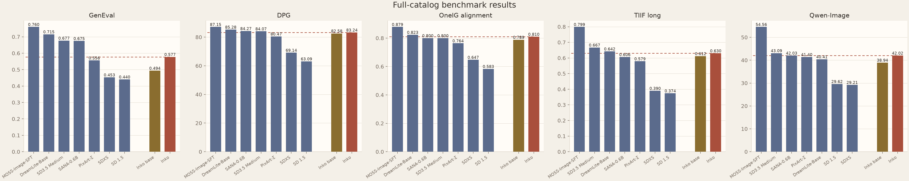

| Model | GenEval ↑ | DPG ↑ | OneIG align ↑ | OneIG div ↑ | OneIG reas ↑ | OneIG style ↑ | OneIG text (WAC) ↑ | TIIF long ↑ | TIIF short ↑ | Qwen ↑ |
|---|---:|---:|---:|---:|---:|---:|---:|---:|---:|---:|
| DreamLite-Base | 0.715 | 85.28 | 0.823 | 0.156 | 0.211 | 0.385 | 0.066 | 0.642 | 0.640 | 40.41 |
| SANA-0.6B * | 0.675 | 84.27 | 0.800 | 0.220 | 0.210 | 0.362 | 0.043 | 0.606 | 0.632 | 42.03 |
| PixArt-Σ | 0.556 | 80.47 | 0.764 | 0.239 | 0.217 | 0.375 | 0.002 | 0.579 | 0.585 | 41.40 |
| SD 1.5 * | 0.440 | 63.09 | 0.583 | 0.425 | 0.212 | 0.390 | 0.010 | 0.374 | 0.435 | 29.62 |
| SDXS * | 0.453 | 69.14 | 0.647 | 0.140 | 0.183 | 0.270 | 0.001 | 0.390 | 0.428 | 29.21 |
| SD3.5 Medium | 0.677 | 84.07 | 0.800 | 0.241 | 0.279 | 0.360 | 0.433 | 0.667 | 0.669 | 43.09 |
| MOSS-Image-SFT | 0.760 | 87.15 | 0.879 | 0.225 | 0.299 | 0.390 | 0.903 | 0.799 | 0.802 | 54.56 |
| Inko base | 0.494 | 82.58 | 0.789 | 0.298 | 0.172 | 0.359 | 0.003 | 0.612 | 0.604 | 38.94 |
| Inko | 0.577 | 83.24 | 0.810 | 0.245 | 0.182 | 0.351 | 0.002 | 0.630 | 0.631 | 42.02 |

\* Every model has 1,000 Qwen images and a judgment row for each image. Three dimension scores average 999 prompts because one expected dimension is missing: SANA Quality (ID 44), SD 1.5 Creative Generation (ID 417) and SDXS Creative Generation (ID 920).

Against PixArt-Σ, Inko scores higher on GenEval, DPG, OneIG alignment and diversity, both TIIF description lengths and Qwen-Image-Bench; PixArt leads on OneIG reasoning and style. Inko is close to SANA-0.6B on DPG, both TIIF lengths and Qwen, while SANA has a clear GenEval advantage. DreamLite-Base is stronger overall among the compact references, especially on GenEval, DPG, OneIG alignment and TIIF.

Inko is also close to the much larger SD3.5 Medium on DPG (83.24 versus 84.07), OneIG alignment (0.810 versus 0.800) and Qwen (42.02 versus 43.09). SD3.5 leads on GenEval, both TIIF lengths, reasoning and text rendering. MOSS-Image-SFT leads all five metrics shown in the overview chart: GenEval, DPG, OneIG alignment, TIIF long and Qwen. These comparisons establish the terrain: dense alignment is Inko's strongest general result, while reasoning and exact text remain substantial limitations.

## Prompt following, alignment and quality

### DPG-Bench: entities, attributes and relations

DPG-Bench, the Dense Prompt Graph Benchmark introduced with [ELLA](https://ella-diffusion.github.io/), represents prompts as graphs of entities, attributes and relations, then asks judge questions about them. Its overall score aggregates those answers with their graph dependencies. Inko scores 83.24, close to SD3.5 at 84.07 and SANA at 84.27, and above PixArt at 80.47.

The category view below uses the fourth of four draws. Inko's entity, attribute and relation scores are all close to SD3.5. The weaker Other category contains count and text, which score 74.00 and 76.00. By contrast, level-2 size reaches 76.45 and color reaches 94.38, both ahead of every external entry.

| Level 1 | DreamLite | SANA | PixArt-Σ | SD 1.5 | SDXS | SD3.5 | MOSS | Inko base | Inko |
|---|---:|---:|---:|---:|---:|---:|---:|---:|---:|
| Entity | 91.16 | 89.89 | 87.37 | 71.82 | 77.37 | 89.85 | 92.61 | 89.40 | 90.45 |
| Attribute | 89.44 | 88.31 | 86.29 | 71.89 | 76.73 | 88.39 | 90.24 | 89.88 | 90.08 |
| Other | 81.60 | 79.20 | 71.60 | 54.80 | 56.40 | 81.60 | 85.60 | 76.40 | 74.40 |
| Relation | 94.02 | 93.17 | 91.25 | 79.87 | 84.69 | 93.60 | 94.52 | 93.37 | 93.56 |

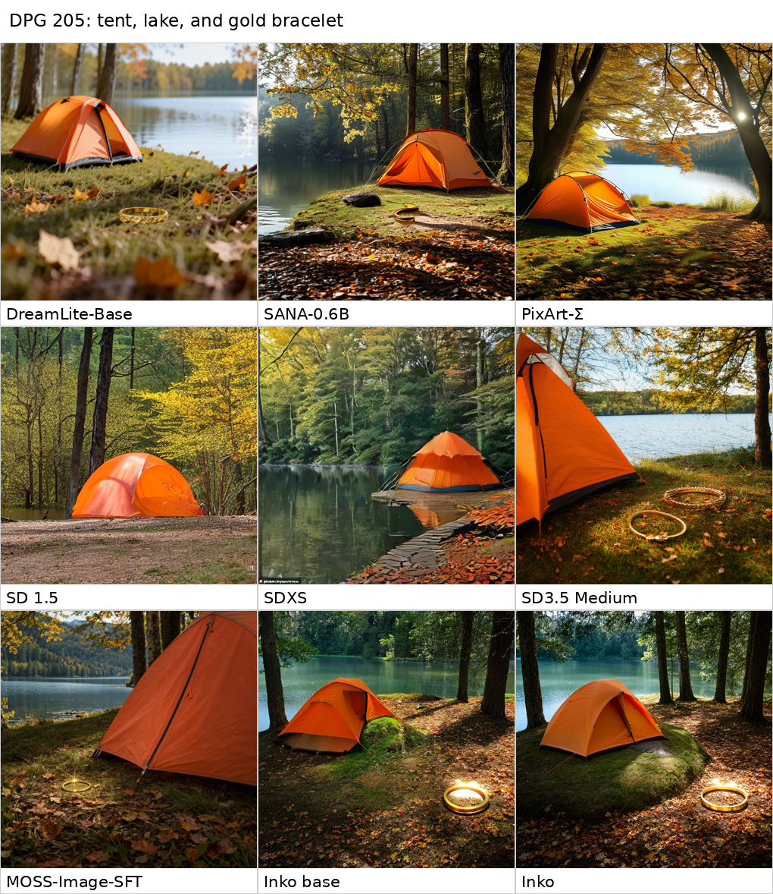

Inko keeps the large orange tent, zipped entrance, grassy knoll, lake and gold bracelet in one scene. The bracelet remains a separate, visible object on the foreground leaves rather than disappearing into the dense setting. MOSS and SD3.5 also preserve that small-object relationship; DreamLite makes the bracelet much less prominent, while PixArt omits visible jewelry.

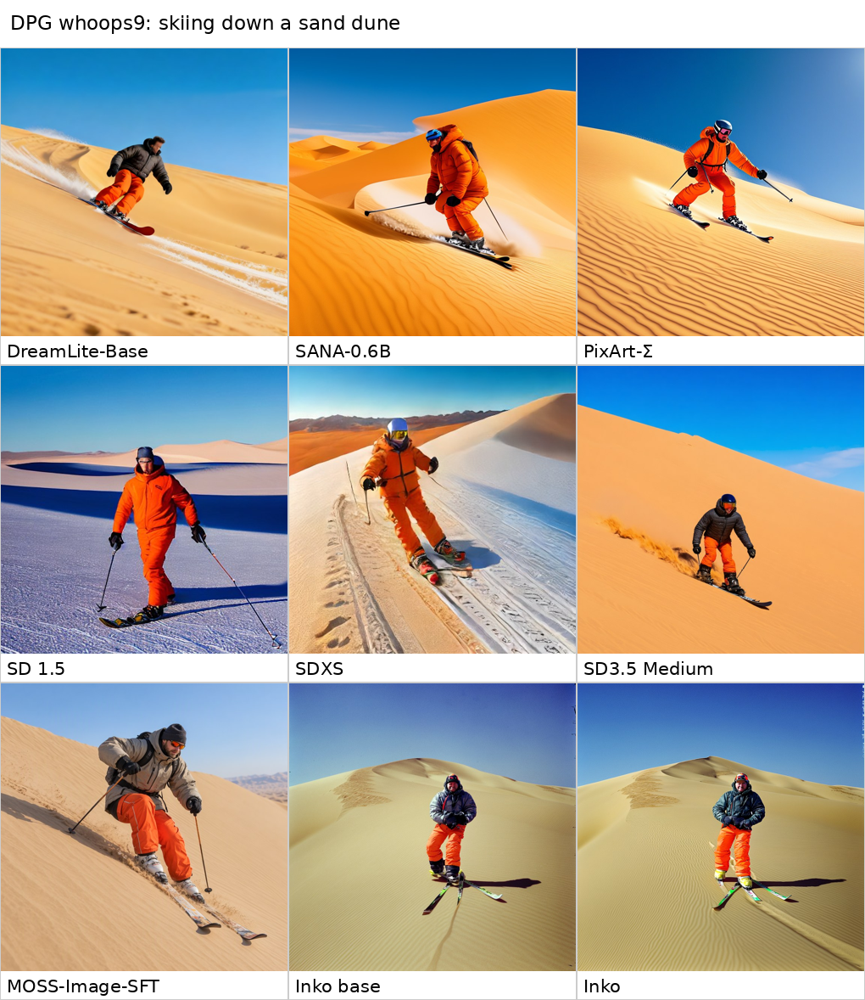

Inko retains the desert, insulated jacket, bright-orange snow pants and two skis. SD 1.5, by contrast, turns the ground into a pale snow-like surface. Inko's upright stance and splayed skis convey less downhill motion than SANA, PixArt and MOSS, whose skiers lean into the slope, and the requested carved trails are not clear.

Exact prompts for the two DPG cases

> *Tent, lake and bracelet:* In a tranquil forest clearing by the water's edge, a large orange tent with its entrance zipped shut is pitched on a grassy knoll overlooking a serene lake. A few steps away from the tent, on the forest floor scattered with autumn leaves, a circular gold bracelet catches the sunlight, creating a subtle sparkle amid the natural surroundings. The nearby trees cast gentle shadows over the area, enhancing the peaceful ambiance of the outdoor scene.

> *Sand-dune skiing:* A man dressed in a thick, insulated jacket and bright orange snow pants is expertly skiing down a large sand dune. The dune's golden sands contrast with the clear blue sky above. Despite the unusual setting, the man's skis carve out smooth trails, leaving a unique pattern behind him as he descends amidst the vast desert surroundings.

### TIIF: short and long instructions

TIIF-Bench evaluates fine-grained instruction following with attribute-specific yes/no questions. The testmini split contains 277 scenes, each with short and long descriptions, and averages nine attribute groups separately for each length. Text scenes additionally measure Global Normalized Edit Distance and OCR recall.

Inko's short score of 0.631 is nearly identical to SANA at 0.632. Its long score of 0.630 is above SANA at 0.606 and PixArt at 0.579, but below DreamLite at 0.642 and SD3.5 at 0.667. Short basic attributes are a relative strength at 0.785, second to MOSS at 0.840. Long basic reasoning reaches 0.794, long numeracy 0.792 and long negation 0.833; the latter two lead all nine entries. Advanced text generation is instead very weak at 0.014 for short descriptions and 0.032 for long ones.

The short cone-and-cushion prompt tests whether two shapes, their spatial separation and the bookstand's function remain intact. Inko merges them into one sculpture, with tapered supports rising from a ring of lobed cushions. Neither a single conical bookstand nor a separate spherical cushion survives. MOSS makes the bookstand's function explicit by placing books on a conical pedestal; DreamLite and SANA preserve the cone-and-cushion pairing but omit the books.

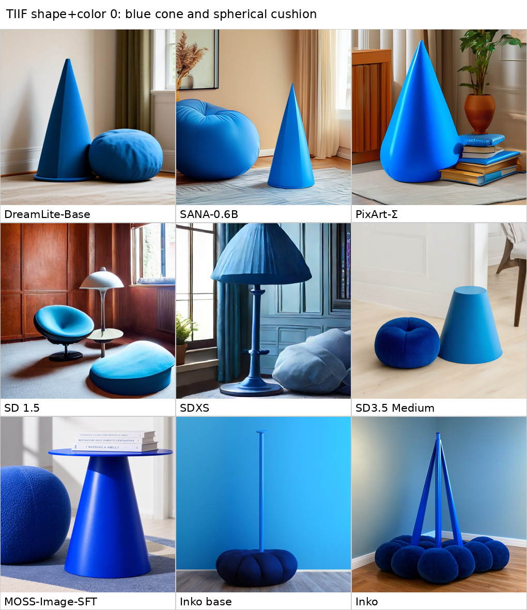

The record-player case tests differentiation by size, age and material. Inko renders reflective metal and warm ambient light in detail, but substitutes one large device and a loose vinyl record for the requested pair. DreamLite and MOSS retain two separate devices with a clear size contrast; MOSS also gives the smaller unit a visibly older design.

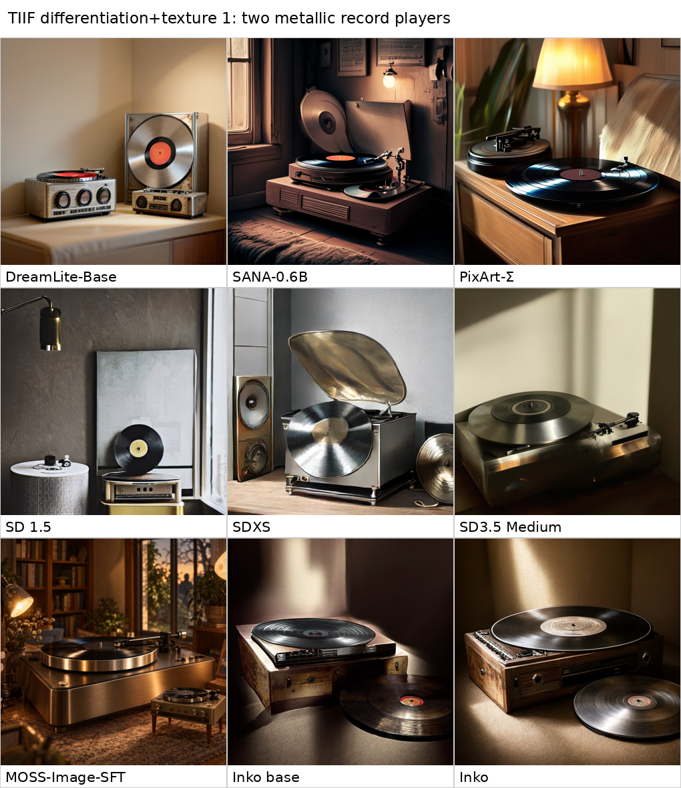

Exact prompts for the two TIIF composition cases

> *Blue cone and spherical cushion:* A blue conical bookstand stands beside the spherical cushion, creating a vibrant contrast in the room.

> *Two metallic record players:* In a cozy corner bathed in soft, ambient light, a stunningly beautiful metallic vinyl record player, sleek and modern in its design, sits regally beside a smaller, more modestly sized and older metallic vinyl record player, whose timeworn charm hints nostalgically at its storied past, both standing together as silent witnesses to the evolution of sound and the passing tides of aural history.

### OneIG alignment and Qwen-Image quality

OneIG-Bench evaluates alignment, reasoning, style, text and diversity through different released prompt subsets. Alignment covers anime, portrait and general-object prompts. Inko scores 0.810, exceeding SANA and SD3.5 at 0.800 and PixArt at 0.764, while DreamLite at 0.823 and MOSS at 0.879 remain ahead. Portraits are especially close between Inko and DreamLite, 0.830 to 0.831. General objects are less strong at 0.739, although that still edges SD3.5 and PixArt.

| Alignment category | Prompts | DreamLite | SANA | PixArt-Σ | SD 1.5 | SDXS | SD3.5 | MOSS | Inko base | Inko |
|---|---|---:|---:|---:|---:|---:|---:|---:|---:|---:|
| Anime stylization | 245 | 0.855 | 0.836 | 0.799 | 0.582 | 0.701 | 0.840 | 0.895 | 0.833 | 0.850 |
| Portrait | 244 | 0.831 | 0.797 | 0.767 | 0.613 | 0.621 | 0.812 | 0.887 | 0.811 | 0.830 |
| General object | 206 | 0.777 | 0.760 | 0.718 | 0.550 | 0.615 | 0.736 | 0.850 | 0.709 | 0.739 |

OneIG's own length bands give Inko 0.804 on short, 0.816 on middle and 0.804 on long prompts, a flat profile across lengths. The corresponding Inko base values are 0.775, 0.805 and 0.774.

Qwen-Image-Bench is a creator-centric benchmark with 1,000 stratified prompts. Its five dimensions, Aesthetics, Quality, Alignment, Real-world Fidelity and Creative Generation, decompose into 23 second-level capabilities and 56 third-level rubrics. The native total uses that hierarchy rather than a simple mean of the five dimensions.

Inko scores 42.02, effectively tied with SANA at 42.03 and ahead of DreamLite at 40.41 and PixArt at 41.40. Alignment reaches 41.85, leading the compact entries and edging SD3.5 at 40.97; Attributes and Layout are second only to MOSS. Quality is 47.38, also above every compact reference. Inko trails SANA on Aesthetics, 42.55 to 45.41, and Creative Generation, 31.81 to 32.90, so their similar totals come from different strengths. Anatomical Portraiture is 6.81, second to MOSS at 12.57.

| Dimension | DreamLite | SANA | PixArt-Σ | SD 1.5 | SDXS | SD3.5 | MOSS | Inko base | Inko |
|---|---:|---:|---:|---:|---:|---:|---:|---:|---:|
| Aesthetics | 43.34 | 45.41 | 45.55 | 29.35 | 32.40 | 45.93 | 57.62 | 39.46 | 42.55 |
| Quality | 44.52 | 45.89 | 46.17 | 36.88 | 34.27 | 48.45 | 53.38 | 43.48 | 47.38 |
| Alignment | 41.05 | 40.76 | 38.95 | 26.13 | 25.40 | 40.97 | 54.89 | 38.45 | 41.85 |
| Real-world Fidelity | 38.64 | 39.99 | 40.53 | 38.71 | 36.39 | 42.65 | 48.94 | 41.69 | 41.12 |
| Creative Generation | 28.15 | 32.90 | 30.42 | 15.39 | 14.41 | 32.61 | 55.49 | 28.09 | 31.81 |
| Native total | 40.41 | 42.03 | 41.40 | 29.62 | 29.21 | 43.09 | 54.56 | 38.94 | 42.02 |

## Counting, position and negation

GenEval measures object-focused alignment with detector-based checks for single objects, two objects, counting, colors, position and color attribution. The overall score averages the six categories over four draws per prompt.

Inko's strongest GenEval channels are position and color attribution. Position reaches 0.323, behind DreamLite at 0.345 and MOSS at 0.560 but above SD3.5 at 0.217 and SANA at 0.228. Color attribution reaches 0.542, close to DreamLite at 0.547, SD3.5 at 0.573 and MOSS at 0.583. Two objects rise to 0.677, above PixArt at 0.634. Counting is much weaker at 0.350, below every external entry except SD 1.5 at 0.347; single-object success is 0.866, below every external entry.

| Category | DreamLite | SANA | PixArt-Σ | SD 1.5 | SDXS | SD3.5 | MOSS | Inko base | Inko |
|---|---:|---:|---:|---:|---:|---:|---:|---:|---:|
| Single object | 0.984 | 0.991 | 0.994 | 0.988 | 0.981 | 0.997 | 0.978 | 0.853 | 0.866 |
| Two objects | 0.894 | 0.806 | 0.634 | 0.399 | 0.455 | 0.874 | 0.881 | 0.545 | 0.677 |
| Counting | 0.634 | 0.691 | 0.478 | 0.347 | 0.388 | 0.600 | 0.722 | 0.278 | 0.350 |
| Colors | 0.886 | 0.886 | 0.827 | 0.779 | 0.771 | 0.801 | 0.838 | 0.681 | 0.707 |
| Position | 0.345 | 0.228 | 0.155 | 0.045 | 0.048 | 0.217 | 0.560 | 0.207 | 0.323 |
| Color attribution | 0.547 | 0.448 | 0.247 | 0.085 | 0.075 | 0.573 | 0.583 | 0.398 | 0.542 |

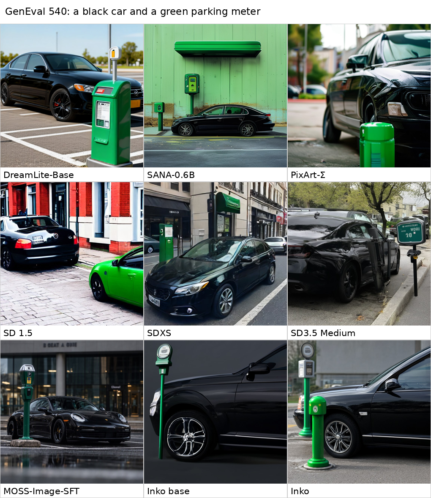

Inko separates the black car from a green parking meter and retains the meter's display, but adds a second green parking meter in the foreground. MOSS produces a cleaner arrangement with one clearly recognizable meter. SANA and SDXS also preserve the requested color binding; SD 1.5 instead makes a second car green, and SD3.5 replaces the meter with a sign.

Exact prompt for the black-car and green-parking-meter case

> a photo of a black car and a green parking meter

The numerical scores look inconsistent at first: GenEval counting is 0.350, DPG count is 74.00 and TIIF long numeracy is 0.792. They measure different tasks. GenEval uses object detectors to check explicit counts in relatively simple scenes. DPG asks judge questions within a dense graph of other scene requirements, and TIIF asks attribute-specific yes/no questions over short and long descriptions. Inko can satisfy many numerical or relational constraints in dense prompts while still failing reliable object counting under detector-based evaluation.

The long-negation aggregate of 0.833 contrasts with a shared hard case: a busy city intersection with a complete lack of blue cars. Inko fills the intersection with blue and cyan cars, and most photographic references make the same error: they preserve the busy street and named objects while losing the absence constraint. SD 1.5 instead produces a stylized road map, which avoids literal blue cars but not the requested city-intersection scene.

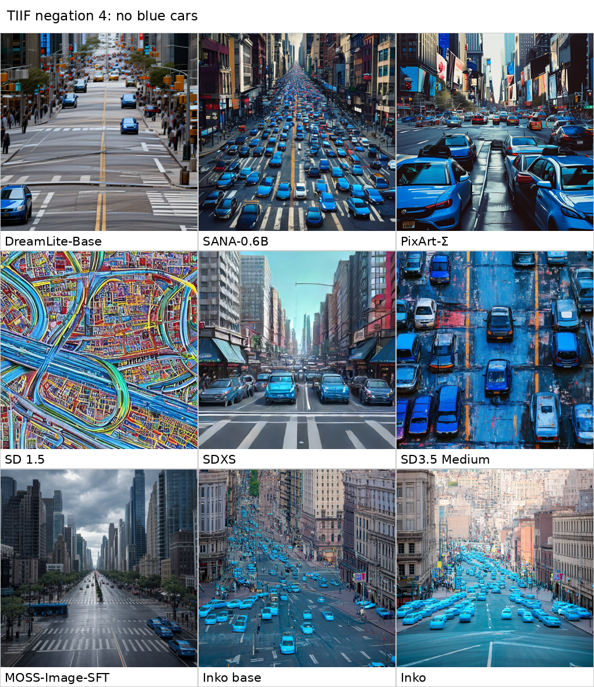

Exact prompt for the no-blue-cars case

> In the vivid tableau of urban life captured at the intersection of bustling streets that form the intricate arteries of the city, there exists a notable absence, a striking void, marked by the complete lack of any blue cars which, though invisible in this particular moment, often weave through the metropolitan tapestry with their cerulean hues, leaving only the impression of their absence amid the vibrant cacophony of the cityscape.

Chinese negation examples

The benchmark evaluations use English prompt variants, so they never exercise Chinese absence instructions. These two generations provide positive Chinese examples in imperative and declarative forms.

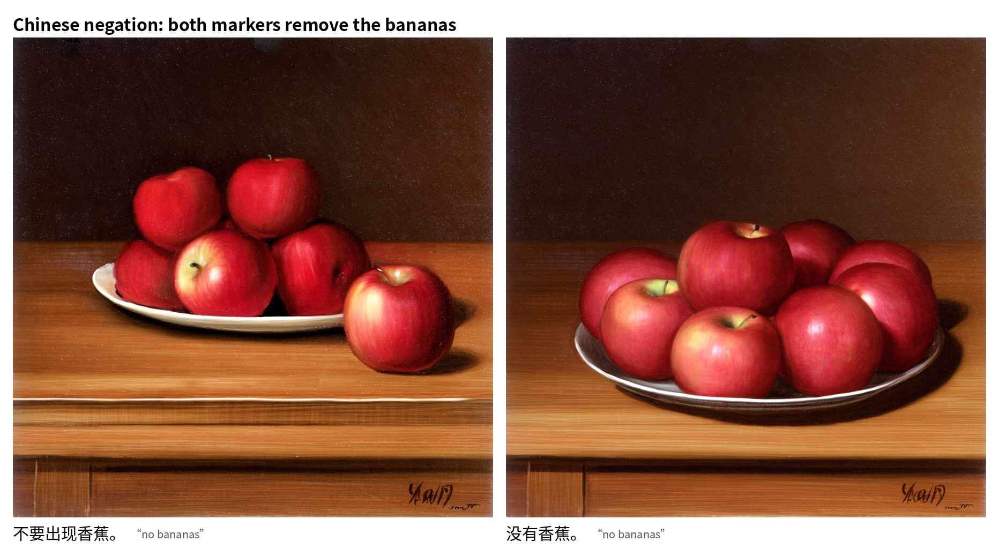

For the left image, the exact prompt is `静物油画：木桌上摆着一盘红苹果，不要出现香蕉。`, meaning “A still-life oil painting: a plate of red apples sits on a wooden table; do not allow bananas to appear.” The imperative `不要出现` asks that bananas not appear. Inko keeps the plate of red apples and adds no bananas.

The right image uses the exact prompt `静物油画：木桌上摆着一盘红苹果，没有香蕉。`, meaning “A still-life oil painting: a plate of red apples sits on a wooden table; there are no bananas.” Here `没有` states the absence directly. Again, Inko preserves the apples without painting bananas. Both phrasings produce the requested absence in these cases.

## Reasoning, knowledge and rendered text

OneIG reasoning is a clear limitation. Inko scores 0.182, below every external entry; SDXS is next at 0.183, while DreamLite, SANA and PixArt are all near 0.21. Common sense is Inko's strongest knowledge category at 0.243 and chemistry its weakest at 0.158. It trails DreamLite, SANA and PixArt in every knowledge category, with SD3.5 and MOSS higher throughout.

Qwen-Image-Bench gives a compatible profile. Logical Resolution is 17.02, behind SANA at 18.51, PixArt at 24.41, SD3.5 at 20.31 and MOSS at 32.87. World Knowledge is 16.37, behind SD3.5 at 20.53 and MOSS at 33.98.

Text rendering recurs across instruments with different scoring methods. OneIG defines ED as mean Levenshtein distance, CR as exact-match rate and WAC as total matched characters divided by total ground-truth characters. Inko produces no exact matches across 200 prompts, with WAC 0.0021 and ED 113.976. TIIF OCR recall is 0.000 for short descriptions and 0.004 for long descriptions, compared with 0.501 and 0.266 for SD3.5 and 0.868 and 0.895 for MOSS.

Judge-based scores are less extreme and change the SD3.5 comparison. DPG text is 76.00, against 98.00 for SD3.5 and 96.00 for MOSS. Qwen Text Rendering is 14.47, close to DreamLite at 13.85 and slightly above SD3.5 at 14.21, while MOSS reaches 48.72. The text limitation is consistent, but its magnitude and the ordering against SD3.5 depend on the instrument.

The bar-chart case combines structured layout, exact quantities and legible text. Inko produces a dense multi-bar graphic with many more than four bars, unreadable labels and a multicolored palette. MOSS is the only entry with the correct title, four bars and values of 12, 18, 9 and 21, although its category labels are not fully legible. SD3.5 draws six bars; 12 and 18 are legible, but the remaining values are corrupted.

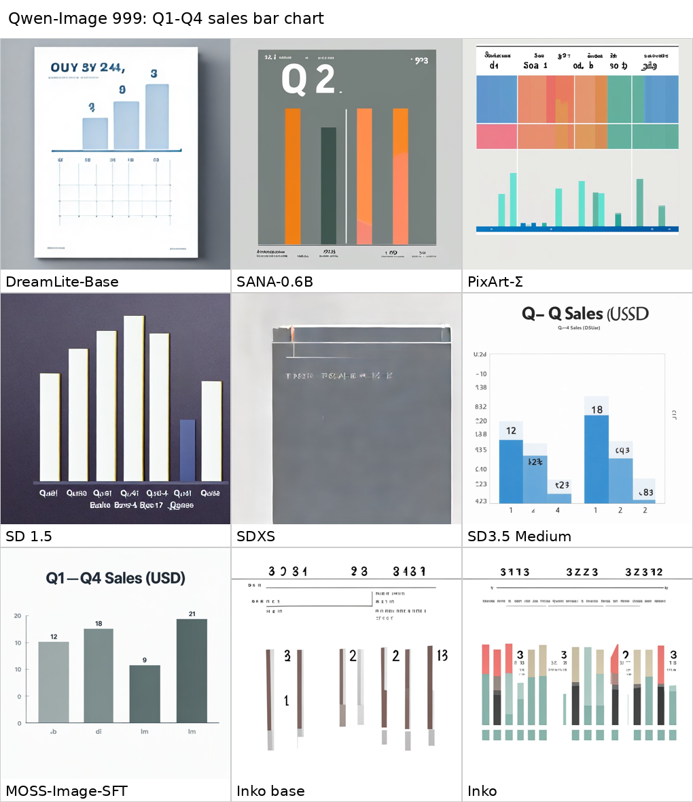

Exact prompt for the bar-chart case

> Generate a minimalist bar chart poster titled "Q1–Q4 Sales (USD)", with the four bars containing values of 12, 18, 9, and 21 (numbers labeled at the top of the bars). The color scheme should be restrained with ample white space. The numbers should be clear and not misaligned, and the axes and scales should be simple, making the overall design suitable for business presentations.

## Style, diversity and fine art

OneIG style separates traditional, media and anime families, weighting styles equally within each mean. Inko's media-family score of 0.396 is the highest in the table. Traditional style is 0.341, close to SANA at 0.342 and above SD3.5 at 0.321, but behind DreamLite at 0.364, PixArt at 0.356, MOSS at 0.367 and SD 1.5 at 0.438.

| Style family | Styles | DreamLite | SANA | PixArt-Σ | SD 1.5 | SDXS | SD3.5 | MOSS | Inko base | Inko |
|---|---|---:|---:|---:|---:|---:|---:|---:|---:|---:|
| Traditional | 13 | 0.364 | 0.342 | 0.356 | 0.438 | 0.247 | 0.321 | 0.367 | 0.359 | 0.341 |
| Media | 8 | 0.357 | 0.294 | 0.266 | 0.335 | 0.271 | 0.331 | 0.374 | 0.371 | 0.396 |
| Anime | 8 | 0.457 | 0.464 | 0.515 | 0.366 | 0.307 | 0.464 | 0.452 | 0.347 | 0.326 |

The family means hide a highly uneven painting profile. Inko's per-style scores include 0.413 for Chinese ink painting over three prompts and 0.546 for Art Nouveau over four, compared with 0.147 for Baroque, 0.126 for Rococo and 0.195 for Impressionism, each over four prompts. Watercolor scores 0.213 over four. These small channel readouts explain why the aggregate cannot stand in for every artistic medium. The custom suite below uses different prompts, so its cases and these channel scores offer complementary views of the same uneven control.

Diversity measures pairwise [DreamSim](https://github.com/ssundaram21/dreamsim) variation among four draws of a prompt. Among the external entries, only SD 1.5 scores higher than Inko, 0.425 to 0.245. On the separate alignment benchmark, Inko scores 0.810 against SD 1.5 at 0.583. Among the entries with comparable alignment, Inko edges PixArt at 0.239 and SD3.5 at 0.241, while Inko base records 0.298 on the same diversity channel. Portrait diversity is less strong at 0.163, trailing SANA, PixArt, SD3.5 and MOSS, while knowledge-reasoning and text prompts produce more variation.

The custom comparisons below examine the target domain directly: Chinese traditional painting, Western fine-art movements and composition across style and subject. The eleven cases are the primary target-domain assessment; OneIG's per-style channels provide a small quantitative supplement. The comparisons consider prompt adherence together with medium-specific structure, including how ink washes establish depth, whether fine brushwork survives, and what happens when a modern object enters a traditional visual language.

For each prompt, the panels show one seed-42 generation from every entry using its native inference recipe. Inko base and Inko occupy the bottom row. Five prompts are Chinese and six are English. Chinese prompts are paired with Chinese painting and the cross-style muscle car, while English prompts cover Western movements; the suite therefore mirrors their intended bilingual usage. The English-centric CLIP models also truncate these Chinese prompts, so their outputs primarily illustrate behavior under an input regime they were not designed for.

### Chinese traditional painting

The four prompts require different kinds of control: atmospheric depth, countable subjects and fine brushwork, mineral-pigment gradation, and a densely constructed architectural landscape.

#### Ink-wash mountain landscape (16:9)

Prompt and English translation

> 水墨山水画，群山层叠，云雾穿行于山谷之间，一条溪流从远山蜿蜒流向近景，岸边孤松横斜，一叶小舟泊在水面。以浓淡墨色表现山石远近，焦墨勾勒松枝，留白构成云雾与水面，纸本水墨，兼工带写。

> *English translation:* An ink-wash landscape painting, with mountain ranges layered one behind another and clouds and mist threading through the valleys. A stream winds from the distant mountains into the foreground; a lone pine leans sideways on the bank, and a small boat is moored on the water. Use light and dark ink to convey the mountains' distance and nearness, dry, dark ink to outline the pine branches, and reserved white space to form the clouds, mist and water. Ink on paper, combining meticulous and freehand brushwork.

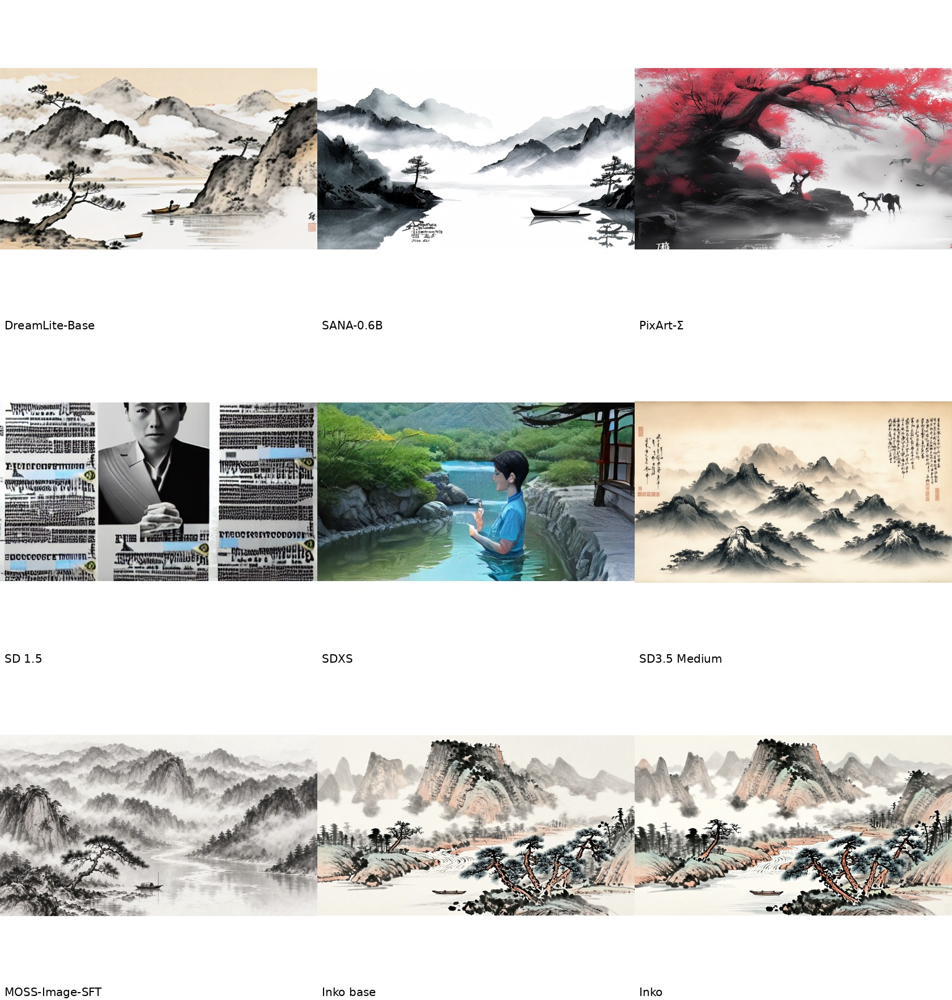

A continuous stream carries the eye from the pale mountains into the foreground, where a small boat sits on an unpainted expanse of water. Large reserves read as mist and water. Dense pine-needle clusters and dry, dark trunks stand against broad gray mountain washes, giving the requested mixture of controlled and free brushwork. Pale ochre washes cover several rock faces, while blue-green accents remain subordinate to the darker ink structure.

The solitary pine becomes a foreground group, however, and several similarly dark trunks make the near bank busier than requested. MOSS achieves comparable mountain and tree detail with a more continuous wooded atmosphere, while DreamLite and SANA use broader reserves and simpler geography. SD3.5 also retains layered ink mountains but gives the stream and boat no clear foreground role. PixArt replaces the stream-and-boat composition with red foliage and animals. SD 1.5 produces a portrait-and-text collage, and SDXS a modern figure beside water, so neither reconstructs the requested painting.

#### Gongbi plum blossom and two birds (1:1)

Prompt and English translation

> 工笔花鸟画，一枝白梅斜伸入画，两只山雀停在枝头，羽毛丝理细密，花瓣以白粉分染，枝干用中锋细线勾勒。绢本设色，构图疏朗，细节精致，色调清雅。

> *English translation:* A gongbi bird-and-flower painting: a branch of white plum blossoms extends diagonally into the picture, with two small tits perched on the branch. The feather filaments are fine and dense, the petals are graded with white pigment, and the branches are outlined with fine lines drawn with a centered brush tip. Color on silk, a spacious composition, exquisite details, and an elegant, restrained palette.

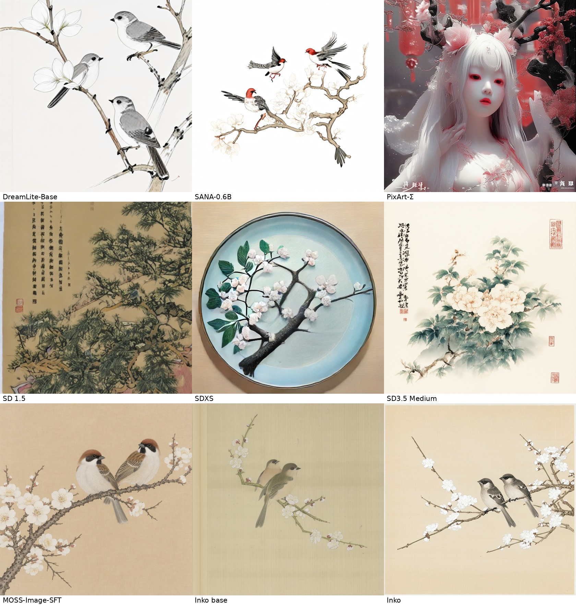

Two perched birds sit side by side on a diagonal white-plum branch, both facing left within a large silk-colored reserve. The composition remains sparse: branches enter from several edges, but the central pair is undisturbed by extra birds or decorative motifs. Fine parallel lines are visible in the wing and tail feathers, and the white blossoms retain their outlines against the pale ground.

The gongbi discipline is less consistent in the broad shading of the birds' breasts and the repeated blossom shapes, which are smoother and simpler than the requested dense feather work. MOSS also satisfies the two-bird constraint and gives the plumage finer hatching. DreamLite draws precise contours but three birds; SANA likewise has three, with one in flight. SD 1.5 and SD3.5 retain plant imagery without birds, SDXS turns the branch into decoration on a plate, and PixArt substitutes a woman for the bird-and-flower study.

#### Gongbi peony in rich color (1:1)

Prompt and English translation

> 工笔重彩牡丹，绢本设色，宋代院体。一枝牡丹从右下斜出，花瓣层层分染，石青石绿点叶，赭石勾枝，背景旧绢微黄，画面留白，左下角朱红印章。

> *English translation:* A gongbi peony painting in rich color, color on silk, in the Song-dynasty court-academy style. A peony branch slants out from the lower right; the petals are graded in layer upon layer of color, the leaves are dotted with azurite blue and malachite green, and the branches are outlined in brown ochre. The background is old silk yellowed slightly with age; the picture retains blank space, with a vermilion seal in the lower-left corner.

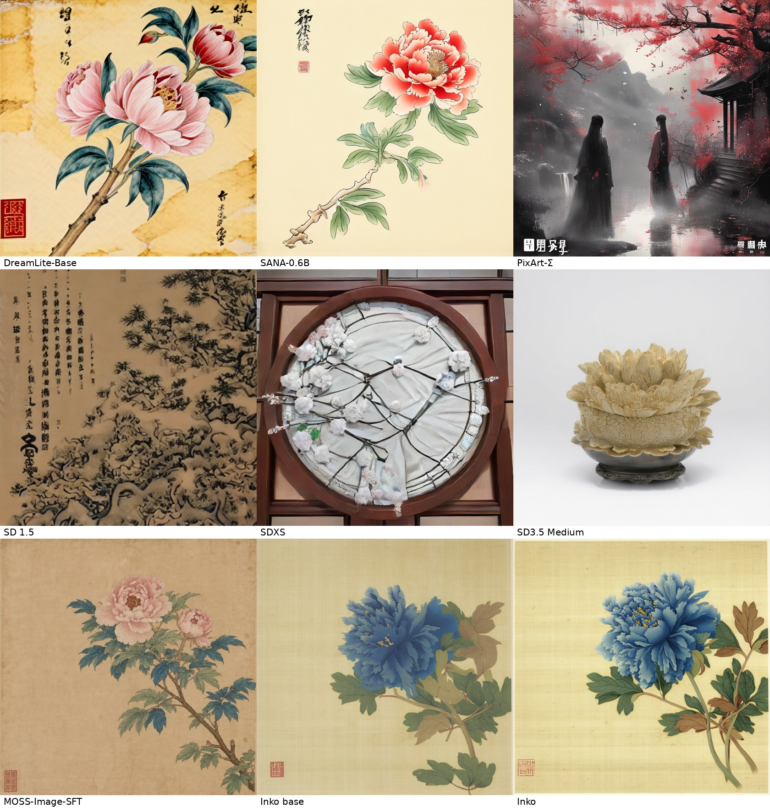

Inko follows the compositional instructions closely: one peony branch enters from the lower right, the blossom dominates a large reserve of yellowed silk, and a vermilion seal sits in the lower-left without added calligraphy. Ochre stems and outlined leaves provide a linear scaffold, while the blue petals carry dense, layered gradation from pale edges to a dark heart.

The pigment assignment is an adherence miss. Azurite blue concentrates in the flower rather than joining malachite green in the leaves, which are mostly green and ochre. The petals also rely on soft, broad shading, where MOSS retains finer contour lines and more explicitly blue-green foliage. DreamLite and SANA produce recognizable peonies but add unrequested inscriptions; Inko keeps only the requested seal.

#### Blue-and-green landscape with pavilions (16:9)

Prompt and English translation

> 青绿山水，绢本设色，仿唐宋金碧山水。层叠山峰以石青石绿敷色，山腰楼阁朱柱金瓦，云雾留白，近景松石，画面填满，无装裱边框，旧绢底色温润。

> *English translation:* A blue-and-green landscape, color on silk, imitating Tang- and Song-dynasty blue-green-and-gold landscape painting. Layered peaks are colored with azurite blue and malachite green; pavilions on the mountainsides have vermilion pillars and golden tiles; clouds and mist are formed by reserved blank space; pine trees and rocks stand in the foreground. The picture is fully filled, with no mounting border, and the old-silk ground has a warm, mellow tone.

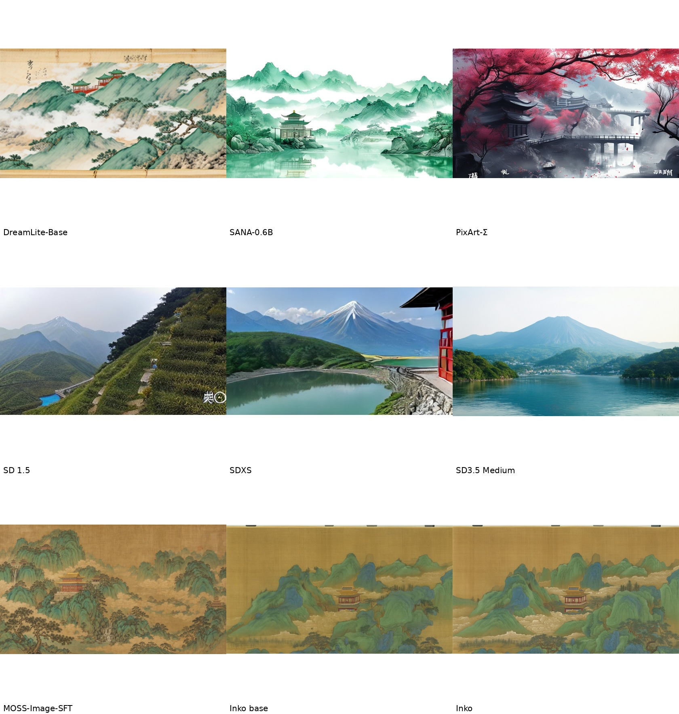

Inko establishes the blue-green-and-gold family through mineral-colored peaks, a warm old-silk ground and pale reserved clouds. The central pavilion has vermilion columns and gold roof outlines, while gnarled pines and rocks fill the foreground. These elements occupy one continuous landscape rather than a collection of isolated Chinese motifs.

The smaller constraints are uneven. Gold picks out the pavilion's roof ridges but not its tiles, and small dark mounting tabs intrude along the upper edge despite the request for no mounting border. DreamLite makes the same border error more explicitly with a full scroll mount. MOSS is stronger on the central medium: finer mountain contours, layered architecture and intricate pine work produce a denser blue-green-and-gold painting on a similarly warm ground.

### Western fine-art movements

The six movements make different demands: directed light and material, dense botanical description, a transient action, expressive color, dreamlike atmosphere and ornamental line.

#### Baroque still life with silver and fruit (4:3)

Prompt

> A Baroque still life oil painting. A silver tazza with pomegranates, grapes and a cut lemon on a dark wooden table, a tall glass, strong chiaroscuro light from the left, deep shadows, crisp highlights on silver and fruit skin, visible canvas texture.

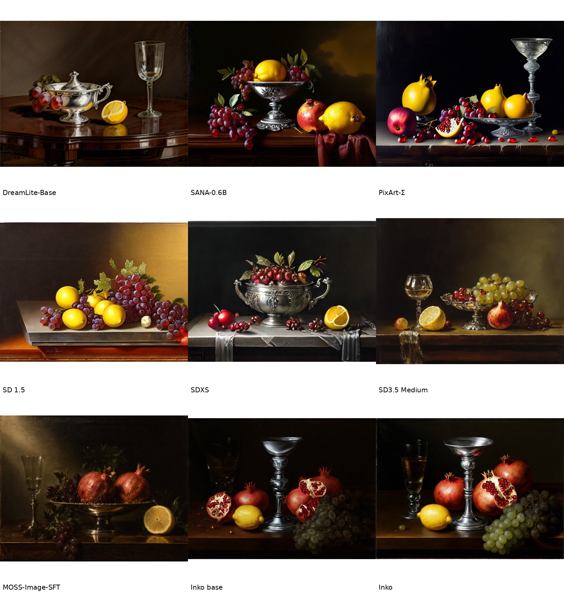

Inko builds the scene around material contrast. Broad highlights travel across the central silver tazza, pomegranate seeds and grape skins carry smaller reflections, and the tall glass remains dark but translucent. Left-hand illumination and a deep background tie these textures into a convincing Baroque still life.

The object relations are less exact. The tazza stands empty behind fruit arranged on the table, and the lemon is whole rather than cut. DreamLite, SD3.5 and MOSS include a cut lemon; MOSS also lets fruit overlap the dish, making the still life feel assembled rather than spaced out. Inko's separated objects are readable, but its symmetrical central stem and evenly spaced fruit give the composition a more ceremonial than spontaneous character.

#### Pre-Raphaelite walled garden (4:3)

Prompt

> A Pre-Raphaelite painting of a walled medieval garden at twilight, a woman in a flowing green gown seated beneath an apple tree, long auburn hair, detailed roses, foxgloves and tapestry-like foliage, hands hidden in her lap, luminous color.

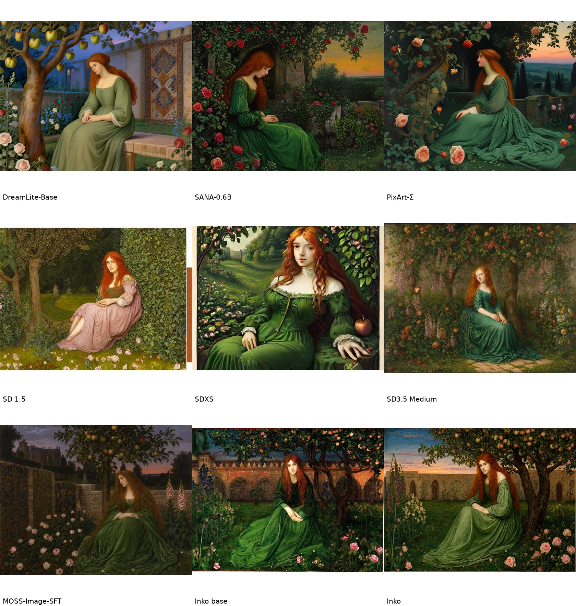

Inko makes the garden do more than supply a backdrop. Apples canopy the seated woman, pointed arches establish the medieval wall, and roses and foxgloves remain recognizable among the denser ground cover. Repeated strokes in the green drapery echo the tapestry-like foliage, while the auburn hair provides a controlled warm accent against the cool twilight.

The dense botanical setting is closer to the Pre-Raphaelite brief than SD 1.5's flatter ivy wall and SDXS's simplified garden. MOSS achieves comparable density with a darker, less luminous palette. Inko nevertheless leaves both hands visibly clasped over the lap rather than hidden within it, and its smooth, idealized face is less intensely observed than the fabrics and plants around it.

#### Impressionist ballet dancer (3:4)

Prompt

> An Impressionist oil painting of a ballet dancer tying her shoe beside a tall studio window, morning light falling across the wooden floor. Loose, visible brushstrokes, a muted palette with flashes of pale blue and rose, soft edges, and an informal behind-the-scenes composition.

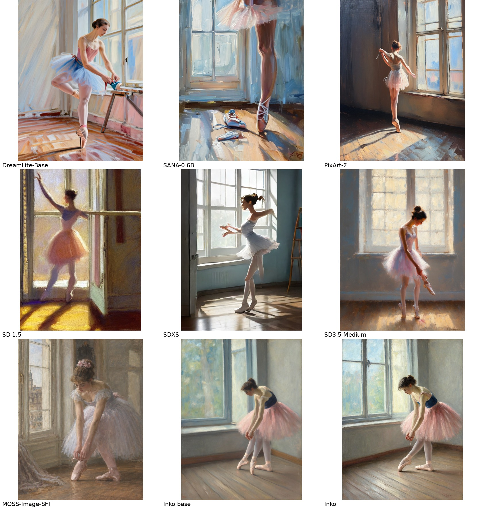

Morning light falls across the wooden floor beside a tall studio window, catching the blue bodice and rose tutu. Long strokes in the skirt and floor contrast with the smoother window light, and the bent figure gives an informal backstage view rather than a performance pose. The face, arms and tights are smoothly modeled. MOSS uses softer, more broken handling across the figure, while DreamLite uses broader, more angular strokes in the tutu and floor.

A loose ribbon hangs from Inko's clasped hands, but the hands stop near the knee, well above the extended pointe shoe. The image suggests preparation without actually showing the shoe being tied. DreamLite raises the shoe onto a small bench and puts the fingers at its ribbon, and MOSS bends the hands directly toward the foot, making the action legible. SANA instead turns shoes into an oversized central motif and introduces casual sneakers; PixArt and SDXS show dancing or posing rather than tying.

#### Post-Impressionist wheat field (4:3)

Prompt

> A Post-Impressionist oil painting of a wheat field under a turbulent evening sky, with a winding path leading toward a small village. Thick impasto, directional rhythmic brushwork, intense ultramarine and ochre, expressive color used to shape the landscape rather than merely describe it.

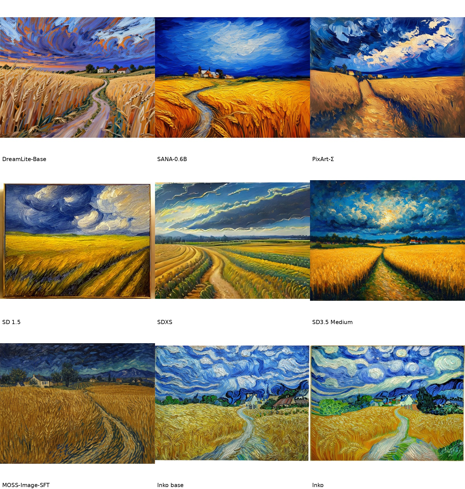

Ultramarine and ochre structure the landscape. A blue-green path pulls the eye through the wheat toward a compact village, while directional strokes follow the stalks, spiral clouds and outlined hills. Thick ridges of simulated impasto remain visible across both sky and field, giving the surface a rhythmic structure that suits the prompt.

The image also relies on highly recognizable Van Gogh motifs: spiral clouds, cypress-like trees and heavily outlined hills. The result reads as a direct quotation of that vocabulary: immediately recognizable and stylistically coherent, but less original in its interpretation of the landscape. DreamLite, SANA and PixArt retain directional wheat and blue-ochre contrast with less literal cloud imagery. MOSS chooses a much quieter sky and darker field. SD3.5 also retains thick impasto, but organizes its sky around a bright central glow rather than repeated spirals.

#### Symbolist moonlit pool (16:9)

Prompt

> A Symbolist painting of a veiled figure standing at the edge of a moonlit pool, surrounded by irises and floating points of light, deep violet, teal and silver, dreamlike atmosphere, soft edges, face turned away.

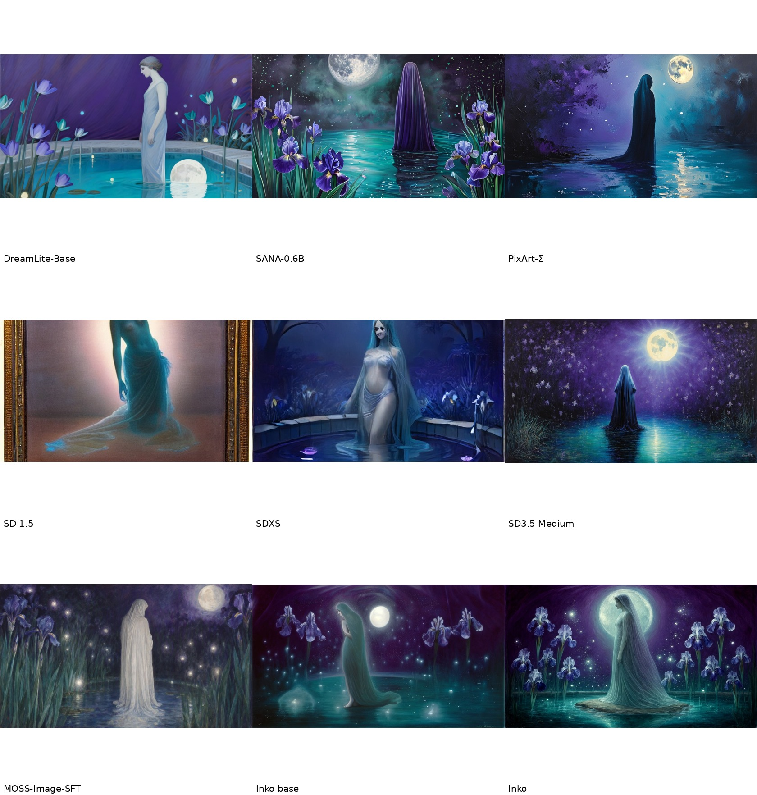

Inko turns the moon into a luminous backdrop for the veiled figure, with irises framing the pool and floating lights connecting sky and water. Violet, teal and silver remain distinct across the large shapes, and the soft veil, flower edges and reflections sustain the dreamlike atmosphere without dissolving the composition.

The interpretation leans toward contemporary fantasy illustration: the moon forms an almost perfect halo, and the symmetrical flowers make the scene deliberately iconic. The woman also stands on a small island in profile, whereas the prompt places her at the pool's edge with her face turned away. SANA and MOSS use rear views to satisfy that constraint more directly and avoid both the visible profile and the explicit halo.

#### Art Nouveau portrait (3:4)

Prompt

> An Art Nouveau portrait in profile of a young woman, framed by whiplash curves of irises and ginkgo leaves, an ornamental halo, muted gold, olive and dusty rose, flat decorative patterns, lithograph-like texture, no visible hands.

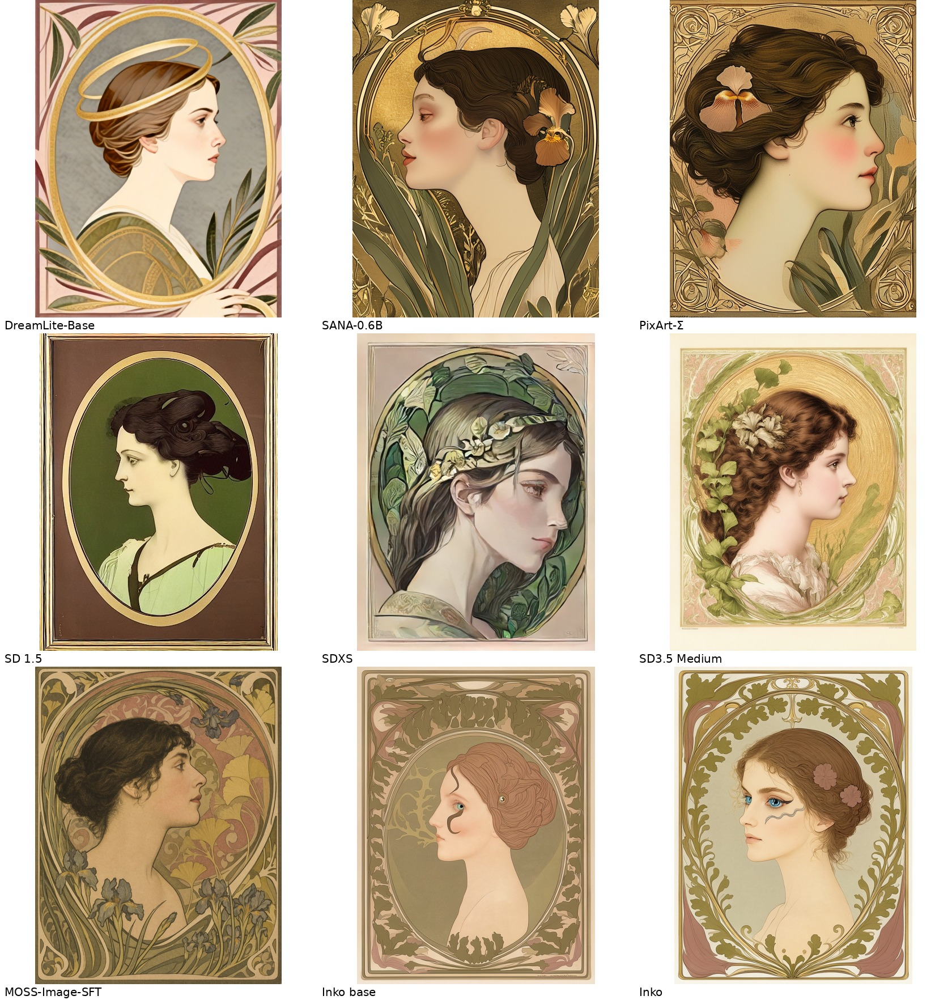

Inko treats Art Nouveau as an organizing system rather than a color filter. Concentric arcs form the ornamental halo, plant shapes repeat around the border, and the whiplash line across the cheek connects the portrait to its frame. Muted gold, olive and dusty rose, fine hair lines and flat background ornament support the lithographic character, and no hands appear.

The botanical brief is less faithfully resolved. The border reads as oak-like foliage and the hair carries round pink flowers, not the specified irises and ginkgo leaves; both eyes are visible, so the head is not a strict profile. SANA and MOSS introduce recognizable irises, while MOSS integrates plants and figure most densely. DreamLite has the opposite problem: its profile is clear, but a hand enters at the bottom and the halo becomes a floating ring detached from the ornament.

### Cross style–subject composition

The mechanical subject tests whether each model can retain a vehicle's defining geometry while changing the painting medium.

#### American muscle car in ink wash (1:1)

Prompt and English translation

> 水墨画风格，一辆美式肌肉车，车身低矮宽大，长引擎盖、短车尾，侧身线条硬朗。以浓淡墨色渲染车身，焦墨勾勒轮廓与轮毂，淡墨晕染阴影与地面，留白处透出宣纸质感。构图取三分之四前侧视角，车头略微朝左，背景以极简远山与薄雾衬托，营造刚柔对比的静谧氛围。整体色调仅黑、白、灰，笔触有干湿浓淡变化，兼工带写，气势沉稳。

> *English translation:* Ink-wash painting style: an American muscle car with a low, wide body, a long hood, a short rear deck and hard, angular side lines. Use light and dark ink to render the body, dry, dark ink to outline the silhouette and wheel hubs, and pale ink to wash in the shadows and ground; leave white space that reveals the texture of xuan paper. Compose a three-quarter front-side view, with the nose pointing slightly left. Use minimal distant mountains and thin mist as the background, creating a quiet atmosphere of contrast between strength and softness. The overall palette is only black, white and gray, with dry and wet, dark and light variations in the brushwork, combining meticulous and freehand techniques and a calm, powerful presence.

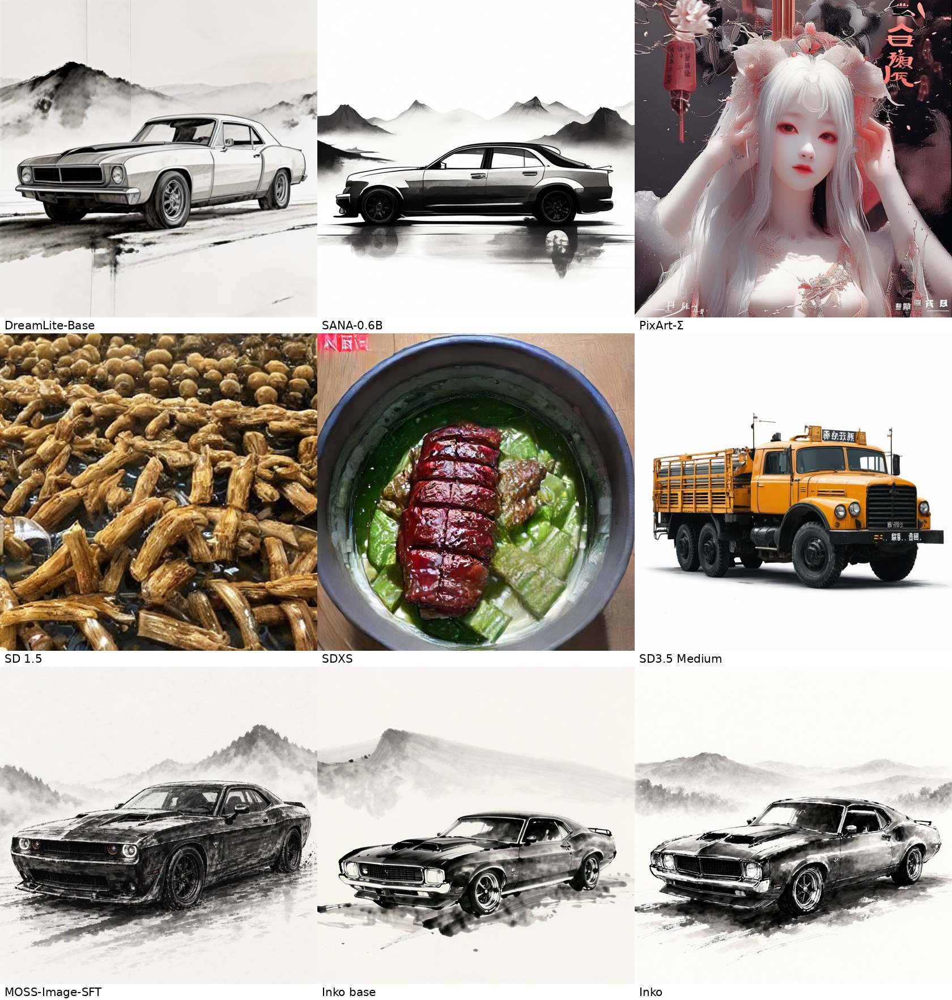

The muscle car retains its low, wide body, long hood, short rear and three-quarter front view with the nose turned slightly left. Ink density does the structural work: a dark grille and wheels anchor the car, diluted washes describe the door panels, and dry strokes spread across the ground. Pale mountain washes and large areas of reserved paper keep the vehicle dominant without isolating it from the landscape. Inko base is also coherent in this pair.

MOSS also preserves the muscle-car stance and monochrome medium with heavier contrast. DreamLite and SANA retain vintage cars in ink landscapes, but SANA chooses a near-side profile and DreamLite a more upright coupe silhouette. Inko's polished, chrome-like edging and evenly rendered wheels remain closer to automotive illustration than the freer mountains behind it, so the fusion is not completely uniform. PixArt replaces the car with a woman, SD 1.5 and SDXS with food, and SD3.5 with a yellow truck.

## Protocol and reproduction

Each entry generated the same released catalogs. GenEval has 553 prompts with four draws, DPG has 1,065 prompts with four draws, OneIG English has 1,120 prompts with four draws, TIIF testmini has 277 scenes with both short and long descriptions, and Qwen-Image-Bench has 1,000 IDs. Generation saves lossless PNGs. Official judges consume those saved images in isolated environments, and native aggregates are recomputed on CPU.

The Inko base CFG of 5.0 was selected from experience with the pretrained checkpoint; release CFG 4.5 was selected by a small sweep after post-training and before the benchmarks. Other sampling settings are identical between base and release. External models use their released pipelines and native recipes. SD 1.5 runs with its safety checker disabled.

## Synthesis

Inko's clearest identity is a compact fine-art generator designed for Chinese and English prompting, with strong dense-prompt alignment. Its 532M backbone competes with DreamLite, SANA and PixArt, and approaches SD3.5 Medium on DPG, OneIG alignment and Qwen-Image-Bench. Dense entities, attributes, relations and global composition are its most consistent general strengths. Diversity is also high relative to models with comparable alignment.

Exact text, knowledge reasoning, detector-based counting and some aspects of anatomy remain clear limitations. The release improves on the base in general scores and human-structure cases. Its remaining diversity and texture costs reflect the limited artistic sensitivity of the post-training reward system, so further gains depend on training that preserves its range.
