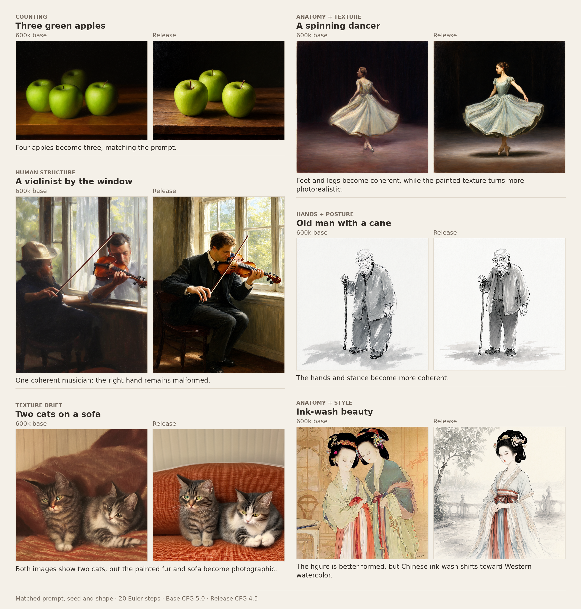
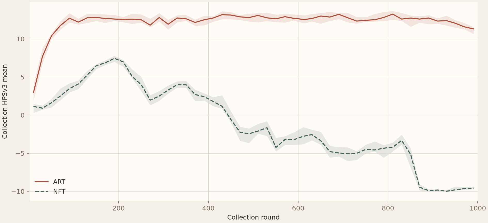
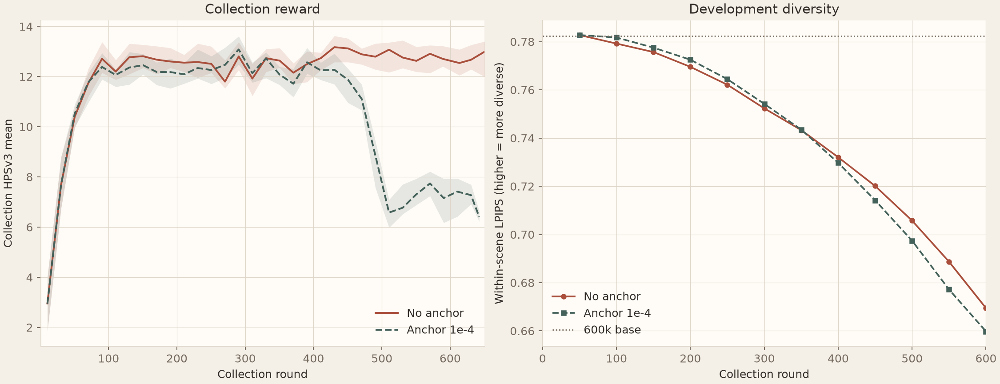
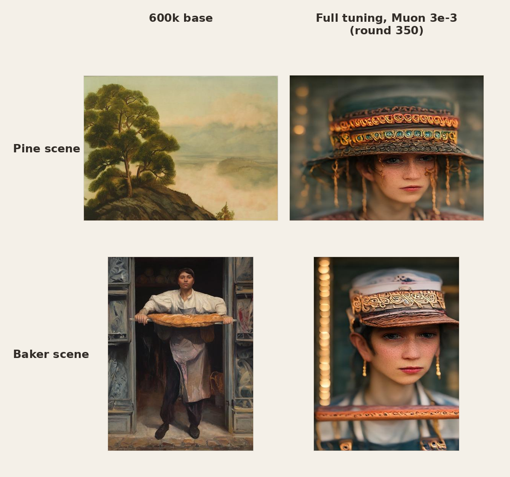
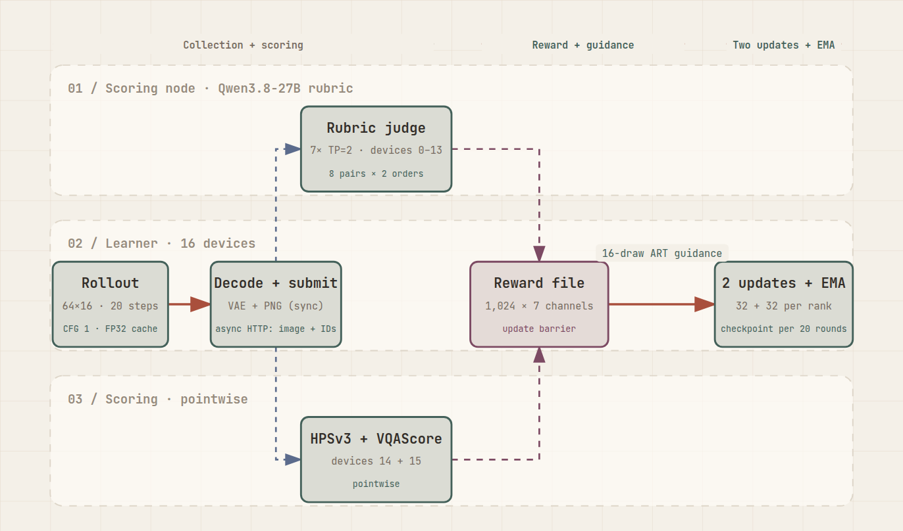
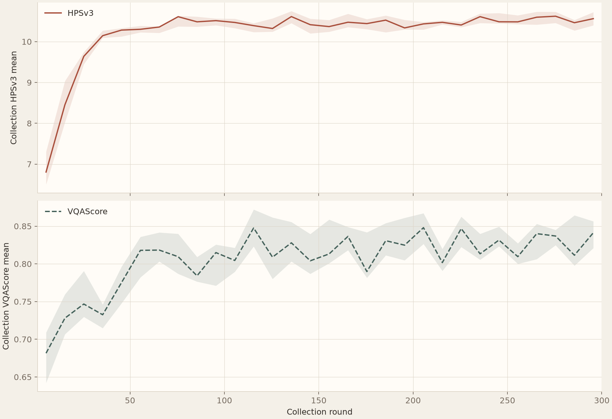
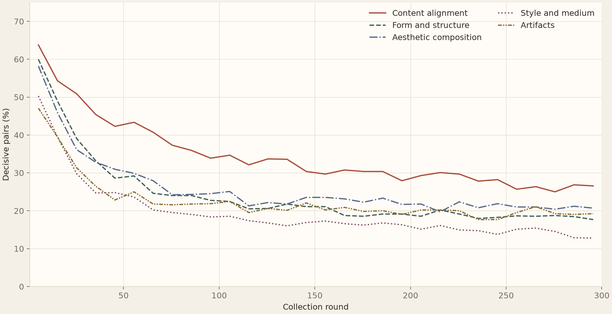
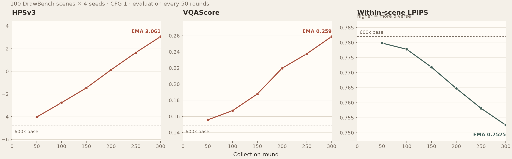

# Post-training

## Release overview

Post-training starts from the 600k pretrain EMA and uses DiffusionART to learn from rewards on the model's own generations. The release weights come from two runs: a main run stopped at 300 of its planned 500 rounds as collection rewards flattened, followed by a fixed 60-round specialized top-up for counting, people and short-prompt ability. Both used attention LoRA rank 64 with alpha 64, Muon LR $10^{-3}$, 20-step Euler rollouts at CFG 1.0, and EMA decay 0.999.



The six case studies were selected to show targeted improvements and accompanying drift. They use matched prompts, seeds and shapes with 20 Euler steps. Base CFG 5.0 was chosen from experience with the pretrained checkpoint; release CFG 4.5 came from a small post-training sweep. Counting and human structure improve, while several outputs drift toward photographic or Western watercolor aesthetics.

| Run | Base initialization | Adapter initialization | Rounds / updates | Destination |
|---|---|---|---:|---|
| Main run | 600k pretrain EMA | Fresh rank-64 LoRA | 300 / 600 | Round-300 EMA |
| Specialized run | 600k base with the main round-300 EMA adapter merged in | Fresh rank-64 LoRA | 60 / 120 | Round-60 EMA, exported as the release |

Production collection draws 64 prompts with 16 images per prompt at 896p. Seven reward channels combine five pairwise rubric judgments with HPSv3 and VQAScore.

## Why reinforcement learning

Post-training was planned before the 600k checkpoint was complete, and the base model's generations gave it four concrete targets: counting, position and layout adherence; anatomical collapses; composition across style and content, such as a structurally coherent muscle car in ink wash; and recovery of the short-prompt ability weakened during pretraining. The style–subject target matters especially for a fine-art model because conventional benchmarks rarely measure it directly.

Efficiency was the other direction considered. An earlier few-step distillation program investigated DMD at 480k, 640p and eight sampling steps. It produced severe texture collapse and drift. A small model already generates quickly with 20 steps instead of 50, so further distillation offered little against the diversity it put at risk. The project kept full-step generation and pursued quality instead.

RL offered a different training signal from another supervised stage. Targeted SFT would require high-quality images that directly repair the base model's failures, costing accelerator time or API fees and another filtering pass. The synthetic-data work had already shown that a strong generator does not guarantee useful training images. And the final pretraining data was also strong, so a repeat of supervised pretraining was less attractive than learning from comparisons among the model's own better and worse outputs.

The candidate algorithms came from two families. [Flow-GRPO](https://arxiv.org/abs/2505.05470) and [DanceGRPO](https://arxiv.org/abs/2505.07818) represented policy-gradient RL, screened out on performance and implementation complexity. [DiffusionNFT](https://arxiv.org/abs/2509.16117) offered a faster forward-process alternative with no special requirements on the generator. [DiffusionART](https://arxiv.org/abs/2610.12572) appeared during implementation; its HunyuanVideo comparison reported 12.02× fewer GPU hours than DiffusionNFT, and its image experiments avoided NFT's per-task old-policy EMA tuning. ART therefore entered the comparison as a challenger.

NFT constructs positive and negative objectives from forward-noised endpoints. ART aggregates each prompt group's rewards and terminal latents into one guidance direction, then applies that direction to states visited by the reverse rollout. Cached rollout velocities provide frozen targets, and two disjoint updates provide restoration without an old-policy EMA in the loss.

## Choosing the algorithm and recipe

Choosing between the two algorithms, and then fixing the recipe around the winner, was done by direct comparison under one protocol. Each selection run started from the 600k EMA, collected 12 prompts per round from a 512-prompt PickScore rollout subset and drew eight images per prompt at 896p, with HPSv3 and VQAScore as equal-weight rewards under round standardization. A separate development read measured the tradeoff every recipe had to balance: 100 DrawBench scenes with four seeds at CFG 1, scored by HPSv3 and VQAScore for adherence, plus within-scene LPIPS, the variation among the four draws of one scene, so that higher values indicate greater diversity. Once the recipe was selected, production started fresh from the 600k EMA.

### ART versus NFT

The algorithm comparison held the adapter fixed at rank-32 attention LoRA with alpha 32 and Muon LR $10^{-3}$ and let each algorithm complete 1,000 active collection rounds. One structural difference complicates a round-by-round read: ART makes two updates per round where NFT makes one, so equal round numbers mean different update counts and different EMA ages. The cleaner question is which algorithm reaches higher adherence at the same diversity. At nearly equal within-scene LPIPS, ART round 300, corresponding to 600 updates, reached development HPSv3 6.004 and VQAScore 0.266 with LPIPS 0.752, while NFT round 800, or 800 updates, reached only 0.044 and 0.209 with LPIPS 0.754. ART's development scores improved further through round 500, after which gains diminished while diversity continued to fall, so round 500 became the horizon for the remaining recipe comparisons. NFT added a collection-side failure on top: its collection HPSv3 eventually collapsed to roughly −10. ART became the production algorithm.



### Anchor, tuning scope, rate and rank

That diversity decline motivated the next experiment: whether an explicit pull toward the frozen base could improve ART's reward–diversity tradeoff. A fresh-base run changed only the frozen-reference velocity penalty from zero to $10^{-4}$; this arm pair ran to round 600, where the anchored arm trailed the control by 0.4964 development HPSv3, 0.0103 VQAScore and 0.00965 within-scene LPIPS. Collection HPSv3 also dropped around round 470 and stayed near 6–8, versus 12–13 without the anchor, and the generated images kept drifting toward similar portraits across unrelated prompts. The anchor had been proposed to protect diversity; with both adherence and diversity worse, there was no case left for it, and it was disabled thereafter.



With the anchor off, the remaining choices were tuning scope and rate: full tuning or rank-32 attention LoRA, each at Muon rates $3\times10^{-4}$, $10^{-3}$ and $3\times10^{-3}$. Selection weighed adherence, within-scene diversity and actual generations at the 500-round horizon. The two higher-rate full-tuning arms learned quickly but later lost prompt adherence and subject diversity. LoRA at $10^{-3}$ gave the best measured balance. Raising the LoRA rate to $3\times10^{-3}$ added 1.131 HPSv3 but lost 0.0871 LPIPS and slightly reduced VQAScore; lowering it to $3\times10^{-4}$ learned too slowly for that horizon.

| Variant | Two-reward development read | Decision |
|---|---|---|
| Full, $3\times10^{-4}$ | Round 150: HPS 2.303, VQA 0.2184, LPIPS 0.7834 | Stopped at round 160 after LoRA selection |
| Full, $10^{-3}$ | Round 500: HPS 11.193, VQA 0.1453, LPIPS 0.4688 | Reject for adherence and diversity loss |
| Full, $3\times10^{-3}$ | At round 350, 31 of 32 fixed development samples were similar portraits | Stop for broad collapse |
| LoRA, $3\times10^{-4}$ | Round 500: HPS 8.016, VQA 0.2880, LPIPS 0.7523 | Slower learning; the live model also developed portrait bias |
| LoRA, $10^{-3}$ | Round 500: HPS 10.295, VQA 0.3267, LPIPS 0.7057 | Select |
| LoRA, $3\times10^{-3}$ | Round 500: HPS 11.426, VQA 0.3223, LPIPS 0.6186 | More diversity loss without a VQAScore gain |

Rank 32 and rank 64 were then compared at $10^{-3}$ with alpha equal to rank. Their round-500 measurements were nearly identical: relative to rank 32, rank 64 gained 0.113 development HPSv3, lost 0.00175 VQAScore and gained 0.00199 LPIPS. I chose rank 64 for additional capacity in the planned seven-channel run, since its adapter cost was small beside generation and scoring.

### The pointwise-reward collapse

The selection experiments share one limitation that no recipe choice could fix: they optimized only HPSv3 and VQAScore, and the cost of that choice became visible in the generations themselves. Across several arms, unrelated prompts gradually produced similar ornate portraits, often while collection HPSv3 approached 15. The full-tuning $3\times10^{-3}$ arm gave the clearest visual record: pine landscapes and baker portraits collapse into variants of the same hat-wearing figure. Reducing the tuning rate or using LoRA delayed the failure without eliminating it. The selected $10^{-3}$ LoRA arm later produced floral portraits on unrelated prompts, and the lower-rate live model showed the same bias.



I read this primarily as overfitting to HPSv3, with diversity loss reinforcing the attractor; the experiments did not isolate VQAScore's separate contribution. General-purpose pointwise rewards could improve their own scores while destroying the subject and style range that Inko was meant to preserve. Production therefore needed a prompt pool and reward that represented the actual target, with those scorers no longer selecting the recipe by themselves.

## The rollout pool and rubric reward

The collapse settled the production design: both the rollout pool and the reward have to represent Inko's actual target. The pool seeds RL from concepts and media already present in pretraining, so post-training sharpens existing abilities and explores new style–subject combinations instead of asking RL to acquire an entirely new visual domain. The reward has to judge what the pointwise scorers could not: artistic conventions, anatomy and defects, alongside general prompt alignment. Five rubric categories supply that primary signal, with HPSv3 and VQAScore reduced to auxiliary roles.

The finished pool is published as [kaupane/inko-rollout-25k](https://huggingface.co/datasets/kaupane/inko-rollout-25k). It contains 24,579 rows: 23,572 train, 505 dev and 502 confirmation. Rows derived from the same seed content or sharing prompt text stay in the same partition, giving 21,813 scene groups in train, 463 in dev and 470 in confirmation. A separate specialized split supplies the later top-up.

### Three prompt branches


The image-seeded branch produces 50% of the pool. It draws a style image from d1 or d2, half each, and a content image from all four pretraining domains, 25% each, applying the manifest crop to each source. The prompt writer, deepseek-v4.1-flash, sees both images but none of their original captions. It writes a self-contained prompt, and the style image becomes the row's reference image.

The caption-seeded branch produces 40%, rewriting a caption drawn from d3 or d4, half each, with the same model. The short band produces the remaining 10% from no seed at all. Caption-seeded and short-band prompts go to a rubric writer conditioned on the prompt. The image-seeded rubric writer also reads the reference image. The three branches merge only at the finished pool.

Six axes shape the resulting distribution:

- **Style.** Chinese- and Western-painting references split the image-seeded half equally. Caption-seeded rows take style cues from their source captions, while the short band has no reference image.
- **Subject.** Content images cover all four domains uniformly and are sampled independently of the style image. This deliberately creates cross subject–style pairs, such as a muscle car in ink wash, while retaining natural pairs such as a landscape in ink wash.
- **Language.** Chinese and English, 50/50.
- **Length.** The image- and caption-seeded branches supply the 90% medium band, spanning 31 to 512 tokens and peaking near 256. The unseeded branch supplies the 10% short band, with at most 30 tokens.
- **Aspect.** 30% square, 40% landscape and 30% portrait, assigned in the production manifest rather than written into the prompt.
- **Rendered text.** When text is requested, the exact characters are quoted in the prompt, such as 「瑤臺霧浄」, and the rubric checks them verbatim.

At 64 prompts per round, the 300-round main run makes 19,200 prompt draws against the 23,572-row training partition, so no row repeats. Each row carries a prompt, rubric, seed kind and length tier; image-seeded rows also embed their reference image.

Two rows show how those choices become concrete conditioning and judging contracts.

<details><summary>Two rows from the pool: c05088 and i00004, with their rubrics</summary>

**c05088** (caption-seeded, English). A d3 caption rewritten by the prompt writer.

> A portrait of a fashionable woman wearing a floral dress and a hat, posing outdoors with a relaxed expression. She is the sole subject, centered in the frame, standing in a lush outdoor setting. Her dress features a lively floral pattern with soft fabric folds, and her hat is a stylish wide-brimmed sun hat, casting a gentle shadow over part of her face. Her posture is natural and at ease, shoulders relaxed, hands loosely held, weight shifted comfortably. Her expression is calm and unforced, with a subtle smile and a direct but gentle gaze. She appears confident yet approachable, as if pausing during a garden stroll or an outdoor event. The background includes blurred greenery, leaves, and hints of blooming flowers, creating depth while keeping focus on her. Natural daylight falls softly, enhancing skin texture, the print of the dress, and the weave of the hat. The atmosphere is airy, warm, and feminine, with a gentle breeze suggested by slight movement in the dress and hat ribbon. The camera captures her from a medium or three-quarter angle, allowing the floral dress and hat to remain prominent. The color palette comes from the dress and natural surroundings, with fresh greens and soft blossoms balanced against the fabric's floral hues. Lighting wraps gently around her, creating soft highlights and subtle shadows that give the image dimension and immediacy. Overall, it is an outdoor portrait focused on a fashionable woman, her floral dress, her hat, and her relaxed, pleasant mood.

Two of its criteria:

> **Content alignment.** 画面中「fashionable woman」存在且为唯一主体，符合「sole subject」，无其他人物或动物成为主体。(high)
>
> Whether the 「fashionable woman」 in the picture exists and is the sole subject, matching 「sole subject」, with no other person or animal becoming the subject. (high)

> **Style and medium.** 符合户外人像摄影的「medium or three-quarter angle」取景，浅景深使「blurred greenery」虚化，焦点落在人物面部与服装。(high)
>
> Whether the framing matches the 「medium or three-quarter angle」 of outdoor portrait photography, with shallow depth of field blurring the 「blurred greenery」 and the focus falling on the subject's face and clothing. (high)

The rubric's working language is Chinese, quoting the prompt verbatim in 「」 brackets, even when the prompt itself is English. The trailing (high) is the criterion's priority.

**i00004** (image-seeded, Chinese). The style source is an album leaf from a painted catalogue of things; the content source is a photograph of a couple at the seaside.


> 绢本工笔淡彩册页，画面四周环以朱红回纹连续边栏，内侧另衬一道淡青绿细线界栏。底质为泛黄的米白绢面，散布细小褐色霉斑与淡淡水渍痕迹。上部大面积留白处竖排楷书题识，自右向左依次为「海濱雙侶」，旁附小字一行「碧波千頃，遠岫如屏，扁舟一葉」。画面下部近岸浅水中，一男一女并肩背立，男子赤膊、着灰蓝短裤，女子着玄色泳衣、长发披肩，二人手臂相挽，一同望向海面。水波以极细匀密的墨线勾出，淡花青与石绿薄染，近岸一道碎白浪花；沙滩上以赭石与淡墨点染散落的珊瑚碎石与海藻。右侧水面浮一叶白色小舟，带低矮篷舱。远景以淡赭石写连绵干燥山峦，轮廓细线勾勒，天际留白，仅以淡蓝细线勾出几缕流云。
>
> A meticulous-brushwork, light-color album leaf on silk. The picture is framed on all four sides by a continuous vermilion key-pattern border, lined inside by an additional thin pale blue-green boundary line. The ground is a yellowed off-white silk surface, scattered with tiny brown mildew spots and faint water-stain marks. In the large blank reserve at the top, a vertical regular-script inscription reads from right to left as 「海濱雙侶」, with one accompanying line of smaller text, 「碧波千頃，遠岫如屏，扁舟一葉」. In the shallow near-shore water at the bottom of the picture, a man and a woman stand side by side, backs to the viewer; the man is bare-chested and wears grey-blue shorts, the woman wears a black swimsuit, her long hair over her shoulders; their arms are linked, and together they face the sea. The waves are outlined in extremely fine, evenly dense ink lines and thinly washed with pale indigo and mineral green, with a strip of broken white surf near the shore; on the beach, scattered coral fragments and seaweed are dotted in ochre and pale ink. On the water at the right floats a small white boat with a low covered cabin. In the distance, continuous dry mountain ridges are painted in pale ochre, their contours drawn in fine lines; the sky is left blank, with only a few strands of drifting cloud outlined in pale blue.

Three of its criteria:

> **Content alignment.** 上部留白处竖排楷书主文「海濱雙侶」四字是否逐字存在且字符序列与原文一致，排列方向为自右向左，无缺字、多字或顺序颠倒。(high)
>
> Whether the four characters of the main vertical regular-script inscription 「海濱雙侶」 in the upper blank reserve exist one by one, whether the character sequence matches the original, and whether the arrangement runs right to left, with no missing characters, extra characters or reversed order. (high)

> **Style and medium.** 与参考图相比，四周朱红回纹连续边栏及内侧淡青绿细线界栏的形制、纹样密度与线宽粗细的接近度。(high)
>
> Compared with the reference image, the closeness of the four-sided continuous vermilion key-pattern border and the inner pale blue-green thin boundary line, in form, pattern density and line weight. (high)

> **Defects.** 已渲染的「海濱雙侶」与「碧波千頃，遠岫如屏，扁舟一葉」字形是否存在错字、伪字、笔画粘连或结构崩坏。(high)
>
> Whether the rendered glyphs of 「海濱雙侶」 and 「碧波千頃，遠岫如屏，扁舟一葉」 contain wrong characters, pseudo-characters, fused strokes or structural collapse. (high)

</details>

### Rubrics and channel weights

The rubric writer is Qwen3.8-27B with thinking enabled, the same model later used for judging. For caption-seeded and short-band rows it reads only the prompt. For image-seeded rows it reads the prompt and reference image, with an explicit requirement to ground Style-and-medium criteria on the reference rather than inferring style from the prompt alone.

For image-seeded rows, reference grounding changes the style task. The judge compares two candidates against a shared reference and decides which is closer in style and texture, rather than assigning an absolute style score. Caption-seeded and short-band rows instead use the medium conventions stated in their prompts. Reference comparison made judging easier, but style and texture remained less reliable than content judgments and eventually limited how far post-training could go.

Five categories organize the visible requirements. Their inspiration comes from entrance-exam art grading and Xie He's Six Laws. Each requirement is assigned to one category, so a count error belongs to content, a malformed hand to form, and a medium mismatch to style; the categories do not score the same defect twice under different names.

| Channel | What the judge compares | Main weight | Specialized weight | Transformation |
|---|---|---:|---:|---|
| Content alignment | Objects, attributes, counts, relations, actions and requested text | 0.16 | 0.20 | Raw pairwise outcome |
| Form and structure | Anatomy, perspective and physical plausibility | 0.16 | 0.20 | Raw pairwise outcome |
| Aesthetic composition | Composition, color, light and rhythm | 0.16 | 0.06 | Raw pairwise outcome |
| Style and medium | Reference-image similarity or medium conventions | 0.16 | 0.06 | Raw pairwise outcome |
| Defects | Artifacts, collapse, extra limbs, watermarks, wrong or pseudo characters, color charts and pegboard textures | 0.16 | 0.20 | Raw pairwise outcome |
| HPSv3 | Pointwise image preference | 0.05 | 0.06 | Round standardization |
| VQAScore | Pointwise visual question answering | 0.15 | 0.22 | Round standardization |

Each criterion quotes concrete prompt words, identifies a visible feature and carries a priority such as (high). The judge returns one verdict per category, A wins, B wins or tie, with a short rationale. Scoring once per category rather than once per criterion greatly reduced judging time.

Every pair is judged twice with the presentation order swapped, and the two decisions merge into a scalar rubric reward on the raw 0, 0.5 and 1 scale. HPSv3 and VQAScore are standardized over the complete round before the weighted sum:

$$\tilde r=\frac{r-\mu_{\mathrm{round}}}{\sigma_{\mathrm{round}}+\epsilon}.$$

The unstandardized rubric channels respond directly to the amount of decisive evidence. When judges find meaningful differences, these channels supply within-group variation. As ties accumulate, their influence falls and the standardized pointwise scorers account for a larger relative share of the remaining guidance. Standardizing a rubric with only a few decisive pairs would amplify those pairs instead.

<details><summary>From rubric standard deviation to decisive pairs and direction energy</summary>

Each prompt's 16 draws form eight disjoint pairs. For one rubric category, a decisive pair receives $(0,1)$ after both presentation orders are merged; a tie or order disagreement receives $(0.5,0.5)$. If $\rho$ is the decisive-pair fraction, the image-level channel has mean $1/2$ and population variance $\sigma^2=\rho/4$, giving

$$\rho=4\sigma^2.$$

The logged quantity is the round-level population standard deviation across all draws, so this conversion applies directly. For example, $\sigma=0.20$ means that 16% of pairs were decisive. A tie can mean genuinely similar candidates or a distinction the judge missed.

Standard deviation alone does not measure a pointwise channel's contribution to ART guidance. For prompt group $g$, center each transformed channel within that group and form its weighted covariance with the terminal latents:

$$\Delta_{g,c}=\frac{w_c}{K-1}\sum_{k=1}^{K}(\tilde r_{c,k}-\overline{\tilde r}_{c,g})x_{g,k},\qquad \Delta_g=\sum_c \Delta_{g,c}.$$

The vector $\Delta_{g,c}$ is channel $c$'s contribution before the common MAD and unit-RMS normalization. Comparing its norm across channels shows which rewards supply within-group directions; the squared norm is the corresponding direction energy. Cross-channel inner products determine whether those directions reinforce or cancel.

</details>

An equal-weight pilot supplied the measurements used to tune the main production hierarchy. The rubric family contributed about 68% of summed per-channel direction energy. HPSv3 had a within-group standard deviation of about 0.38, with roughly 85% of its variance occurring between prompts, limiting its useful within-group guidance. I also kept its weight small because it had moved fastest during the pointwise-reward experiments and was associated with artifacts. The five rubric channels carry 80% of the main mixture; VQAScore supplies an auxiliary pointwise alignment signal at 0.15 and HPSv3 remains at 0.05.

### Prompt standards and quality gates

Every prompt follows one writing standard: self-contained, caption-style prose with no references to seed images, no negations of seed attributes and no imperative openings. Mechanical checks enforce schema, language, length and criterion structure, discarding non-conforming rows. The pool is decontaminated against DrawBench, GenEval, PickScore and HPS prompts through n-gram hits and multilingual embedding similarity, then deduplicated by embeddings.

## One training round

### From rollouts to rewards

Production uses one 16-device learner node and one 16-device scoring node. The learner holds the student, frozen text encoder, VAE and trajectory caches. On the scoring node, 14 devices serve seven Qwen3.8-27B replicas in TP=2 form, while the remaining two serve HPSv3 and VQAScore. This separation lets generation overlap the slow reasoning-based judgments.

The learner takes 64 prompts and collects 16 draws for each, using 20 deterministic Euler steps, CFG 1.0, shape-dependent timestep shift and text exit layer 20. The three 896p collection shapes are 896×896, 768×1024 and 1024×768. Development monitoring uses the same CFG as collection; release generation uses the separately selected CFG 4.5.



For every draw, the learner caches 20 prediction-site latents and predicted velocities in FP32 host memory. Decoded images are submitted asynchronously to scoring. The scoring service forms eight disjoint pairs within each prompt group and judges every pair in both presentation orders, covering all 16 draws once per rubric category while exposing order disagreement. Image-seeded rows include their reference image for style-and-medium comparisons. HPSv3 and VQAScore score the same images pointwise.

The coordinator waits for all seven channels on all 1,024 images and assembles the weighted rewards. Every learner waits for that complete reward file before guidance, so scoring can overlap generation but cannot cross the update barrier.

### ART's two updates

The combined reward for draw $k$ is $R_k=\sum_c w_c\tilde r_{c,k}$. For each complete 16-draw prompt group, ART computes a reward-endpoint covariance and normalizes it to unit RMS:

$$\overline R=\frac1K\sum_{k=1}^K R_k,\qquad r_k=R_k-\overline R,$$
$$\operatorname{cov}=\frac{1}{K-1}\sum_{k=1}^K r_kx_k,\qquad \operatorname{MAD}=\frac1K\sum_{k=1}^K|r_k|,$$
$$G=\frac{\operatorname{cov}/\operatorname{MAD}}{\operatorname{RMS}(\operatorname{cov}/\operatorname{MAD})}.$$

Here $x_k$ is the terminal latent and $K=16$. The group is completed across learner ranks before guidance is computed. Exactly constant combined rewards make the group inactive.

At every cached trajectory state, the frozen target is $v_{\text{target}}=\operatorname{stopgrad}(v_{\text{old}}+G)$. Inko uses $t=0$ for noise and $t=1$ for data, so the per-item loss weights velocity MSE by $1-t$. A directional trust-region mask limits movement away from the cached rollout prediction while leaving corrections back toward it active. The frozen-reference velocity penalty is zero.

The round splits whole trajectories into two disjoint windows. Each of the 16 learner ranks holds 64 trajectories, one draw from every prompt, and shuffles them into two sets of 32. Each window therefore contains 512 trajectories globally and all 20 states from those trajectories, followed by one Muon update. Both windows use targets frozen at collection time. If $d=v_{\text{new}}-v_{\text{old}}$, the second window's residual is $G-d$, restoring the cached prediction as the student moves away from it. All trainable tensors are LoRA A/B matrices optimized by Muon.

ART needs no old-policy EMA in its objective. Inko maintains a separate EMA of the trainable LoRA parameters after each update for interval evaluation and export. Checkpoints appear every 20 rounds. The fixed visual monitor compares the entry model and student EMA on 48 Chinese and English entries from 12 scenes, with short and long prompts at matched seeds and aspect ratios.

<details><summary>ART coordinate mapping and trust-region details</summary>

The ART reference uses decreasing noise time $\sigma$ and velocity $\epsilon-x$. Inko sets $t=1-\sigma$ and $v=x-\epsilon$, so the reference's negative integration step becomes a positive $dt$ and its target $v_{\text{old,ref}}-G$ becomes $v_{\text{old}}+G$ in Inko's coordinates. Products and squared terms in the restoration and trust-region calculations are invariant under the paired sign changes.

For a cached state $z$, physical time $t$, rollout step $dt$, current displacement $d=v_{\text{new}}-v_{\text{old}}$ and residual $\operatorname{target}-v_{\text{new}}$:

```text
alignment   = mean_elements(stopgrad(d) * stopgrad(residual))
l_art       = (1 - t) mean_elements(residual^2)
std         = 0.8                                  at t = 0
              0.8 sqrt((1 - t) dt / t)              otherwise
coefficient = dt                                   at t = 0
              dt (1 + 0.5 * 0.8^2)                 otherwise
proxy       = coefficient^2 mean_elements(stopgrad(d)^2) / (2 std^2)
keep        = active and not (proxy >= 1e-5 and alignment > 0)
```

The 0.8 reference noise level and $10^{-5}$ threshold are ART paper constants. Masked and inactive items contribute zero loss while remaining in the window's item denominator. Collection IDs and seeds advance through an entirely inactive round, but optimizer and EMA state remain fixed.

</details>

### Making scoring feasible

Reasoning-based scoring dominated production time. Greedy decoding could repeat indefinitely on generated lettering; sampled decoding with medium reasoning ended all three observed failures. On that failure cohort, medium reasoning used 6,826 completion tokens versus 15,903 with the default xhigh setting, a 57% reduction. Disabling reasoning was faster but confused references with candidates and invented objects. A constrained five-line final response made verdict parsing strict without constraining the reasoning itself.

Seven TP=2 replicas also provided useful parallelism. Three TP=4 replicas sustained about 3,134 generated tokens per second across 12 devices, or 261 per device. The selected TP=2 deployment sustained about 4,458 across 14 devices, or 318 per device. Dispatching by available slots kept new work from entering a busy replica while another was idle.

The Ascend runner initially copied the full logits matrix to CPU for structured-output masking on every decoding step, including unconstrained reasoning rows. A selective path transfers only rows with an active grammar mask, cutting a separate 1,536-image qualification workload from 1,168.63 to 1,065.93 seconds, an 8.8% reduction in elapsed time.

The original 80-prompt × 48-draw collection could not fit the runtime budget. The final 64-prompt × 16-draw shape reduced prompt groups while retaining 16 draws for pairwise guidance and 512 whole trajectories per update across 16 ranks. ART reports stability with smaller groups, but 16 was a conservative choice for the new reward system.

The completed main run averaged about 784 seconds per round: roughly 107 seconds collecting, 445 seconds waiting for scoring, and 233 seconds across the two updates. Pipeline overlap remained incomplete, with large bubbles. These timings explain both the emphasis on scorer optimization and why additional LoRA capacity added relatively little cost.

## The two production runs

### The 300-round main run

The main run started fresh from the 600k EMA with the selected ART recipe and seven-channel reward. It collected 307,200 images and trained 6.144 million trajectory sites over 300 rounds and 600 updates. Qualitative review of the fixed 48-entry monitor found no severe portrait attractor.

Most collection-reward gains arrived within the first 100 rounds. Mean HPSv3 reached 10.420 in rounds 51–100 and stayed within 10.423–10.554 in later 50-round blocks; VQAScore stayed within 0.824–0.830 after reaching 0.806. At the same time, decisive-pair ratios declined across all five rubric channels, reducing the raw rubric contribution to later updates.





With collection rewards flattening, a second read checked whether held-out quality still improved. Development evaluation used a different population: 100 DrawBench scenes with four seeds at CFG 1. HPSv3 and VQAScore therefore started much lower than their collection counterparts. With HPSv3 reduced to 0.05 in the seven-channel production reward, these values also form a separate trajectory from the equal-weight selection experiments. Both development point estimates were still rising at round 300, with gains over the 600k base of 7.81 HPSv3 and 0.110 VQAScore, while within-scene LPIPS continued to decline.



The stopping decision came from the collection curves and the visual monitor: in one of the fixed monitor scenes, `style_pines`, the student showed a very slight loss of faded texture. With collection rewards flattening, decisive rubric pairs falling and diversity declining, the still-rising development scores did not justify further drift, so the planned 500-round run stopped at 300.

### The 60-round specialized top-up

The specialized run targeted counting, people and spatial relations, and attempted to recover short-prompt ability. Its split contains 3,840 rows: 3,640 selected from the main pool by bilingual counting, position and people tags, plus 200 synthetic short prompts. Near-equal class quotas guide the selection, with overlapping rows serving every class they match. At 64 prompts per round, the fixed 60-round budget makes exactly one permutation pass through this pool.

The top-up changed data and reward together. The five rubric channels carry 72% of the specialized mixture, down from 80% in the main run, with more mass on content, form and defects and less on aesthetics and style. VQAScore rises from 0.15 to 0.22 as the stronger auxiliary alignment signal. This allocation reflected the main run's few decisive style pairs and slight pine-texture fading.

The scorer channel configuration was part of the resume contract and could not change mid-run, so the top-up required a fresh run. The main round-300 EMA adapter was merged into the 600k base, and a fresh rank-64 adapter was initialized on the resulting weights. A direct continuation with changed prompts and weights could be preferable, but the infrastructure did not support it.

The same 100-scene DrawBench protocol evaluated the top-up every 20 rounds. These measurements track general adherence and diversity during the run. The opening matched cases and the release benchmark channels below assess the targeted behaviors.

| Checkpoint | HPSv3 | VQAScore | Within-scene LPIPS |
|---|---:|---:|---:|
| Main round 300 (top-up entry) | 3.061 | 0.259 | 0.7525 |
| Specialized round 20 | 3.154 | 0.263 | 0.7527 |
| Specialized round 40 | 3.378 | 0.272 | 0.7531 |
| Specialized round 60 | 3.630 | 0.269 | 0.7517 |

Relative to the main-run endpoint, specialized round 60 gained 0.570 HPSv3 and 0.0105 VQAScore, with within-scene LPIPS changing by only −0.0008. The release is the specialized round-60 EMA.

## Release assessment and remaining headroom

The opening pairs show real gains with visible limits. The apple count changes from four to the requested three. The violinist becomes one coherent musician, although his right hand remains malformed. The dancer's feet and legs become coherent, and the old man's hands and stance improve. These cases give the counting, position and anatomy objectives a concrete form.

The remaining pairs reveal what changed around those gains. The dancer's painted surface becomes more photorealistic even as her anatomy improves. The two-cat prompt retains the correct subjects while its fur and sofa turn photographic. The ink-wash beauty gains a better-formed single figure but shifts from Chinese ink wash toward Western watercolor. Post-training therefore changed medium as well as structure, and not always in the intended direction.

The original style–subject objective appears directly in the [ink-wash muscle-car comparison](evaluation.md#american-muscle-car-in-ink-wash-11). The release preserves the low, wide body, long hood, short rear and three-quarter front view, using dark ink for structure and diluted washes for body panels and ground. The matched base is also coherent in this seed-42 pair, so the case demonstrates the release's cross style–subject capability rather than the size of its improvement.

Under the same checkpoint-specific settings as the image pairs, GenEval counting rises from 0.278 in the base to 0.350 in the release, position from 0.207 to 0.323, and color attribution from 0.398 to 0.542. Qwen-Image-Bench's Anatomical Portraiture channel rises more modestly, from 5.97 to 6.81. The remaining scores and the violinist's malformed right hand leave substantial room for further improvement.

Short- and long-prompt scores both rise in the complete release. TIIF short rises from 0.604 to 0.631, alongside long from 0.612 to 0.630. OneIG alignment rises from 0.775 to 0.804 on short prompts and from 0.774 to 0.804 on long prompts. The similar OneIG gains of 0.029 and 0.030 describe broad improvement across lengths rather than an isolated short-prompt effect from the specialized run.

Diversity has a clearer cost than the aggregate style score. OneIG diversity falls from 0.298 to 0.245, while aggregate style changes from 0.359 to 0.351. OneIG's two style families move in opposite directions: media rises from 0.371 to 0.396, while traditional falls from 0.359 to 0.341. The dancer, cats and ink-wash beauty give that uneven medium movement a concrete visual form.

The EMA makes the release conservative in another respect. Each run starts its EMA at a zero adapter delta, whose coefficient after $n$ updates is $0.999^n$: about 0.549 after the 600 main updates and 0.887 after the 120 specialized updates. The exported EMA therefore trails the live adapter, especially during the short top-up.

Across the two adapters, the release received only 720 updates, and the main development curves were still rising at handoff. More optimization remained feasible. RL had not removed the judgment problem; it had moved that problem from selecting supervised images to scoring the model's own rollouts. Custom rubrics and pairwise references made content and structure judgments useful, but artistic texture and style remained much harder for the reward system to measure. Continuing could have raised the measurable scores while moving further from Inko's fine-art target. The remaining headroom is therefore tied to better artistic judgment, not simply to more rounds.
