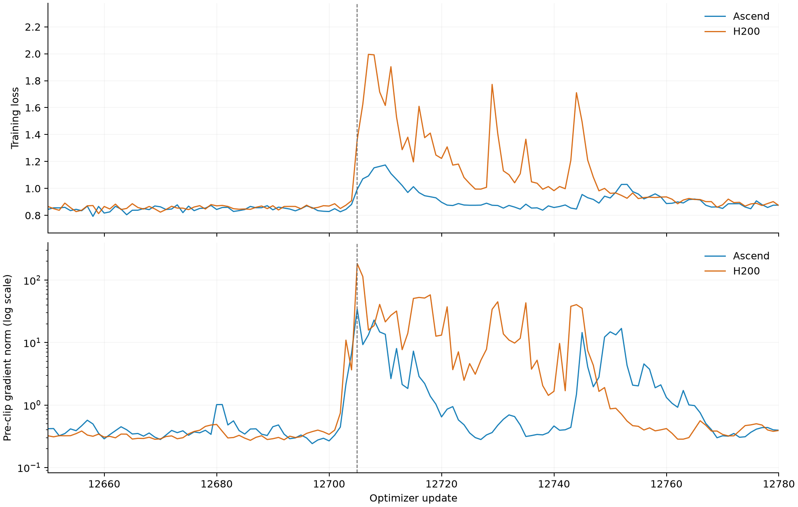

# Pretraining

## Pretraining at a glance

Inko's trainable diffusion backbone has **532,496,992 parameters**. Pretraining ran for 600,000 optimizer updates on 16 Ascend 910B2C cards, using rectified flow with a frozen Qwen3-0.6B text encoder and a frozen REPA-E image VAE. One global learning-rate schedule carried the model through three resolutions.

| Resolution | Optimizer updates | Actual duration |
|---|---:|---:|
| 256p | 450,000 | 160h 12m |
| 640p | 120,000 | 119h 11m |
| 896p | 30,000 | 44h 03m |
| **Total** | **600,000** | **323h 26m** |

The reported durations include evaluation and checkpoint work. Data-related pauses are documented in the [data chapter](data.md#weights-splits-and-events).

## Architecture under the 0.6B budget

The architecture was designed to a **0.6B trainable-parameter budget**.

| Component | Final setting |
|---|---|
| Backbone | Inko, hidden size 1152, 16 attention heads, 1 double-stream block followed by 24 single-stream blocks |
| Feed-forward | SwiGLU, width 3072, an 8/3 ratio to the hidden size |
| Text path | Frozen Qwen3-0.6B, online early exit at layer 20; 1024-wide features projected to 1152 |
| Image latents | Frozen [`REPA-E/e2e-qwenimage-vae`](https://huggingface.co/REPA-E/e2e-qwenimage-vae), 16 channels, spatial factor 8, 2×2 latent patches |
| Conditioning | Masked-mean text pooling fused with sinusoidal timestep features; factor-1000 timestep input; branch RMSNorm before residual gates |
| Normalization | Affine-free pre-branch LayerNorm; QK-RMSNorm and branch-output RMSNorm with learned gains; AdaLN-zero gates |
| Modulation | Independent image/text and attention/MLP modulation in the double-stream block; shared attention/MLP modulation in each single-stream block |
| Positions | Centered image RoPE and a fixed text diagonal |
| Optimizer | Chunked Muon for the main hidden matrices, auxiliary AdamW for embeddings, conditioning and output heads, norms and biases |

Branch RMSNorm and the factor-1000 timestep input are explained through the evidence in [Training stability](#training-stability).

Single-stream processing was attractive because double-stream blocks carry roughly twice the parameters at comparable compute. Z-Image's comparison of stream architectures favored all-single-stream processing for image quality, with weaker text rendering as the tradeoff. Since text rendering was not an Inko target, that tradeoff had little weight. FLUX.1 supplied the double-to-single ordering. A bounded matched-compute comparison of double-stream, single-stream and hybrid models found nearly identical loss, making parameter efficiency the deciding factor. The initial choice was full single-stream.

The final 1+24 assembly came later. Twenty-four single-stream blocks gave roughly 485M parameters, and one double-stream block brought the total to 532M.

The width–depth balance extrapolated a directional result from only two roughly 100M candidates: wider and shallower won on loss and Kernel Inception distance (KID), so I used 1152 with 24 single-stream blocks. A grid search to fit an optimal ratio would have been better, but was not performed. Head dimension 72 with 16 heads had a slight advantage over 64 with 18 in a small comparison. The 8/3 FFN ratio was a SwiGLU convention; the later change from 3075 to 3072 was for Ascend alignment.

Qwen3-0.6B followed the LLM-based conditioning direction established by Qwen-Image. The smallest Qwen3 model suited bilingual and long prompts, while freezing it avoided additional optimizer groups, learning rates and training memory. Early exit addressed a different hypothesis: final-layer features are prepared for next-token prediction and need not be best for visual conditioning. A sweep over layers {8, 16, 20, 24, 28} selected layer 20. Layer 28 had slightly lower loss, while layer 20 gave better KID and facial-structure review; layers 8 and 16 were too early. Intermediate-feature aggregation was not explored.

The VAE is the REPA-E fine-tune of the Qwen-Image VAE, selected because the REPA-E paper reported better DiT learning even without end-to-end VAE tuning during DiT training. Inko keeps it frozen and did not ablate the choice. The 2×2 latent patch size was inherited from the [original DiT](https://arxiv.org/abs/2212.09748).

Text conditions the blocks through joint attention and through a global modulation path. The latter mean-pools non-padding text features, projects them, and combines them with timestep features. Single-stream blocks share one shift, scale and gate between attention and MLP to save parameters. A matched comparison favored sharing on loss, KID and peak memory. The double-stream block was added later and kept independent modulation.

The positional layout follows Qwen-Image. Centered image coordinates were intended to reduce the largest absolute coordinates during extrapolation, while text tokens continue along a fixed diagonal beyond the image grid. An early comparison against a corner-origin image-diagonal variant tied at 320p transfer, and both failed at zero-shot scale factors of at least 1.875. Centering was not a measured winner; progressive training supplied the transfer mechanism.

Muon showed faster convergence than AdamW in a matched comparison. Fused QKV, modulation and gated-FFN matrices are split into functional chunks before orthogonalization, following [CMuon](https://arxiv.org/abs/2608.02502), which was not itself ablated. Auxiliary parameters use AdamW by convention. The initial Moonlight scaling convention and its correction appear in the stability account.

Matched architecture comparisons

| Decision | Comparison | Result |
|---|---|---|
| Width and depth | Two roughly 100M candidates under matched compute | Wider and shallower won on loss and KID, establishing the direction later extrapolated to 1152 × 24 single-stream blocks |
| Head shape | 72 × 16 versus 64 × 18 | A slight advantage for 72 × 16 |
| Single-stream modulation | Shared attention/MLP modulation versus separate modulation | Loss 0.9437 versus 0.9441; KID 0.0190 versus 0.0195; 8% lower peak memory |
| Qwen exit | Layer 20 versus layer 28, within the five-layer sweep | Loss 0.92160 versus 0.92134; KID 0.00892 versus 0.00922; stronger facial-structure review for layer 20 |
| Optimizer | RMS-matched Muon versus AdamW at 16,000 updates | Loss 0.91127 versus 0.92134; KID 0.00699 versus 0.00922 |

The Muon comparison establishes the convergence advantage of the tested RMS-matched recipe. It does not by itself qualify the final original-scaling implementation.

Final optimization settings

| Setting | Value |
|---|---|
| Muon | LR 0.02, weight decay 0.0015, momentum 0.95, original per-chunk scaling `sqrt(max(1, rows / cols))` |
| Auxiliary AdamW | Start LR 1e-5, peak LR 1e-4, final LR 5e-6, betas 0.9/0.95, epsilon 1e-8, ordinary decay 0.01 |
| Conditioning decay | 0.4 on `txt_pooled_proj.weight`, `c_mlp.0.weight` and `c_mlp.2.weight` |
| Schedule | 20k warmup followed by cosine decay over one 600k global horizon |
| Gradient clipping | Global norm 1.0 |
| Exponential moving average (EMA) | Bias-corrected, decay 0.9999, updated every optimizer step |

## Resolution and caption-length curricula

### Resolution

The 75:20:5 allocation across 256p, 640p and 896p was fixed before the staged run. Existing DiT recipes commonly spend most updates at low resolution and very few at the largest; Inko followed that prior because 896p training remained expensive.

Timesteps start from a logit-normal distribution with mean 0 and standard deviation 1. The model uses $t=0$ for noise and $t=1$ for data, with the SD3-style resolution shift. For latent spatial dimensions $H\times W$, the image-patch token count is $N=(H/2)(W/2)$ because patches are 2×2. The shift is $s=\sqrt{N/256}$ when $N>256$, and $s=1$ otherwise:

$$t' = \frac{t}{s-(s-1)t}.$$

The 256p reference geometry has $N=256$ and a neutral shift. Larger token counts shift sampled times toward noise under this convention.

Zero-shot positional scaling failed at factors of at least 1.875, so progressive training supplied the transfer mechanism instead. In the actual 256p→640p transition, adaptation took about 20k updates with EMA decay 0.9999.

### Caption length

For retained caption lengths $n_i$ within a selected image row, the length-based sampling probability is proportional to $n_i^\beta$, with $\beta$ moving linearly from −1 to +1 over the global run. Early training therefore favors shorter texts, while later training favors detailed conditioning. This ordering was designed from the beginning on the intuition that short prompts are easier to learn first.

For a row containing captions shorter than 256 tokens, 20% of the within-row probability mass is distributed uniformly over those short captions; the remaining 80% follows the power law, including any short captions within that part. Rows without short captions use the power law alone. The reserve maintains short-prompt exposure as $\beta$ rises.

Long captions remained scarce even after the enrichment described in the [data chapter](data.md#the-caption-strategy), so each conditioned example also receives a loss weight based on retained caption length $n$:

$$w(n)=\max\left(1,\log_2\frac{n}{128}\right).$$

Captions up to 256 tokens receive weight 1; weights are 2 at 512, 3 at 1024 and 4 at the 2,048-token cap. The update uses a weighted mean, $\sum_i w_i\ell_i/\sum_i w_i$, rather than a weighted sum, changing where gradient mass goes without rescaling the whole update. Comparisons of curves and reference thresholds produced no clear winner, so this remains a heuristic choice.

Caption dropout independently removes text for 10% of examples, supplying unconditional examples for classifier-free guidance. Precompute stores image latents, cleaned caption candidates and length metadata, while tokenization and the frozen Qwen forward run online. Source weights and the data changes at 250k, 400k, 450k, 480k and 570k stay with the [data chapter](data.md#weights-splits-and-events).

## Packing and infrastructure optimization

### From a long-caption OOM to dynamic micro-batching

The initial infrastructure problem was a long-caption out-of-memory failure. Reducing every micro-batch to fit the worst caption would have wasted the rest of the workload, and a fixed micro-batch per aspect ratio ignores text length. Here, packing means dynamic micro-batching by aspect and caption length, not concatenating sequences. Its goals were stable memory, limited padding waste and measured throughput.

Each aspect bucket receives 20 caption-length buckets with a 2,048-token cap. The planner chooses their upper bounds by minimizing expected padded compute. For image-token count $N$ and caption length $n$, $C(n)$ is the estimated per-sample compute cost under the fitted time model:

$$C(n)=\alpha(N+n)+\gamma(N+n)^2.$$

The linear term represents projections and MLPs, while the quadratic term represents attention. The coefficients are architecture-dependent, and only their ratio affects the optimum. A row padded to a bucket's upper bound $h$ is charged $C(h)$, so its padding waste is $C(h)-C(n)$. For a bucket with lower bound $a$ and upper bound $h$, expected waste is $\sum_{n\in(a,h]}p(n)(C(h)-C(n))$, where $p(n)$ is the weighted caption-length distribution for the stage and curriculum window. Dynamic programming finds the boundaries that minimize total waste, rather than using uniform lengths.

Micro-batch sizes come from measured forward/backward calibration on the target cards. For the 640p and 896p plans, the per-rank allocation budget was **52 GiB on 60.96 GiB devices**. With padded sequence length $L=N+h$ and micro-batch size $B$, the fitted models are

$$M(B,L)=m_0+B\,m_1L,\qquad T(B,L)=t_0+B(t_1L+t_2L^2).$$

$M$ estimates peak allocated memory and $T$ estimates forward/backward time. The coefficients are fitted constants. A quadratic memory term is added when the linear fit has $R^2<0.95$; fitted memory residuals were at most 0.60 GiB. The 52 GiB budget covered the FP32 model, EMA, frozen BF16 text encoder, initialized optimizer states and gradients, plus a model-sized DDP-buffer reserve. The planner selects the largest $B$ within the configured batch range whose predicted peak fits this full-resident budget. Each fixed later-resolution plan averages caption probabilities over its stage window: 0.75–0.95 at 640p and 0.95–1.0 at 896p.

Captions are padded only to their local bound, so the per-rank micro-batch shrinks as that bound grows. Gradient accumulation increases samples per update without exceeding the per-microbatch memory ceiling: accumulation 1 at 256p, 3 at 640p and 4 at 896p. The selected micro-batch ranges are 8–72, 5–12 and 3–6 per rank.

For a telemetry window with mean per-rank micro-batch $\bar B$ and stage accumulation $A$, the estimated global batch per optimizer update is

$$\widehat{B}_{\mathrm{global}}=16A\bar B.$$

This is a realized window estimate, not a fixed batch size: bucket occupancy changes with the caption curriculum and the configured pools.

Median estimates across the staged run were **898**, **514** and **358** global samples per update at 256p, 640p and 896p, respectively.

The direct result of packing was memory coverage rather than a headline throughput percentage. A forced-shape check covered all 280 distinct aspect, length and batch combinations across the later-resolution candidates, with three forward/backward repeats and finite loss and gradient checks. Peak allocations were 51.57 and 52.03 GiB against 60.96 GiB device capacity. The production trace adds the time dimension, showing how logging-rank memory behaved as resolution, caption lengths and pool composition changed.

The throughput gains came from the subsequent execution work.

### From CUDA exploration to Ascend execution

The RTX 4090 pass supplied the first candidate screen. Autotuning reduced warm update time by **1.73%**, **4.41%** and **3.50%** at 256p, 640p and 896p, respectively. Cold subprocess time rose from 485 to 918 seconds at 256p, from 783 or 919 to 1,712 seconds at 640p, and from 1,013 to 1,067 seconds at 896p. A long training run can amortize that compilation cost; a short probe can lose the entire warm gain.

Event-level costs received their own measurements. Periodic cleanup fell from about 3.14 to 1.30 seconds at its update boundary, and health collection from 3.526 to 1.410 seconds, both at their event cadences rather than every ordinary update. The combined CUDA path improved steady single-GPU throughput from **54.99 to 72.98 samples/s**.

Communication precision provided a counterexample. BF16 communication reduced the measured communication interval from roughly 141 to 80 ms, but added 2.33 GB of memory. Simulated Muon updates differed by 6.52% on two ranks and 8.58% on eight ranks, despite gradient differences of only 0.23% and 0.317%. Orthogonalization amplified the reduction error, so the hook was rejected before Ascend qualification.

The CUDA screen informed the Ascend candidates, and adoption required fresh matched measurements on 16×910B2C. Long-caption memory depended on the attention implementation. The generic float-mask SDPA path retained a quadratic attention-sized tensor, costing approximately 2.81 GiB of extra saved memory in the measured case. Direct native Ascend attention reduced that overhead to 0.06 GiB by using a boolean `[B,1,Sq,Sk]` drop mask, with `True` meaning drop.

The early-256p comparisons used the selected variable-aspect and caption workload over updates 100–450, excluding startup, profiling and periodic evaluation or checkpoint work. Fused RMSNorm retains FP32 arithmetic and learned gains while using the native operator. FFN alignment changes the matrix shape seen by Ascend kernels and reduces total parameters by about 0.05%. Native SwiGLU replaces the separate chunk, activation and multiplication operations with one native call.

The upper panels below isolate specific execution changes; the lower panel follows the configured pools and caption curriculum through the staged run.

![CUDA and Ascend infrastructure measurements. Top left: warm baseline and autotuned seconds per update on one RTX 4090, with time reductions of 1.73%, 4.41% and 3.50%. Top right: cumulative early-256p throughput on 16 Ascend 910B2C cards, rising from 656.29 to 878.91 samples per second with incremental gains labeled. Bottom: EMA of per-update global throughput for the configured training runs, with a 500-update median and stage medians of approximately 787, 161 and 78 samples per second. Faint vertical dashed lines mark 56k, 250k, 400k and 480k; thicker dashed lines mark the resolution transitions at 450k and 570k.](assets/pretrain_throughput.png)

Together the Ascend changes gave **33.92% more throughput and 24.81% less time per update**. The final SwiGLU kernel comparison matched 9,600 sample identities over 600 updates, kept the parameter layout unchanged, retained comparable short-run loss and gradient distributions, and reduced peak allocation from 52.591 to 49.678 GiB.

### Later-resolution plans

At 640p and 896p, the planner compared memory-sized batches with time-aligned batches. Time alignment reduces sizes in faster buckets to keep predicted micro-batch times under a shared target, since distributed updates wait for the slowest rank. Each candidate ran with the same mature 180k model weights, fresh optimizers, fixed caption progress and monitoring disabled. Data-source mixture weights, optimizer policy and accumulation were held fixed within a comparison. The last three columns report the selected memory-sized path.

| Stage | Time-aligned samples/s | Memory-sized samples/s | Samples/update | Seconds/update | Peak allocated / reserved GiB |
|---|---:|---:|---:|---:|---:|
| 640p, accumulation 3 | 169.78 | **173.47** | 531.66 | 3.0648 | 51.18 / 51.59 |
| 896p, accumulation 4 | 83.30 | **83.90** | 375.43 | 4.4747 | 51.74 / 52.67 |

Time alignment needed at least a 3% gain with a positive lower 95% block-bootstrap bound. It instead changed throughput by −2.13% at 640p and −0.72% at 896p, so it was rejected and memory-sized plans remained selected. Accumulation may dilute the effect of any one slow micro-batch, but that remains a plausible hypothesis rather than an established mechanism.

The reference pools used for these measurements were not the final configured pools. The rates therefore qualify the compared execution paths, not final-pool bucket occupancy or production throughput.

### Rejected candidates and the remaining bottleneck

Not every plausible optimization survived measurement.

| Candidate | Evidence and decision |
|---|---|
| Compiled attention | The tested stack hit converter/output problems and later device out-of-bounds failures. Native attention remained the qualified path. |
| Custom RoPE kernel | Measured 1.167/2.304/2.140 ms against native 0.478/1.074/1.327 ms at the tested shapes. Rejected. |
| Batched `baddbmm` Muon | 40–59% slower than the existing optimizer probe and numerically different. Rejected. |
| DDP buffer changes | No material real-workload gain. Retained the existing path. |

For the selected early-256p workload, a three-update trace attributed 84.56% of time to compute, 7.22% to exposed communication and 8.22% to free gaps. Eliminating every non-compute component would have removed at most 15.44% of that trace's wall time. Further substantial gains would require compute improvements rather than another round of small overhead fixes.

## Training stability

### Reproducing and isolating loss spikes

Before the staged schedule, an Ascend run using the earlier recipe developed loss spikes. The investigation first examined platform numerics, including the Newton–Schulz iteration inside Muon. A separate H200 reproduction of the recipe then showed a corresponding loss and gradient event. With both platforms reaching their largest local gradient at update 12,705, the attention shifted from Ascend-specific numerics to the architecture and recipe.

The investigation then used two additional captured H200 states for controlled replay. They came from separate spike events, not from update 12,705. At step 12,829, replaying the same batch and state in FP32 produced gradient norms 41.709637 on H200 and 41.709521 on RTX 4090. This cross-hardware agreement pointed to model-side dynamics rather than a card-specific or BF16-only failure. At step 12,172, an exact reconstruction of the preceding update reproduced the stored state bit-for-bit. The same following batch then allowed interventions on individual update components:

| Intervention on the preceding update at step 12,172 | Gradient norm on the following batch |
|---|---:|
| Full preceding update | 45.0366 |
| Only the `c_mlp.2.weight` update | 55.8181 |
| Remove that matrix update acting on the mean hidden feature | 0.247787 |
| Bias update alone | 0.2921 |

The update was decomposed into its action on the mean hidden feature and the remaining variation. The former acts as a common conditioning offset. Removing that part of the update reduced the gradient to 0.247787, close to the 0.2921 produced by the bias-only update. Each intervention was evaluated through the nonlinear network, so the gradient norms do not add or subtract linearly. The experiment isolated a causal path from the matrix-induced shared displacement to this captured spike.

### Changes that followed the investigation

Branch-output RMSNorm was introduced in response to the spikes. It normalizes each attention or MLP branch before the residual addition, limiting raw branch amplitude rather than allowing a conditioning offset to pass directly into the residual stream. Together with the existing pre-branch LayerNorm, it forms a sandwich around each branch:

$$x \leftarrow x + \mathrm{gate}\odot\mathrm{RMSNorm}(\mathrm{branch}(x)).$$

A matched 2,000-update comparison held effective batching fixed and measured the fixed diagnostic panel:

| Measurement | Control | Branch RMSNorm |
|---|---:|---:|
| Evaluation loss | 0.92154 | 0.91259 |
| Block-24 residual-stream RMS | 12,001 | 73.58 |

The factor-1000 timestep input multiplies $t\in[0,1]$ by 1000 before the sinusoidal embedding. The initial hypothesis was that adjacent timesteps were difficult to discriminate because too few channels avoided saturation. That hypothesis did not explain the spike, but the change was reasonable and showed no harmful effect, so it remained in the recipe.

Muon also received an implementation correction. The previous Moonlight/RMS-matched multiplier was `0.2 * sqrt(max(rows, cols))`; the corrected original convention is `sqrt(max(1, rows / cols))`. The configured LR remained 0.02, while the correction reduced the effective update magnitude. For square 1152 × 1152 matrices the old multiplier was 6.79 times the new one. For the wide 1152 × 3072 down-projection, the old multiplier was 11.09 and the new multiplier is 1, an 11.09× ratio. This was a substantial effective-LR correction.

The subsequent 600k schedule started from scratch with branch-output RMSNorm, the factor-1000 timestep input and the corrected Muon scaling.

### Scale growth at 46k and the 56k intervention

The new run developed a separate scale-growth problem. Around 46k, conditioning, gate and residual curves appeared to grow exponentially, while loss had not yet supplied an equally clear warning. Combining 46k conditioning matrices with 44k biases reproduced 99.87% of conditioning growth; bias-only changes reproduced 0.12%. Nearly flat matrix RMS coexisted with changed directional responses, so weight magnitude alone could not explain the changed conditioning.

Four matched continuations from a preserved 48k checkpoint compared the existing recipe, conditioning weight decay 0.2, decay 0.5 and conditioning-output normalization. All used the same random draws and sample identities on 16 Ascend ranks for 1,000 updates. The table reports log-linear slopes over the last 500 updates, in percent per 1,000 updates; the gate, residual and pre-branch columns are slopes of the corresponding fixed-panel maxima.

| Arm | Conditioning | Gate maximum | Residual maximum | Pre-branch maximum |
|---|---:|---:|---:|---:|
| Control | +6.73 | +7.45 | +7.04 | +12.20 |
| Decay 0.2 | +3.20 | +4.42 | +4.68 | +7.20 |
| Output normalization | 0 | −3.56 | −4.40 | −6.73 |
| Decay 0.5 | −2.55 | −0.49 | −0.35 | +1.17 |

Decay 0.2 left the conditioning path under-controlled. Decay 0.5 drove all measured gate and residual late slopes negative, although some pre-normalization layers still grew. Output normalization imposed a constant conditioner RMS, with insertion transients of roughly 12% in gates and 33% in pre-branch activations. I selected an intermediate weight decay of 0.4 to avoid over-constraining the conditioning path.

The stronger decay applies only to `txt_pooled_proj.weight`, `c_mlp.0.weight` and `c_mlp.2.weight`; other AdamW parameters keep ordinary decay. The 0.4 setting was qualified on 16 Ascend ranks over 500 updates from 56k. Conditioning, gate and residual RMS fell 1.385%, 1.301% and 2.314%, with no clipped update and a maximum gradient of 0.393383. Eleven of 52 pre-branch traces still grew, and the plotted curves rise again later.

Production then resumed from 56k after an eight-minute pause with that setting. The original cloud series overlaps the continuation through update 57,094 under the preceding recipe, so the plotted post-56k values come from the corrected continuation's local telemetry.

### The full-run record

The 600k schedule completed with **zero skipped optimizer updates**. Across the exported record, 994 updates (0.166%) exceeded the global-norm clipping threshold of 1.0.

| Stage | Paired log points | Updates above clip threshold | Maximum pre-clip gradient | Maximum logged loss after update 1,000 |
|---|---:|---:|---:|---:|
| 256p | 450,000 | 591 (0.131%) | 7.873 | 0.978 |
| 640p | 118,996 | 194 (0.163%) | 4.093 | 0.886 |
| 896p | 29,877 | 209 (0.700%) | 6.588 | 0.717 |
| **Full schedule** | **598,873** | **994 (0.166%)** | **7.873** | **0.978** |

The loss, gradient, memory and throughput exports share 598,873 update indices. All 1,127 missing indices lie between updates 543,173 and 599,281. Timestamps on either side of each gap account for the missing updates at the surrounding training cadence, pointing to a SwanLab export problem rather than additional interruptions.

At step 599,576, the 896p gradient reached its maximum of 6.588 while the loss at that update was 0.587. The run completed the remaining 424 updates.

## Checkpointing and recovery

Complete checkpoints were saved every 2,000 updates, retaining the latest two plus stage endpoints. The saved training state includes the run configuration, model metadata and active bucket table, model and EMA weights, both optimizers, schedulers, sampler state and per-rank RNG state. A bounded recovery test from step 400 to step 600 restored that state exactly on all 16 ranks and matched 3,200 subsequent sample identities.

The 600k EMA checkpoint became the starting point for [post-training](posttraining.md).
